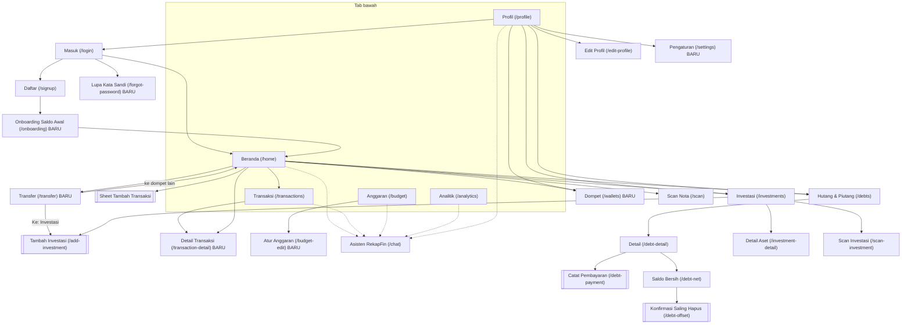
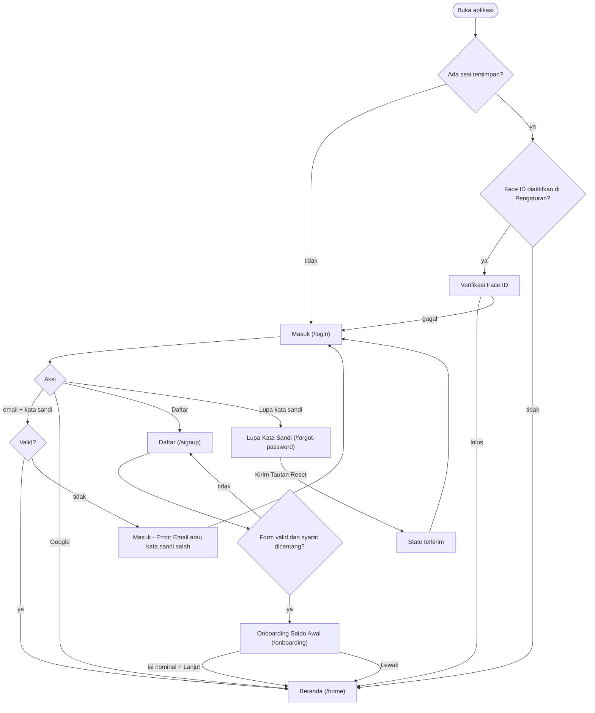
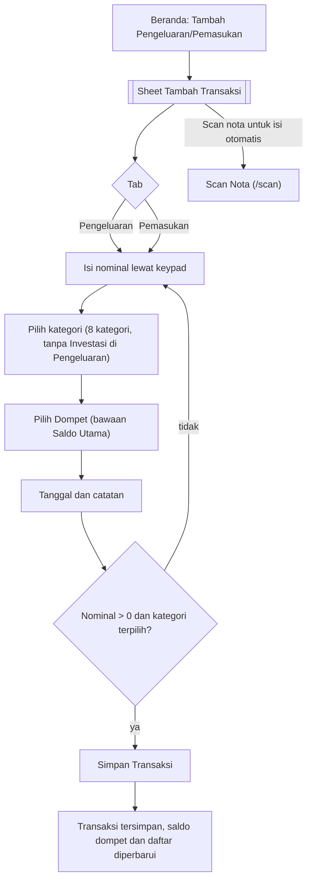
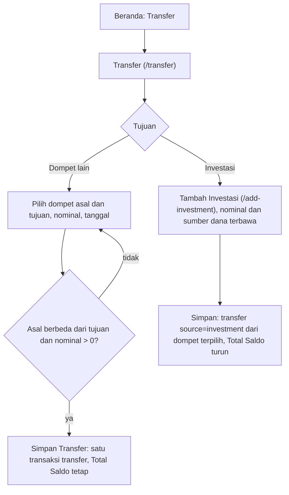
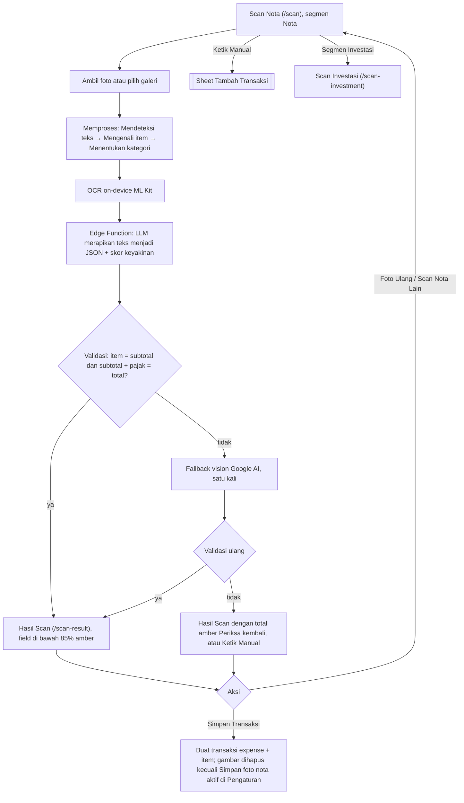
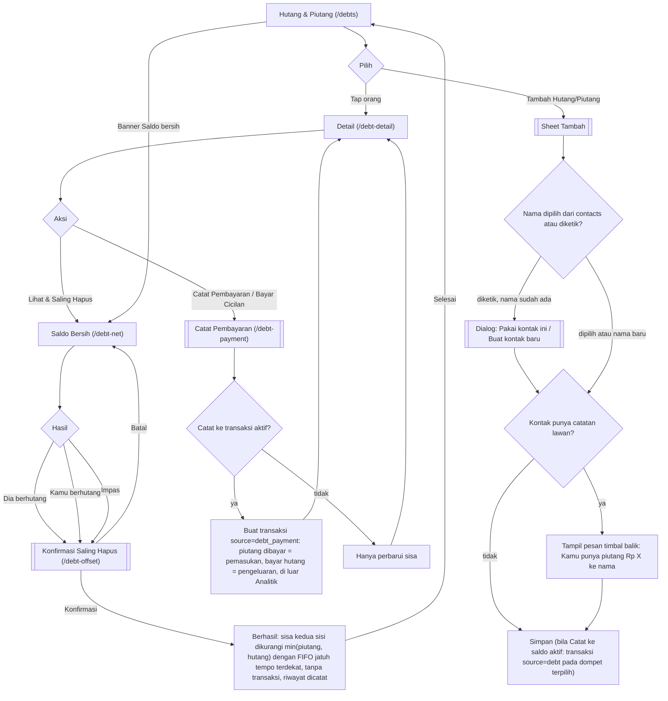
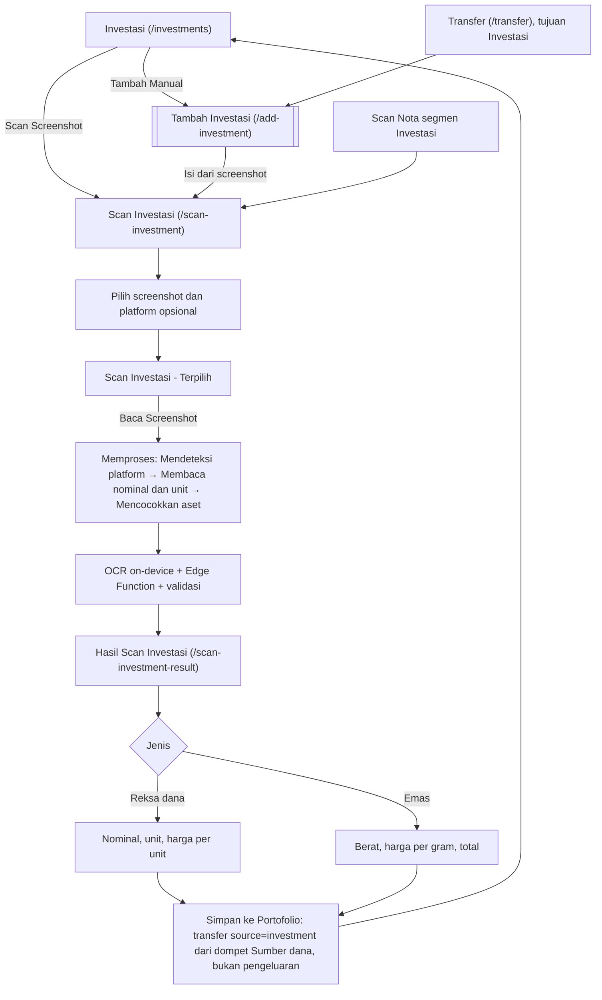
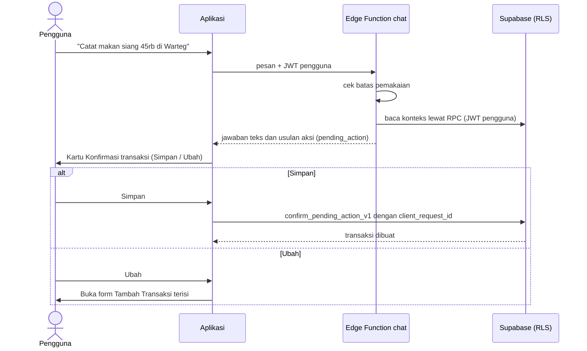

# 04. Alur Pengguna

> Ringkasan: alur utama dalam diagram Mermaid: onboarding/login, catat transaksi, transfer, scan nota, hutang-piutang dan saling hapus, scan investasi, dan chatbot, plus peta navigasi keseluruhan. Karena desain tidak memuat interaksi, semua panah adalah [ASUMSI] yang diturunkan dari tombol, teks di layar, dan keputusan pemilik produk. Layar baru (Onboarding, Lupa Kata Sandi, Dompet, Transfer, Detail Transaksi, Atur Anggaran, Pengaturan) ditandai di diagram.

Status: Diperbarui setelah keputusan OI-01 sampai OI-25. Nama layar dan route sama dengan [03-inventaris-layar.md](03-inventaris-layar.md). Diagram belum divalidasi render.

## 1. Peta navigasi

Garis putus-putus: tombol melayang Tanya AI di semua layar bernav. Kotak ganda: sheet. Notifikasi dan Riwayat Saling Hapus ditunda dan tidak digambar.

## 2. Onboarding dan login

Catatan: saat permintaan berjalan tampil varian Masuk - Loading ("Memproses..."). Onboarding mengisi saldo awal Saldo Utama; dilewati berarti Rp 0 dan dapat diubah di Dompet (OI-08). Tombol "Masuk dengan Face ID" hanya relevan bila Face ID diaktifkan (OI-25).

## 3. Catat transaksi manual

Kategori "Investasi" sudah dihapus dari tab Pengeluaran (OI-06). Investasi dicatat lewat Transfer atau layar Investasi.

### 3.1 Transfer

## 4. Scan nota

## 5. Hutang-piutang dan saling hapus

Ditunda: "Lihat Riwayat" (layar Riwayat Saling Hapus) dan "Kirim Pengingat" via WhatsApp. Pengingat jatuh tempo berupa notifikasi lokal H-3 dan hari-H (OI-22).

## 6. Scan investasi

## 7. Chatbot

Aturan: chatbot tidak pernah menulis langsung; hanya `confirm_pending_action_v1` dari klien yang menulis (BR-17).
