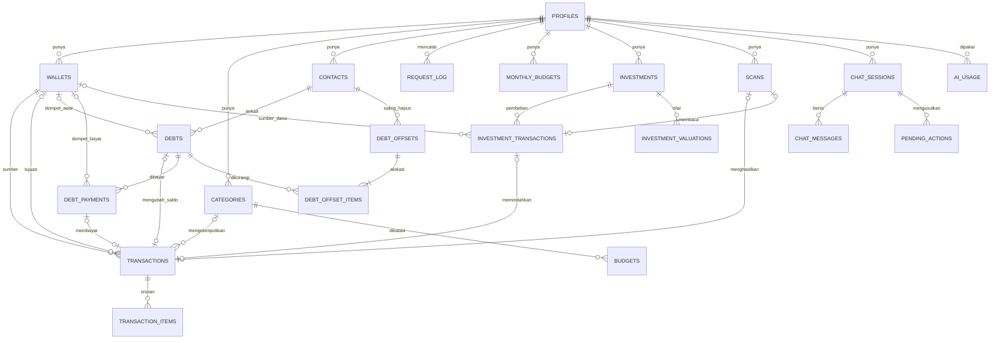

# 06. Model Data

> Ringkasan: model data Supabase (PostgreSQL) untuk RekapFin: entitas, relasi satu arah (tanpa FK melingkar), FK komposit `(user_id, id)`, matriks CHECK `type` x `source`, rumus saldo dompet, kebijakan tulis (tabel berinvarian hanya lewat RPC `SECURITY DEFINER` berversi dengan `client_request_id`), RLS, Storage, view, indeks, dan alur hapus akun. Dokumen ini deskripsi, bukan SQL final. Nominal rupiah selalu bigint (BR-01).

Status: Diperbarui setelah audit arsitektur (keputusan 1 sampai 13, lihat OPEN_ISSUES bagian F) dan keputusan OI-01 sampai OI-57 (Diputuskan, termasuk kolom persetujuan AI, OI-54). Tidak ada butir Tertunda yang menyentuh dokumen ini.

## 1. Cara data ditulis (BR-40, BR-29)

### 1.1 Dua kelas tabel
| Kelas | Tabel | Tulis (INSERT/UPDATE/DELETE) | Baca |
|---|---|---|---|
| A: dijaga invarian | wallets, transactions, transaction_items, budgets, monthly_budgets, debts, debt_payments, debt_offsets, debt_offset_items, investments, investment_transactions, investment_valuations, scans, pending_actions, ai_usage, request_log | Hanya lewat RPC (bagian 9). DML dicabut dari `authenticated`, `anon`, dan `PUBLIC` | SELECT langsung lewat RLS atau view |
| B: bebas invarian lintas tabel | profiles (kolom terbatas), categories (kategori kustom), contacts, chat_sessions, chat_messages | Langsung di bawah RLS (`WITH CHECK user_id = auth.uid()`), dengan hak kolom/kebijakan sempit; `id` dibuat klien | SELECT lewat RLS |
| C: konfigurasi | ai_limits, app_config | Tidak ada tulis oleh pengguna | `ai_limits` SELECT oleh `authenticated`; `app_config` hanya lewat RPC `get_app_config_v1` |
Keputusan OI-38 (Diputuskan): `budgets` (dan `monthly_budgets`, invariannya sama) serta `scans` kelas A; `contacts` kelas B. `wallets`, `pending_actions`, `ai_usage`, dan `request_log` kelas A mengikuti keputusan 1 dan 11 audit. Konsekuensi `contacts` kelas B: aturan nama ganda (BR-08) ditegakkan di sisi klien lewat `find_similar_contacts_v1` dan dialog konfirmasi, bukan oleh server; server hanya menjaga keunikan `(user_id, phone)` bila phone ada, panjang nama, kepemilikan, dan `ON DELETE RESTRICT` dari `debts.contact_id`.

### 1.2 Mekanisme penegakan
1. DML pada tabel kelas A dicabut dari `authenticated`, `anon`, dan `PUBLIC`; hanya role pemilik migrasi (non-login) yang menulis.
2. Semua RPC tulis `SECURITY DEFINER` dengan `search_path` tetap (nama objek dikualifikasi skema), cek `auth.uid()` tidak kosong di baris pertama, dan setiap kueri difilter `user_id = auth.uid()`. Fungsi tidak pernah menerima `user_id` dari klien.
3. `EXECUTE` dicabut dari `anon` dan `PUBLIC` dan hanya diberikan ke `authenticated`. Supabase memberi hak eksekusi bawaan ke `anon`, `authenticated`, dan `service_role` untuk fungsi baru di skema `public` dan menganjurkan `search_path` tetap pada fungsi definer (terverifikasi dari dokumentasi Supabase). Karena itu setiap migrasi yang membuat fungsi harus mencabut hak bawaan itu, dan CI memeriksanya (T-SEC).
4. Fungsi pembantu internal berada di skema `private` yang tidak terekspos Data API.
5. RLS tetap aktif di semua tabel sebagai lapis kedua. Untuk kelas A tidak ada kebijakan INSERT/UPDATE/DELETE (default tolak); hanya SELECT.
6. Pengecualian terdokumentasi: `purge_user_data_v1` menerima id pengguna eksplisit dan hanya dapat dieksekusi oleh `service_role` (dipakai `delete-account`).
7. Peringatan Supabase: pencabutan hak pada objek yang dikelola Supabase sendiri (Storage, pg_cron, Vault, ekstensi) bisa tidak berefek; pencabutan pada tabel dan fungsi milik RekapFin berlaku. Verifikasi lewat pgTAP, jangan diasumsikan.

### 1.3 Idempotensi: `client_request_id` (BR-40)
- Setiap RPC tulis wajib menerima `client_request_id` (uuid dibuat klien per niat pengguna, bukan per percobaan).
- Tabel `request_log`: kunci unik `(user_id, client_request_id)`, kolom `rpc_name`, `payload_hash`, `result` (jsonb ringkas, mis. id baris yang dibuat), `created_at`. Baris ditulis di dalam transaksi database yang sama dengan penulisan data.
- Pemanggilan ulang dengan id sama dan `rpc_name`/`payload_hash` sama mengembalikan `result` lama tanpa efek baru. Id sama dengan nama RPC atau muatan berbeda ditolak (`request_id_reuse`).
- Penamaan tunggal `client_request_id`; nama `idempotency_key` dihapus dari seluruh dokumen.
- Retensi `request_log` 30 hari lalu dibersihkan oleh pg_cron (OI-45, Diputuskan).
- Tabel kelas B tidak lewat RPC sehingga tidak memakai `request_log`. Pada INSERT, klien membuat `id` (uuid) sendiri sehingga retry bertabrakan pada kunci primer dan diperlakukan sebagai sukses (idempoten); pembaruan `profiles` bersifat menimpa; kategori kustom unik `(user_id, kind, lower(name))`; `contacts` unik `(user_id, phone)` bila phone ada.

### 1.4 Versi RPC (BR-41)
Setiap RPC publik bernama `<aksi>_v<N>`, mis. `create_transaction_v1`. Perubahan yang memutus kompatibilitas membuat `_v2` baru; versi lama dipertahankan sampai versi aplikasi minimum melewatinya. Tabel `app_config` menyimpan `min_app_version` dan `recommended_version` per platform; aplikasi memeriksanya lewat `get_app_config_v1` hanya setelah sesi tersedia dan memblokir penggunaan di bawah minimum (OI-38, Diputuskan: tidak ada pemeriksaan sebelum login karena EXECUTE anon dicabut).

## 2. ERD

Semua panah menunjuk dari anak ke induk, satu arah. Tidak ada FK melingkar: transaksi menunjuk catatan induknya (`debt_id`, `debt_payment_id`, `investment_transaction_id`, `scan_id`), bukan sebaliknya (keputusan 6).

## 3. Konvensi kolom
- Setiap tabel data: `id` (uuid PK), `user_id` (uuid, wajib, `FOREIGN KEY` ke `auth.users` dengan `ON DELETE CASCADE`), `created_at`, `updated_at` (timestamptz, `updated_at` oleh pemicu).
- Setiap tabel induk punya `UNIQUE (user_id, id)`; setiap tabel anak menunjuk induk dengan FK komposit `(user_id, <induk>_id)` ke `(user_id, id)` induk (bagian 3.1). Dengan begitu baris anak tidak mungkin menunjuk induk milik pengguna lain, walau FK biasa melewati RLS.
- Nominal: `bigint` rupiah utuh, CHECK `0 < amount <= 100.000.000.000` (Rp 100 miliar per transaksi, OI-43 Diputuskan; konfigurasi di migrasi). Batas sama untuk `principal`, `cost`, `value`, dan `limit_amount`. `opening_balance` bigint `>= 0` dan `<= 100.000.000.000`.
- Unit/gram: `numeric(18,6)`; dikirim ke klien sebagai string agar tidak kehilangan presisi di JSON/float [ASUMSI].
- Waktu: `timestamptz` untuk instan (`occurred_at`, `created_at`, `performed_at`); `date` untuk tanggal kalender (`borrowed_on`, `due_on`, `paid_on`, `occurred_on`, `as_of`, `ai_usage.day`); `monthly_budgets.month` dan `budgets.month` bertipe `date` bertanggal 1 sebagai label bulan (bagian 3.2).
- Penghapusan: hapus keras. Tidak ada `deleted_at` (MVP online-only, tanpa sinkronisasi; BR-39).

### 3.1 FK komposit (keputusan 7)
| Anak | Kolom penunjuk (semua berpasangan dengan `user_id`) |
|---|---|
| transactions | wallet_id, counter_wallet_id, category_id, scan_id, debt_id, debt_payment_id, investment_transaction_id |
| transaction_items | transaction_id |
| budgets | category_id |
| debts | contact_id, wallet_id |
| debt_payments | debt_id, wallet_id |
| debt_offsets | contact_id |
| debt_offset_items | offset_id, debt_id |
| investment_transactions | investment_id, wallet_id, scan_id |
| investment_valuations | investment_id |
| chat_messages | session_id |
| pending_actions | session_id |
Kolom penunjuk yang boleh kosong memakai perilaku FK bawaan (dilewati bila kosong), sehingga pemeriksaan hanya berlaku saat terisi.

### 3.2 Zona waktu, "hari", dan "bulan" (BR-42)
- `profiles.timezone`: nama zona IANA, bawaan `Asia/Jakarta`; dibatasi pada daftar yang diizinkan (Asia/Jakarta, Asia/Makassar, Asia/Jayapura; OI-44 Diputuskan). Pada pendaftaran, zona diisi dari zona perangkat bila termasuk daftar, selain itu `Asia/Jakarta` [ASUMSI].
- "Hari" = tanggal kalender pada zona pengguna. "Bulan" = rentang `[tanggal 1 pukul 00.00 zona pengguna, tanggal 1 bulan berikutnya pukul 00.00 zona pengguna)`, dikonversi ke UTC saat dikueri.
- Semua penentuan hari/bulan dilakukan di RPC dan view di server (menggabungkan `profiles.timezone`), bukan di klien. Klien hanya meneruskan label bulan (tanggal 1) atau rentang.
- Pemakaian: pengelompokan hari di daftar Transaksi, bulan Anggaran/Analitik, "sisa hari" anggaran, `ai_usage.day` (reset kuota harian pukul 00.00 zona pengguna), label "Hari Ini/Kemarin".
- Mengganti zona memindahkan batas bulan/hari secara retroaktif karena nilai dihitung saat dikueri, bukan disimpan; `budgets.month` hanya label. Kuota hari berjalan tidak dihitung ulang (dapat memberi sedikit kelonggaran, diterima [ASUMSI]).
- `due_on`, `borrowed_on`, `paid_on` adalah tanggal kalender tanpa zona.
- Notifikasi lokal dijadwalkan pada waktu perangkat (pukul 09.00 [ASUMSI]).

## 4. Entitas dan atribut

### profiles
| Atribut | Tipe | Catatan |
|---|---|---|
| id | uuid PK, FK auth.users ON DELETE CASCADE | satu per pengguna |
| full_name | text | |
| phone | text null | format +62 |
| birth_date | date null | [DESAIN] Edit Profil |
| avatar_path | text null | path Storage `{user_id}/...` |
| timezone | text | bawaan `Asia/Jakarta`, daftar diizinkan (bagian 3.2) |
| plan | text | 'free'; tidak dapat diubah klien (OI-21) |
| onboarded_at | timestamptz null | hanya diisi `complete_onboarding_v1` |
| biometric_lock | boolean | Face ID opsional, bawaan false (OI-25) |
| keep_receipt_images | boolean | "Simpan foto nota", bawaan false (OI-10) |
| deletion_requested_at | timestamptz null | penanda hapus akun sedang berjalan (bagian 12) |
| ai_consent_at | timestamptz null | waktu pengguna menyetujui pemrosesan AI oleh Google; kosong = belum setuju (BR-47, OI-54) |
| ai_consent_version | text null | versi teks persetujuan yang disetujui; diisi bersama `ai_consent_at` |
Kelas B: klien hanya boleh mengubah `full_name`, `phone`, `birth_date`, `avatar_path`, `timezone`, `biometric_lock`, `keep_receipt_images` (hak kolom). `plan`, `onboarded_at` (`complete_onboarding_v1`), dan `deletion_requested_at` (`request_account_deletion_v1`), serta `ai_consent_at` dan `ai_consent_version` (`record_ai_consent_v1`) hanya lewat RPC.

### wallets
| Atribut | Tipe | Catatan |
|---|---|---|
| name | text | bawaan "Saldo Utama" |
| kind | enum | `cash` (Tunai), `bank`, `ewallet` |
| opening_balance | bigint | >= 0, bawaan 0 |
| is_default | boolean | tepat satu default per pengguna; default tidak dapat diarsipkan |
| archived_at | timestamptz null | hanya bila saldo = 0 (BR-43) |
Saldo dihitung, tidak disimpan (bagian 6).

### categories
name, kind (`expense`/`income`), icon, is_system, sort_order, archived_at null. Kategori bawaan disalin per pengguna oleh pemicu pendaftaran (migrasi, bukan `seed.sql`). Kelas B: pengguna menambah dan mengubah kategori kustom; kategori sistem tidak dapat dihapus; `transactions.category_id` memakai `ON DELETE RESTRICT`.

### transactions
| Atribut | Tipe | Catatan |
|---|---|---|
| wallet_id | FK wallets | dompet sumber |
| type | enum | `income`, `expense`, `transfer` |
| amount | bigint | > 0; tanda ditentukan `type` |
| category_id | FK categories null | lihat matriks (bagian 5) |
| title | text | <= 120 karakter |
| note | text null | <= 500 karakter |
| occurred_at | timestamptz | |
| source | enum | `manual`, `scan`, `chat`, `debt`, `debt_payment`, `investment` |
| counter_wallet_id | FK wallets null | tujuan transfer antar dompet |
| scan_id | FK scans null | induk untuk source `scan` |
| debt_id | FK debts null | induk untuk source `debt`; `ON DELETE CASCADE` |
| debt_payment_id | FK debt_payments null | induk untuk source `debt_payment`; `ON DELETE CASCADE` |
| investment_transaction_id | FK investment_transactions null | induk untuk source `investment`; `ON DELETE CASCADE` |
Keunikan: satu transaksi per `debt_id`, per `debt_payment_id`, dan per `investment_transaction_id` (indeks unik parsial). Dari catatan induk, transaksi ditemukan lewat kolom-kolom ini, bukan sebaliknya.

### transaction_items
transaction_id, name (<= 120), quantity numeric(12,3), unit_price bigint, line_total bigint. `subtotal` dan `tax_amount` disimpan di `scans.parsed` dan dipakai untuk validasi BR-13 oleh `save_scanned_transaction_v1`; tidak ada kolom tersendiri [ASUMSI].

### budgets dan monthly_budgets
| Tabel | Atribut | Catatan |
|---|---|---|
| monthly_budgets | month (date, tanggal 1), total_limit (bigint) | unik `(user_id, month)` |
| budgets | month, category_id, limit_amount (bigint) | unik `(user_id, month, category_id)` |
Jumlah `limit_amount` per bulan tidak boleh melebihi `total_limit` (dijaga `upsert_*_v1` dengan kunci baris bulan itu). Terpakai total mencakup kategori tanpa baris `budgets`. Status warna (BR-22) dihitung di view.

### contacts
name (<= 80 karakter), phone null. Kelas B: dibuat/diubah/dihapus langsung oleh pemilik di bawah RLS dengan `id` dari klien. Indeks nama tanpa huruf besar/kecil. Nama ganda tidak dicegah server; klien memanggil `find_similar_contacts_v1` dan menampilkan dialog "Pakai kontak ini / Buat kontak baru" (BR-08). Unik `(user_id, phone)` bila phone ada. Kontak yang dipakai catatan hutang tidak dapat dihapus (`ON DELETE RESTRICT`). Tidak ada impor kontak perangkat (OI-36).

### debts
| Atribut | Tipe | Catatan |
|---|---|---|
| contact_id | FK contacts | wajib (BR-08) |
| direction | enum | `borrowed` = hutang, `lent` = piutang |
| principal | bigint | total |
| borrowed_on | date | |
| due_on | date null | |
| note | text null | |
| remind_days_before | int null | bawaan 3 |
| installments_enabled | boolean | |
| record_to_ledger | boolean | |
| wallet_id | FK wallets null | wajib bila `record_to_ledger` |
Kolom `origin_transaction_id` dihapus (keputusan 6): transaksi awal ditemukan lewat `transactions.debt_id`. Sisa dan status dihitung di view (BR-21).

### debt_payments
debt_id, amount (bigint > 0, tidak melebihi sisa), paid_on (date), payment_channel (enum `cash`, `transfer`, `ewallet`; nama lama `method`), note null, wallet_id null (dompet bila dicatat ke transaksi). Kolom `transaction_id` dihapus; transaksi ditemukan lewat `transactions.debt_payment_id`.

### debt_offsets dan debt_offset_items
| Tabel | Atribut |
|---|---|
| debt_offsets | contact_id, amount (bigint, nilai yang lebih kecil), note, performed_at |
| debt_offset_items | offset_id, debt_id, side (`receivable`/`payable`), amount (bigint) |
Jumlah item `receivable` = jumlah item `payable` = `debt_offsets.amount`. Alokasi FIFO per sisi: `due_on` terdekat, `due_on` kosong terakhir, seri `borrowed_on` lebih lama lalu `created_at` (BR-34). Tidak ada baris `transactions` (BR-07). Saling hapus tidak dapat dibatalkan di MVP (OI-46 Diputuskan): tidak ada RPC pembatalan; layar konfirmasi wajib. Kolom `idempotency_key` dihapus; idempotensi lewat `request_log`.

### investments, investment_transactions, investment_valuations
| Tabel | Atribut |
|---|---|
| investments | kind (`mutual_fund`, `gold`, `stock`, `other`), name, platform (text), unit_label (`unit`, `gram`) |
| investment_transactions | investment_id, occurred_on (date), cost (bigint, modal), units numeric(18,6), unit_price (bigint), wallet_id null (sumber dana), scan_id null |
| investment_valuations | investment_id, as_of (date), unit_price (bigint) null, value (bigint) |
Nilai saat ini sebuah aset = `value` pada valuasi terbaru (`as_of` terbesar); bila belum ada valuasi, nilai = jumlah `cost` pembelian (BR-23). Harga per unit "hari ini" adalah informasi turunan, bukan pengali nilai. Transaksi transfer ke aset ditemukan lewat `transactions.investment_transaction_id`. Penjualan di luar cakupan.

### scans
| Atribut | Tipe | Catatan |
|---|---|---|
| kind | enum `receipt`, `investment` | |
| status | enum `processing`, `done`, `failed` | `processing` lebih dari 1 jam ditandai `failed` oleh pg_cron |
| parsed | jsonb | JSON rapi tervalidasi tanpa teks mentah OCR |
| accuracy | numeric(4,3) | |
| fallback_used | boolean | satu kali per scan (BR-14) |
| image_path | text null | terisi hanya bila `keep_receipt_images` aktif (BR-15) |
| (retensi) | - | scan tanpa transaksi atau pembelian tertaut dihapus 7 hari setelah dibuat oleh pg_cron; scan yang tertaut dipertahankan karena menjadi induk (OI-45, Diputuskan; tafsiran) |
Dibuat oleh `start_scan_v1` (yang memotong kuota scan). Teks mentah OCR tidak disimpan (OI-09).

### chat_sessions, chat_messages, pending_actions
| Tabel | Atribut |
|---|---|
| chat_sessions | title, last_message_at |
| chat_messages | session_id, role (`user`, `assistant`), content (<= batas panjang), created_at |
| pending_actions | session_id, kind (`create_transaction`, `create_debt`, `record_payment`, `create_investment`, ...), payload (jsonb tervalidasi skema), status (`pending`, `confirmed`, `rejected`, `expired`), expires_at, result_ref |
`chat_sessions` dan `chat_messages` kelas B; `pending_actions` kelas A. Retensi: teks percakapan disimpan 90 hari lalu dibersihkan pg_cron; layar riwayat ditunda ke pasca-rilis (OI-29, Diputuskan).

### request_log, ai_usage, ai_limits, app_config
| Tabel | Atribut |
|---|---|
| request_log | client_request_id, rpc_name, payload_hash, result (jsonb), created_at; unik `(user_id, client_request_id)` |
| ai_usage | day (date, zona pengguna), kind (`chat`, `scan`, `scan_fallback`), count; unik `(user_id, day, kind)` |
| ai_limits | plan (`free`), kind, daily_limit; awal: scan 20, chat 50, scan_fallback 10 per hari (OI-09, keputusan 5); dapat diubah tanpa rilis aplikasi |
| app_config | platform, min_app_version, recommended_version, update_url (tautan unduh APK terbaru, mis. Google Drive; OI-53) |

## 5. Matriks CHECK: `type` x `source` x kolom penunjuk (keputusan 6)
Hanya kombinasi berikut yang valid pada keadaan akhir. CHECK diterapkan bertahap per fase (lihat [12-build-plan.md](12-build-plan.md)): fase 2 mengizinkan baris `manual` (income, expense, transfer); fase 4 menambah `expense`/`scan`; fase 5 menambah `debt` dan `debt_payment`; fase 6 menambah `transfer`/`investment`; fase 7 menambah `chat`. FK ke `scans`, `debts`, `debt_payments`, dan `investment_transactions` ditambahkan pada fase pembuatan tabel induknya (pola expand). "wajib" berarti NOT NULL; "-" berarti harus NULL. Semua kombinasi lain ditolak oleh CHECK.
| type | source | category_id | counter_wallet_id | scan_id | debt_id | debt_payment_id | investment_transaction_id | Arti |
|---|---|---|---|---|---|---|---|---|
| income | manual | wajib (kind income) | - | - | - | - | - | pemasukan manual |
| expense | manual | wajib (kind expense) | - | - | - | - | - | pengeluaran manual |
| expense | scan | wajib (kind expense) | - | wajib | - | - | - | pengeluaran dari nota |
| income | chat | wajib (kind income) | - | - | - | - | - | pemasukan lewat chatbot |
| expense | chat | wajib (kind expense) | - | - | - | - | - | pengeluaran lewat chatbot |
| income | debt | - | - | - | wajib | - | - | hutang baru (saldo naik) |
| expense | debt | - | - | - | wajib | - | - | piutang baru (saldo turun) |
| income | debt_payment | - | - | - | - | wajib | - | terima pembayaran piutang |
| expense | debt_payment | - | - | - | - | wajib | - | bayar hutang |
| transfer | manual | - | wajib, berbeda dari wallet_id | - | - | - | - | antar dompet |
| transfer | investment | - | - | - | - | - | wajib | dompet ke aset |
Pemeriksaan lintas tabel (di RPC dan pemicu, bukan CHECK satu tabel):
- `income`+`debt` hanya bila `debts.direction = 'borrowed'`; `expense`+`debt` hanya bila `'lent'`.
- `income`+`debt_payment` hanya bila induknya `'lent'` (piutang dibayar); `expense`+`debt_payment` hanya bila `'borrowed'` (bayar hutang).
- Dompet dan kategori milik pengguna yang sama (dijamin FK komposit); dompet tidak diarsipkan.

## 6. Rumus saldo dompet (`v_wallet_balance`, BR-30, keputusan 8)
Saldo dihitung, tidak disimpan. Untuk dompet `w`:

saldo(w) = opening_balance(w) + Σ efek transaksi pada `w`

| type | source | Efek pada `wallet_id` (sumber) | Efek pada `counter_wallet_id` |
|---|---|---|---|
| income | manual, chat, debt, debt_payment | + amount | - |
| expense | manual, scan, chat, debt, debt_payment | - amount | - |
| transfer | manual (antar dompet) | - amount | + amount |
| transfer | investment (ke aset, `counter_wallet_id` kosong) | - amount | tidak ada |
Total Saldo = jumlah saldo semua dompet yang tidak diarsipkan. Karena dompet diarsipkan hanya bila saldonya 0, jumlah ini sama dengan jumlah semua dompet. Transfer antar dompet tidak mengubah Total Saldo; transfer ke investasi menguranginya; nilai investasi tidak ikut (BR-30). Semua `source` ikut dihitung dalam saldo (berbeda dari Analitik, BR-04).
Saldo negatif diizinkan dengan peringatan di klien saat transaksi/transfer akan membuat saldo dompet di bawah nol (OI-31, Diputuskan); server tidak menolaknya. Cache saldo tidak dipakai; ditambahkan hanya bila p95 saldo lebih dari 300 ms pada 10.000 transaksi (T-PERF-06, OI-47 Diputuskan).

## 7. RLS, tulis, dan Storage

### 7.1 Kebijakan per tabel
| Tabel | SELECT | INSERT/UPDATE/DELETE |
|---|---|---|
| profiles | `id = auth.uid()` | UPDATE kolom terbatas oleh pemilik; INSERT oleh pemicu pendaftaran; DELETE hanya cascade dari auth |
| categories | `user_id = auth.uid()` | kelas B: pemilik; kategori sistem tidak dapat diubah/dihapus |
| chat_sessions, chat_messages | `user_id = auth.uid()` | kelas B: INSERT oleh pemilik dengan FK komposit; UPDATE tidak; DELETE oleh pemilik |
| wallets, transactions, transaction_items, budgets, monthly_budgets | `user_id = auth.uid()` | kelas A: hanya RPC |
| contacts | `user_id = auth.uid()` | kelas B: INSERT/UPDATE/DELETE oleh pemilik (`WITH CHECK user_id = auth.uid()`), `id` dari klien |
| debts, debt_payments, debt_offsets, debt_offset_items | `user_id = auth.uid()` | kelas A: hanya RPC |
| investments, investment_transactions, investment_valuations | `user_id = auth.uid()` | kelas A: hanya RPC |
| scans, pending_actions, ai_usage | `user_id = auth.uid()` | kelas A: hanya RPC (dipanggil Edge Function dengan JWT pengguna) |
| request_log | tidak ada (klien tidak membaca) | kelas A: hanya RPC |
| ai_limits | `authenticated` | tidak ada |
| app_config | tidak ada | tidak ada (RPC `get_app_config_v1`) |
Catatan keamanan: `create_pending_action_v1` dapat dipanggil langsung oleh klien dengan muatan buatan sendiri. Itu bukan eskalasi karena `confirm_pending_action_v1` menjalankan validasi RPC tujuan yang sama dengan pemanggilan langsung. BR-17 adalah pagar terhadap model, bukan batas keamanan terhadap pengguna.

### 7.2 Storage (keputusan: kebijakan per operasi)
| Bucket | Isi | Aturan |
|---|---|---|
| receipts (privat) | foto nota/screenshot yang disimpan (hanya bila `keep_receipt_images` aktif) | SELECT/INSERT/UPDATE/DELETE hanya bila folder tingkat pertama path = `auth.uid()`; path wajib `{user_id}/{scan_id}.{ext}`; batas ukuran (usulan 5 MB) dan tipe MIME (JPEG, PNG, WebP) [ASUMSI]; akses lewat signed URL berumur pendek |
| avatars (privat) | foto profil | pola dan operasi sama; path `{user_id}/avatar.{ext}`; batas ukuran lebih kecil (usulan 2 MB) [ASUMSI] |
- Klien tidak memiliki hak tulis ke `storage.objects` selain lewat kebijakan di atas; penghapusan massal (hapus akun, pembersihan yatim) hanya oleh fungsi berhak (bagian 12 dan 07).
- Objek di Storage hanya ada untuk (a) foto nota yang disetujui disimpan dan (b) avatar. Fallback vision mengirim gambar dalam badan permintaan, tidak lewat Storage.
- Penghapusan file mengikuti commit database (keputusan 13): RPC menghapus baris lebih dulu; klien (atau pembersih) menghapus file sesudahnya. Bila gagal, file yatim dibersihkan oleh `storage-janitor` (07).

## 8. View yang dibutuhkan
Semua `security_invoker` agar RLS tabel dasar berlaku. Penentuan bulan/hari memakai `profiles.timezone` (bagian 3.2).
| View | Isi |
|---|---|
| v_wallet_balance | saldo per dompet (rumus bagian 6) dan Total Saldo |
| v_debt_balances | per catatan: principal, total terbayar, total saling hapus, sisa, status (BR-19, BR-21) |
| v_contact_balances | per kontak: piutang sisa, hutang sisa, saldo bersih, jumlah catatan |
| v_debt_summary | total hutang, jumlah orang, total piutang, jumlah orang, saldo bersih (BR-24) |
| v_monthly_summary | per bulan (zona pengguna): income dan expense yang dihitung (source bukan `debt`/`debt_payment`, bukan transfer; BR-04) |
| v_category_spending | per bulan dan kategori: total expense yang dihitung |
| v_budget_status | per bulan: total batas, terpakai total, sisa, persen, warna; per kategori berbatas (BR-22) |
| v_transaction_feed | semua transaksi dengan label sumber untuk daftar Transaksi (BR-26) |
| v_investment_positions, v_investment_summary | nilai (valuasi terbaru), modal, untung, persen, alokasi (BR-23) |

## 9. Fungsi (RPC)
Semua RPC tulis: `SECURITY DEFINER`, `search_path` tetap, cek `auth.uid()`, `EXECUTE` hanya `authenticated`, parameter `client_request_id` wajib, atomik dalam satu transaksi database bersama baris `request_log`. Nama berversi `_v1`.

### 9.1 RPC tulis
| RPC | Masukan utama | Perilaku (atomik) |
|---|---|---|
| request_account_deletion_v1 | - | dipanggil `delete-account` dengan JWT pengguna: isi `profiles.deletion_requested_at`; idempoten |
| record_ai_consent_v1 | versi teks persetujuan | isi `ai_consent_at` (waktu server) dan `ai_consent_version` untuk pemanggil; idempoten; menolak versi kosong (BR-47) |
| complete_onboarding_v1 | saldo awal (opsional) | atur `opening_balance` Saldo Utama (0 bila dilewati), isi `onboarded_at` |
| create_wallet_v1 / update_wallet_v1 | nama, jenis, saldo awal | kelola dompet |
| archive_wallet_v1 | wallet_id | kunci dompet, hitung saldo; tolak bila saldo tidak sama dengan 0 atau dompet default (BR-43) |
| create_transaction_v1 | tipe, nominal, dompet, kategori, tanggal, catatan, sumber (`manual`/`chat`) | validasi matriks (bagian 5), kategori sesuai tipe dan bukan investasi untuk pengeluaran (BR-25), dompet aktif |
| update_transaction_v1 / delete_transaction_v1 | id, bidang | hanya source `manual`, `scan`, `chat`; source lain lewat induknya (BR-38); menghapus transaksi `scan` tidak menghapus file, klien menghapusnya sesudah commit |
| create_transfer_v1 | dompet asal, dompet tujuan, nominal, tanggal, catatan | tolak bila asal sama dengan tujuan; satu baris `transfer`/`manual`. Tujuan "Investasi" melalui `create_investment_v1`/`add_investment_purchase_v1` (BR-32) |
| start_scan_v1 | jenis (`receipt`/`investment`) | tolak dengan `ai_consent_required` bila `ai_consent_at` kosong (BR-47); buat `scans` berstatus `processing` dan potong kuota `scan` dalam satu transaksi; kembalikan `scan_id` |
| claim_scan_fallback_v1 | scan_id | tolak dengan `ai_consent_required` bila `ai_consent_at` kosong (BR-47); tolak bila scan bukan milik pemanggil atau `fallback_used` sudah true; bila kuota `scan_fallback` (10 per hari) habis, kembalikan kode `fallback_quota_exhausted` (klien menampilkan pesan dan mengarahkan ke input manual, OI-48); tandai `fallback_used`; tidak memotong kuota `scan` |
| save_scanned_transaction_v1 | scan_id, hasil terkoreksi, item, dompet | validasi BR-13, buat transaksi `expense`/`scan` dan item, tandai scan `done`, simpan `image_path` hanya bila `keep_receipt_images` aktif |
| attach_scan_image_v1 | scan_id, image_path | hanya bila `keep_receipt_images` aktif dan path sesuai pola `{user_id}/{scan_id}.{ext}`; mengisi `image_path` |
| create_debt_v1 | contact_id, arah, nominal, tanggal, dompet, opsi | buat catatan; bila `record_to_ledger`, buat transaksi `debt` (hutang baru income, piutang baru expense; BR-33) |
| update_debt_v1 | debt_id, bidang | ubah catatan; `principal` tidak boleh di bawah total terbayar dan alokasi; bila ada transaksi `debt` tertaut, perbarui nominal/dompetnya sekaligus |
| delete_debt_v1 | debt_id | hanya bila tanpa pembayaran dan tanpa alokasi saling hapus [ASUMSI, OI-46]; hapus transaksi `debt` tertaut |
| record_debt_payment_v1 | debt_id, nominal, payment_channel, dompet, tanggal, catatan, catat_ke_transaksi | kunci baris catatan, tolak bila nominal melebihi sisa, simpan pembayaran, bila toggle aktif buat transaksi `debt_payment` (BR-09) |
| cancel_debt_payment_v1 | payment_id | kunci catatan, hapus pembayaran dan transaksi `debt_payment` tertaut (cascade), pulihkan sisa |
| apply_debt_offset_v1 | contact_id, `expected_amount`, catatan | kunci semua catatan terbuka kontak itu (urutan tetap), hitung ulang; tolak bila nilai hitung tidak sama dengan `expected_amount` (pratinjau sudah basi); alokasi FIFO (BR-34); tulis `debt_offsets` dan `debt_offset_items`; tanpa `transactions`; tolak bila nilai 0 |
| create_investment_v1 | aset, pembelian pertama, dompet sumber, opsi transfer | buat aset dan pembelian; bila diminta buat transaksi `transfer`/`investment` (BR-03) |
| add_investment_purchase_v1 | investment_id, rincian, opsi transfer | tambah pembelian (dan transfer bila diminta) |
| update_investment_v1 | investment_id, bidang aset dan/atau `purchase_id` dengan bidang pembelian | ubah metadata atau satu pembelian; sinkronkan transaksi `investment` tertaut |
| delete_investment_v1 | investment_id | hapus aset beserta pembelian, valuasi, dan transaksi transfer tertaut (cascade); saldo dompet pulih |
| update_investment_value_v1 | investment_id, harga atau nilai | tambah valuasi baru |
| upsert_monthly_budget_v1 / upsert_budget_v1 | bulan, total atau (kategori, batas) | simpan; tolak bila jumlah batas kategori melebihi total |
| create_pending_action_v1 | session_id, kind, payload | validasi skema; kedaluwarsa (usulan 10 menit) |
| confirm_pending_action_v1 | action_id | validasi pemilik, status `pending`, belum kedaluwarsa, payload valid; panggil RPC tujuan di transaksi yang sama; status `confirmed` (BR-17) |
| reject_pending_action_v1 | action_id | status `rejected` |
| consume_chat_quota_v1 | (kuota chat) | tolak dengan `ai_consent_required` bila `ai_consent_at` kosong (BR-47); potong kuota `chat`; `client_request_id` dari pesan klien agar retry tidak memotong dua kali |
| purge_user_data_v1 | user_id | hanya `service_role`; hapus semua baris pengguna (bagian 12) |

### 9.2 RPC baca (tanpa `client_request_id`)
preview_debt_offset_v1 (hitung R, H, min, saldo bersih, rencana alokasi tanpa menulis), list_debt_offsets_v1, find_similar_contacts_v1 (cek nama ganda untuk dialog klien), get_monthly_summary_v1, get_category_breakdown_v1, get_cashflow_v1, get_budget_status_v1, get_wallet_balances_v1, get_app_config_v1.

## 10. Indeks (keputusan 10)
| Tabel | Indeks | Tujuan |
|---|---|---|
| transactions | `(user_id, occurred_at DESC, id DESC)` | daftar Transaksi dengan paginasi keyset `(occurred_at, id)` |
| transactions | parsial `(user_id, occurred_at)` `WHERE source NOT IN ('debt','debt_payment') AND type <> 'transfer'`, `INCLUDE (category_id, type, amount)` | Analitik, Anggaran, kartu Beranda |
| transactions | `(user_id, wallet_id, occurred_at)` | saldo dan feed per dompet |
| transactions | parsial `(user_id, counter_wallet_id)` `WHERE counter_wallet_id IS NOT NULL` | transfer masuk pada rumus saldo |
| transactions | unik parsial pada `debt_id`, `debt_payment_id`, `investment_transaction_id` (bila tidak kosong) | keunikan dan pencarian induk |
| transactions | GIN trigram (`pg_trgm`) pada `title` dan `note` | pencarian "Cari catatan atau merchant" |
| debts | `(user_id, contact_id)` | saldo bersih per kontak |
| debt_payments | `(debt_id)` | sisa per catatan |
| debt_offset_items | `(debt_id)` | sisa per catatan |
| contacts | `(user_id, lower(btrim(name)))` | cek nama ganda tanpa huruf besar/kecil |
| investment_transactions | `(investment_id, occurred_on)` | riwayat pembelian |
| investment_valuations | `(investment_id, as_of DESC)` | valuasi terbaru |
| chat_messages | `(session_id, created_at)` | riwayat percakapan |
| pending_actions | `(user_id, status, expires_at)` | aksi tertunda dan kedaluwarsa |
| scans | `(user_id, created_at)` | riwayat dan pembersihan |
| request_log | unik `(user_id, client_request_id)`; `(created_at)` | idempotensi; pembersihan retensi |
Indeks lama `(user_id, type, source, occurred_at)` dan `(user_id, category_id, occurred_at)` digantikan indeks parsial di atas [ASUMSI]. Setiap kolom FK yang dipakai join punya indeks. Rencana kueri diperiksa pada data uji besar (T-PERF).

## 11. Kendala integritas lain
- CHECK nominal (bagian 3) pada semua kolom rupiah.
- `debt_payments.amount` + total saling hapus tidak melebihi `debts.principal` (RPC dan pemicu).
- Jumlah item saling hapus sisi `receivable` = sisi `payable` = `debt_offsets.amount`.
- Kategori bertipe sama dengan jenis transaksi (matriks bagian 5).
- Tepat satu dompet default per pengguna (indeks unik parsial).
- Zona waktu pada daftar yang diizinkan.
- Saldo dompet negatif tidak ditolak server (BR-30); peringatan hanya di klien.

## 12. Hapus akun: rantai penghapusan data (keputusan 9)
- Semua tabel pengguna memiliki `user_id` dengan `ON DELETE CASCADE` ke `auth.users`; karena tidak ada FK melingkar, penghapusan berantai tidak terkunci urutan. `purge_user_data_v1` menghapus eksplisit lebih dulu agar langkah dapat diperiksa dan diulang.
- Alur lengkap, urutan, dan penanganan gagal ada di [07-arsitektur.md](07-arsitektur.md) bagian 11.

## 13. Data benih
`seed.sql` hanya untuk lingkungan lokal/staging dan memuat data demo (3 dompet, 5 piutang, 3 hutang, 3 aset, anggaran, transaksi contoh; lihat [10-test-plan.md](10-test-plan.md) dan set demo OPEN_ISSUES bagian C, disetujui OI-26). Data bawaan produksi (kategori sistem, dompet "Saldo Utama", profil) dibuat oleh pemicu pendaftaran di migrasi, bukan oleh `seed.sql`.
