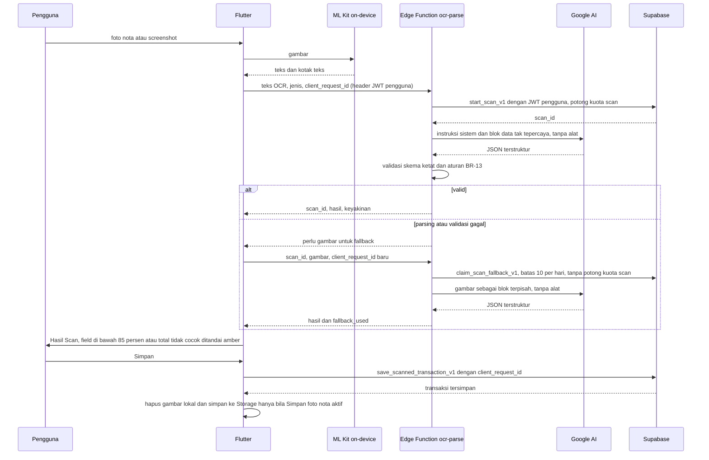
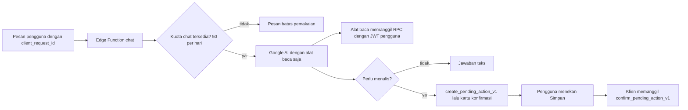
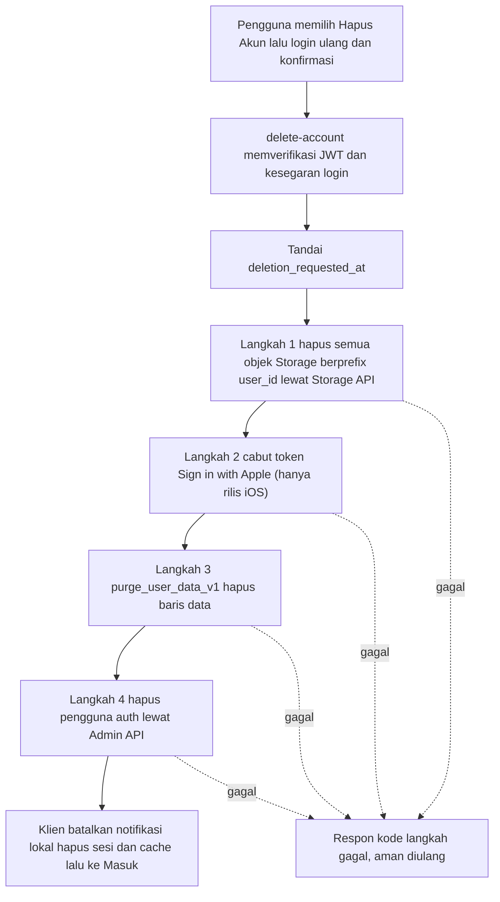

# 07. Arsitektur

> Ringkasan: aplikasi Flutter (Riverpod, go_router, supabase_flutter, freezed, fl_chart, local_auth, Google ML Kit) feature-first dengan backend Supabase. Prinsip utama setelah audit: MVP online-only; tabel berinvarian hanya ditulis lewat RPC `SECURITY DEFINER` berversi dengan `client_request_id`; Edge Function selalu memakai JWT pengguna (service role hanya untuk `delete-account` dan `storage-janitor`); keluaran LLM dan teks OCR diperlakukan sebagai data tak tepercaya; "hari" dan "bulan" dihitung di server menurut `profiles.timezone`.

Status: Diperbarui setelah audit arsitektur (keputusan 1 sampai 13) dan penutupan semua butir OI-01 sampai OI-53 (Diputuskan). Tindak lanjut terjadwal: model chat di fase 7, uji hapus akun di proyek dev pada fase 1, desain layar versi dan offline (P2). Versi paket tidak ditetapkan di sini; kunci versi saat scaffolding fase 0 dan catat di CLAUDE.md.

## 1. Stack
| Lapisan | Pilihan | Peran |
|---|---|---|
| UI | Flutter (Dart) | satu basis kode; rilis pertama Android, iOS ditunda (OI-51) |
| State | flutter_riverpod (dengan riverpod_generator opsional) | provider, caching, injeksi |
| Navigasi | go_router | rute /home dst., ShellRoute untuk tab bawah, rute sheet |
| Backend klien | supabase_flutter | auth, Postgres, Storage, Functions |
| Model | freezed + json_serializable | model imutabel dan serialisasi |
| Grafik | fl_chart | donat, area, ring, bar |
| Biometrik | local_auth | Face ID/sidik jari untuk membuka sesi tersimpan |
| OCR | google_mlkit_text_recognition | baca teks on-device |
| Kamera/galeri | camera atau image_picker | ambil gambar |
| Format | intl | rupiah dan tanggal (locale id_ID) |
| Notifikasi lokal | flutter_local_notifications [ASUMSI, paket tambahan] | pengingat jatuh tempo H-3 dan hari-H (OI-22) |
| Backend | Supabase Postgres, RLS, RPC definer, Edge Functions (Deno/TypeScript), Storage, pg_cron | data, otorisasi, logika AI |
| LLM | Google AI (Gemini API) lewat Edge Function (OI-52, Diputuskan): model ringan untuk perapian teks, model berkemampuan vision hanya fallback; model untuk chat dipilih di fase 7 (OI-40). Nama model dikonfigurasi, tidak dikunci di dokumen; daftar model diverifikasi sebelum fase 4 | OI-09, OI-52 |
| Tes | flutter_test, mocktail, Supabase CLI (pgTAP), tes Deno | lihat [10-test-plan.md](10-test-plan.md) |

Platform target: Android untuk rilis pertama (OI-51, Diputuskan); iOS ditunda sampai setelah rilis Android. Biometrik memakai biometrik perangkat Android (sidik jari atau wajah). Font Plus Jakarta Sans dibundel sebagai aset. Deteksi konektivitas memakai kegagalan permintaan; paket konektivitas opsional [ASUMSI].

## 2. Struktur folder (feature-first)
```
lib/
  main.dart
  app/                    # MaterialApp, router, tema
    router/               # go_router, daftar route
    theme/                # token dari 08-design-system
  core/
    design_system/        # GlassCard, PrimaryButton, FilterChip, TransactionItem, BottomNavBar, TanyaAiFab
    money/                # Rupiah (int), format BR-02
    supabase/             # klien, penyedia sesi, pembungkus RPC berversi (client_request_id otomatis)
    errors/               # Failure, NetworkFailure, mapper error
    utils/
  features/
    auth/  home/  wallets/  transactions/  budget/  analytics/
    scan/  chat/  profile/  debts/  investments/  notifications/
  l10n/                   # teks bahasa Indonesia
supabase/
  migrations/             # SQL bernomor maju-saja, RLS dan REVOKE di migrasi yang sama dengan tabel
  functions/              # ocr-parse, chat, delete-account, storage-janitor
  seed.sql                # hanya lokal dan staging
  tests/                  # pgTAP
test/                     # sama strukturnya dengan lib/
docs/
```
Aturan lapisan per fitur: `presentation` → `domain` → `data` (repository, sumber data Supabase). Fitur tidak mengimpor fitur lain secara langsung; berbagi lewat `core/` atau provider antarmuka.

## 3. Prinsip kode
- Nominal rupiah: `int` dibungkus `Rupiah`; dilarang `double` untuk uang (BR-01). Unit/gram diterima sebagai string dari server.
- Semua panggilan Supabase lewat repository; tidak ada di widget.
- Semua penulisan data pada tabel kelas A (06 bagian 1) lewat RPC berversi (`_v1`) dengan `client_request_id` yang dibuat sekali per niat pengguna dan dipakai ulang pada retry. Pembungkus di `core/supabase/` menambahkannya otomatis.
- Operasi multi-tabel atomik di server, dalam satu transaksi database (BR-40):
  1. transfer antar dompet dan transfer ke investasi (`create_transfer_v1`, `create_investment_v1`, `add_investment_purchase_v1`)
  2. bayar hutang dan batalkan pembayaran bertaut (`record_debt_payment_v1`, `cancel_debt_payment_v1`)
  3. hutang/piutang baru, ubah, hapus (`create_debt_v1`, `update_debt_v1`, `delete_debt_v1`)
  4. saling hapus (`apply_debt_offset_v1`)
  5. simpan hasil scan (`save_scanned_transaction_v1`) dan mulai scan beserta potong kuota (`start_scan_v1`)
  6. ubah dan hapus investasi (`update_investment_v1`, `delete_investment_v1`)
  7. arsip dompet, onboarding, anggaran (`archive_wallet_v1`, `complete_onboarding_v1`, `upsert_*_v1`)
  8. konfirmasi aksi chatbot (`confirm_pending_action_v1`, memanggil RPC tujuan di transaksi yang sama)
- Yang tidak dapat atomik karena melibatkan sistem lain (Storage, Auth, Apple pada rilis iOS, LLM) dirancang sebagai langkah idempoten berurutan: penghapusan file Storage mengikuti commit database, hapus akun (bagian 11).
- Model dari freezed; hindari `dynamic`. Teks UI bahasa Indonesia sesuai desain; konstanta teks terpusat.

## 4. Routing
Route dari desain [DESAIN]: /login, /signup, /home, /transactions, /budget, /analytics, /scan, /scan-result, /chat, /profile, /edit-profile, /debts, /debt-detail, /debt-payment, /debt-net, /debt-offset, /investments, /scan-investment, /scan-investment-result, /add-investment, /investment-detail.
Route baru dari keputusan [ASUMSI nama]: /forgot-password, /onboarding, /wallets, /transfer, /transaction-detail, /budget-edit, /settings. Layar pemblokir versi: /update-required (placeholder fungsional di fase 0, desain P2, OI-39). Sheet baru: form dompet, edit transaksi, pemilih kontak, dialog nama ganda, dialog hapus.
- Tab bawah (ShellRoute): /home, /transactions, /budget, /analytics, /profile. Tombol Tanya AI melayang di shell menuju /chat.
- Sheet dibuka sebagai modal route; Tambah Transaksi dan Tambah Hutang/Piutang tidak punya route di desain [ASUMSI: `/transactions/new`, `/debts/new`].
- Parameter: /debt-detail?id=..., /debt-net?contactId=..., /investment-detail?id=.... Pengalihan: tanpa sesi → /login; sesi tanpa `onboarded_at` → /onboarding; versi di bawah minimum → /update-required.
- /debts dan /investments adalah halaman turunan: nav tampil tanpa tab aktif [DESAIN].

## 5. Alur OCR

- Teks mentah OCR tidak disimpan di server maupun basis data (OI-09). Keyakinan rendah saja tidak memicu fallback; yang memicu adalah JSON tidak valid atau validasi BR-13 gagal (BR-14).
- Pengulangan permintaan dengan `client_request_id` yang sama mengembalikan `scan_id` yang sama tanpa memotong kuota lagi. Fallback hanya sekali per scan.
- Bila kuota fallback (10 per hari) habis, `claim_scan_fallback_v1` mengembalikan `fallback_quota_exhausted`; aplikasi menampilkan pesan batas harian dan mengarahkan ke input manual ("Ketik Manual"), tanpa menampilkan hasil amber (OI-48, Diputuskan). Hal yang sama berlaku bila kuota scan (20) habis.
- Gambar fallback dikirim dalam badan permintaan, tidak lewat Storage. Bila pengaturan simpan foto aktif, klien mengunggah ke Storage setelah `save_scanned_transaction_v1` berhasil, lalu memanggil `attach_scan_image_v1` untuk mengisi `image_path` [ASUMSI]. Bila unggahan gagal, transaksi tetap tersimpan tanpa foto.
- Platform screenshot investasi: Bibit, Tokopedia Emas, Pegadaian, Pluang, Lainnya (OI-23).

## 6. Alur chatbot

Aturan:
1. Alat baca memanggil RPC/view dengan JWT pengguna sehingga RLS berlaku. Fungsi `chat` tidak memakai service role.
2. Tidak ada alat tulis. Penulisan hanya lewat `pending_actions` lalu `confirm_pending_action_v1` yang dipicu klien (BR-17). `payload` tervalidasi skema, kedaluwarsa (usulan 10 menit). Ini pagar terhadap model, bukan batas keamanan terhadap pengguna (06 bagian 7.1).
3. Jawaban berangka wajib berasal dari hasil alat, bukan dari ingatan model, dan memakai aturan hitung Analitik (BR-04) serta `v_budget_status`.
4. Konteks dibatasi (ringkasan agregat) untuk biaya dan privasi.
5. Log hanya metadata, bukan isi pesan [ASUMSI].
6. Semua teks yang berasal dari data pengguna dan masuk ke konteks (judul transaksi, catatan, nama kontak, nama item) ditandai sebagai data tak tepercaya (bagian 8).
7. Retensi riwayat percakapan: teks disimpan 90 hari lalu dibersihkan pg_cron (OI-29, Diputuskan); layar riwayat ditunda ke pasca-rilis. Model chat dipilih di fase 7 (OI-40, Diputuskan).

## 7. Edge Functions
| Fungsi | Tugas | Identitas | Service role |
|---|---|---|---|
| ocr-parse | rapikan teks OCR menjadi JSON, validasi, fallback vision | JWT pengguna | tidak boleh |
| chat | percakapan dengan alat baca dan usulan aksi | JWT pengguna | tidak boleh |
| delete-account | hapus data dan akun (bagian 11) | JWT pengguna terverifikasi, login ulang segar | satu-satunya yang memakai, dengan pembatasan di bawah |
| storage-janitor | bersihkan objek Storage yatim, terjadwal | rahasia penjadwal, tanpa titik masuk pengguna | memakai (Diputuskan, OI-41): hanya terjadwal, tidak dapat dipanggil pengguna, hanya menghapus file yatim |

### 7.1 Aturan bersama
1. Verifikasi JWT aktif untuk semua fungsi yang dipanggil pengguna (`ocr-parse`, `chat`, `delete-account`). Di dalam fungsi, token dari header `Authorization` diverifikasi ulang dengan `auth.getUser()`; tanpa token valid, tolak 401.
2. Klien Supabase di dalam fungsi dibuat dengan URL proyek, anon key, dan header `Authorization` dari pemanggil. Seluruh akses DB dan RPC memakai klien itu sehingga `auth.uid()` dan RLS menjadi pemanggil. Kuota, `scans`, dan `pending_actions` ditulis lewat RPC definer yang dipanggil dengan JWT pengguna (`start_scan_v1`, `claim_scan_fallback_v1`, `consume_chat_quota_v1`, `create_pending_action_v1`).
3. Larangan service role di `ocr-parse` dan `chat`: kode tidak boleh membaca variabel service role atau membuat klien admin. CI memindai direktori kedua fungsi untuk rujukan service role dan menggagalkan build bila ada. Catatan [tidak terverifikasi]: rahasia Edge Function pada Supabase tampaknya berlaku tingkat proyek sehingga tidak dapat dibatasi per fungsi; karena itu pembatasan ditegakkan oleh kode dan CI (OI-49, Diputuskan).
4. Batas muatan (teks OCR sampai 20 KB, gambar sampai 5 MB [ASUMSI]), tenggat waktu permintaan 25 detik [ASUMSI], CORS dibatasi, kode error JSON konsisten `{code, message}`, log hanya metadata.
5. `client_request_id` diteruskan ke RPC; fungsi tidak membuat id sendiri untuk niat pengguna.

### 7.2 `delete-account`: pembatasan service role
1. Id pengguna hanya dari JWT terverifikasi, tidak pernah dari badan permintaan.
2. Wajib login ulang segar (autentikasi dalam 5 menit terakhir [ASUMSI]) dan konfirmasi ketik ulang; untuk akun Apple (rilis iOS), login ulang Apple (bagian 11).
3. Batas 3 percobaan per jam per pengguna [ASUMSI].
4. Hanya tiga operasi istimewa: hapus objek Storage dengan prefix `{user_id}/`, panggil `purge_user_data_v1(user_id)`, hapus pengguna auth yang sama.
5. Log audit tanpa data pribadi (hash id) [ASUMSI].

### 7.3 `storage-janitor`
Terjadwal (pg_cron memicu); diputuskan boleh memakai service role karena hanya terjadwal, tidak dapat dipanggil pengguna, dan hanya menghapus file yatim (OI-41). Hanya menghapus objek yatim: objek `receipts` tanpa `scans.image_path` yang cocok dan berumur lebih dari 24 jam, dan avatar yang tidak sama dengan `profiles.avatar_path` dan berumur lebih dari 24 jam. Tidak membaca isi berkas, tidak menerima parameter dari luar, dan setiap penghapusan dicatat tanpa data pribadi. Tugas yang murni basis data dijalankan langsung oleh pg_cron tanpa service role (OI-45): menandai scan `processing` lebih dari 1 jam sebagai `failed`, menghapus scan tanpa transaksi atau pembelian tertaut yang berumur lebih dari 7 hari, menandai `pending_actions` kedaluwarsa (10 menit), dan membersihkan `request_log` lebih dari 30 hari.

## 8. Validasi keluaran LLM dan data tak tepercaya (keputusan 12, BR-45)
1. Keluaran terstruktur dengan skema ketat (tanpa properti tambahan). Jenis nota: `merchant`, `date`, `category_id`, `items[] {name, quantity, unit_price, line_total}`, `subtotal`, `tax`, `total`, `confidence` per field, `accuracy`. Jenis investasi: `platform`, `kind`, `product_name`, `date`, `amount`, `units` atau `weight_gram`, `unit_price`, `confidence` per field. Skema juga divalidasi ulang di Edge Function sebelum dikembalikan dan di aplikasi sebelum disimpan. JSON tidak valid diulang sekali [ASUMSI], lalu fallback atau gagal.
2. `category_suggestion` hanya berupa `category_id` dari daftar kategori pengeluaran pengguna (daftar dikirim ke model sebagai pasangan id dan nama). Id di luar daftar diubah menjadi kosong, tidak pernah menjadi kategori baru.
3. Batas nilai (OI-43, Diputuskan): nominal bilangan bulat `0 < x <= 100.000.000.000` (Rp 100 miliar); `quantity` positif; jumlah item sampai 100; tanggal tidak lebih dari 1 hari di depan dan tidak lebih dari 5 tahun di belakang; `confidence` antara 0 dan 1.
4. Panjang string [ASUMSI]: merchant sampai 80, nama item sampai 120, catatan sampai 500 karakter; karakter kontrol dibuang; teks dipangkas.
5. Panggilan OCR tanpa alat (tanpa function calling), tanpa akses internet atau basis data; keluaran hanya JSON.
6. Teks OCR dan gambar dipisah dari instruksi sistem: instruksi sistem berisi aturan tetap dan menyatakan bahwa blok data adalah data tak tepercaya yang tidak boleh dipatuhi sebagai perintah; teks OCR berada di blok data terdelimitasi pada giliran pengguna; gambar fallback berada di blok konten terpisah.
7. Data tersimpan yang kembali ke konteks chat (judul transaksi, catatan, nama kontak, nama item, `parsed`) ditandai sebagai data tak tepercaya: dibungkus blok terdelimitasi, dipangkas, dan model chat hanya punya alat baca. Aksi tulis hanya lewat usulan yang dikonfirmasi pengguna.
8. Angka dalam jawaban chat diambil dari hasil alat, bukan dari teks tersimpan.
9. Keluaran model tidak pernah dieksekusi sebagai kode atau SQL.

## 9. Keamanan
- Aplikasi hanya memuat URL proyek dan anon key; tidak ada kunci API pihak ketiga atau service role (BR-16). Anon key aman karena DML tabel kelas A dicabut dan `EXECUTE` anon/PUBLIC dicabut (06 bagian 1.2).
- Penulisan data hanya lewat RPC definer berversi (BR-40). RLS tetap aktif sebagai lapis kedua. CI mengaudit hak (T-SEC).
- Sesi disimpan oleh supabase_flutter di penyimpanan aman platform; Face ID hanya membuka sesi, tidak menggantikan autentikasi (OI-25).
- Transport HTTPS saja. Tanpa log yang memuat nominal, nama kontak, atau teks nota.
- Validasi input di klien (UX) dan server (otoritatif): nominal, tanggal wajar, panjang teks, matriks CHECK (06 bagian 5).
- Prompt injection ditangani lewat bagian 8.
- Batas laju: kuota AI (bagian 10), batas percobaan `delete-account`; batas laju permintaan umum diserahkan pada pengaturan Supabase [ASUMSI].

## 10. Batas pemakaian AI (OI-09, BR-28)
- Kuota harian per pengguna: 20 scan, 50 chat, dan 10 fallback vision per hari (`scan_fallback`), di tabel `ai_limits`, dihitung di `ai_usage` lewat RPC. Dapat diubah di server tanpa rilis aplikasi. Satu paket (OI-21).
- Fallback tidak menambah kuota `scan` tetapi punya batas 10 per hari dan hanya satu kali per scan (`claim_scan_fallback_v1` membawa `scan_id`).
- "Hari" kuota mengikuti `profiles.timezone`, reset pukul 00.00 zona pengguna (bagian 13).
- Retry dengan `client_request_id` yang sama tidak memotong kuota dua kali.
- Batasan tambahan [ASUMSI]: jumlah gambar per scan investasi sampai 5, ukuran gambar dikompres di klien, tenggat waktu.
- Saat batas habis: pesan jelas di UI, tombol dinonaktifkan sementara, jalur manual tetap ada ("Ketik Manual", "Tambah Manual").
- Pemantauan: biaya per hari, tingkat fallback, tingkat gagal validasi.

### 10.1 Penyedia AI dan penanganan data (OI-52, Diputuskan)
- Penyedia AI: Google AI (Gemini API), dipanggil hanya dari Edge Function. Kunci API hanya sebagai secret Edge Function per lingkungan, tidak pernah di aplikasi (BR-16). Bagian "Claude" pada keputusan OI-09 awal digantikan oleh keputusan ini.
- Model dikonfigurasi, tidak dikunci di dokumen. Daftar model yang tersedia berubah-ubah; sebelum fase 4 pilih model ringan untuk perapian teks dan model berkemampuan vision untuk fallback dari daftar terkini [belum diverifikasi]. Pemilihan model chat tetap di fase 7 (OI-40).
- Keluaran terstruktur: Gemini API mendukung keluaran sesuai JSON Schema (terverifikasi dari dokumentasi Google) dan contoh dokumentasi memasangkan masukan gambar dengan skema respons; dukungan per model diperiksa saat memilih model. Validasi skema ketat di Edge Function tetap wajib (bagian 8).
- **Data pengguna dan kuota gratis:** menurut ketentuan Gemini API, konten yang dikirim pada kuota gratis dan responsnya dapat dipakai Google untuk meningkatkan produk dan dapat ditinjau manusia, sedangkan layanan berbayar tidak memakai prompt dan respons untuk meningkatkan produk (terverifikasi dari ketentuan dan forum Google; kata-kata ketentuan berubah antarversi, jadi periksa versi terkini sebelum fase 4). Karena teks nota dan data keuangan bersifat sensitif: (1) produksi wajib memakai akun dengan penagihan aktif (layanan berbayar); (2) dev dan staging hanya memakai data sintetis atau data uji tanpa PII, terutama bila memakai kuota gratis; (3) data pengguna nyata tidak pernah dikirim lewat kuota gratis.
- Minimalisasi data: ke model hanya teks OCR, agregat yang dibutuhkan, dan gambar fallback; nama kontak dan nomor telepon tidak dikirim kecuali dibutuhkan jawaban chat.
- Persetujuan: kebijakan privasi dan persetujuan eksplisit sebelum fitur AI aktif harus menyebut Google sebagai pemroses (X-07). Persetujuan dicatat di `profiles.ai_consent_at` lewat `record_ai_consent_v1` dan ditegakkan di server oleh RPC kuota AI (BR-47, OI-54).
- Batas dari penyedia: error batas laju atau kuota dari Google (mis. HTTP 429) dipetakan ke pesan "Layanan AI sedang sibuk" dengan arahan ke input manual; ini berbeda dari kuota harian RekapFin (20/50/10) [ASUMSI].
- Satu ekosistem: Sign in with Google dan Google AI memakai akun Google yang berbeda fungsi; kunci Gemini API tidak berhubungan dengan login pengguna.

## 11. Hapus akun (keputusan 9)

| Langkah | Aksi | Idempoten karena | Gagal |
|---|---|---|---|
| 0 | verifikasi JWT, login ulang segar, tandai `deletion_requested_at`; aplikasi menampilkan "akun sedang dihapus" bila dibuka lagi | penanda hanya ditimpa | tidak ada efek |
| 1 | Storage: daftar dan hapus semua objek berprefix `{user_id}/` di `receipts` dan `avatars` lewat Storage API sampai kosong | daftar kosong = selesai | ulangi dari langkah 1 |
| 2 | Apple: cabut token Sign in with Apple lewat REST API Apple bila identitas Apple ada | pencabutan ulang diabaikan | catat dan lanjut; hanya berlaku saat rilis iOS, dilewati di Android (OI-51) |
| 3 | DB: `purge_user_data_v1(user_id)` menghapus semua baris pengguna | menghapus baris yang tak ada = selesai | ulangi dari langkah 3 |
| 4 | Auth: hapus pengguna lewat Admin API; sisa baris terhapus oleh `ON DELETE CASCADE` | "pengguna tak ditemukan" = selesai | ulangi dari langkah 4 |
| 5 | Klien: batalkan semua notifikasi lokal, `signOut`, hapus penyimpanan aman, cache, dan pengaturan Face ID lokal | lokal dan aman diulang | tampilkan Masuk |
- Urutan Storage lebih dulu karena Supabase tidak mengizinkan menghapus pengguna auth yang memiliki objek Storage (kolom `owner` pada `storage.objects` merujuk `auth.users`).
- Hapus lewat API Storage, bukan menghapus baris SQL di `storage.objects`, supaya berkas fisik ikut terhapus.

### Status verifikasi
| Klaim | Status | Sumber |
|---|---|---|
| Aplikasi dengan pembuatan akun wajib menyediakan penghapusan akun di dalam aplikasi; hanya menonaktifkan tidak cukup | Terverifikasi (pencarian web 9 Nov 2026); kewajiban Apple berlaku saat rilis iOS | [Apple 5.1.1(v)](https://developer.apple.com/help/app-review/guideline-reference/5-1-1-account-deletion/) |
| Aplikasi dengan Sign in with Apple harus mencabut token lewat REST API saat akun dihapus | Terverifikasi; berlaku saat rilis iOS | [Apple 5.1.1(v)](https://developer.apple.com/help/app-review/guideline-reference/5-1-1-account-deletion/), [pengumuman Apple](https://developer.apple.com/news/?id=12m75xbj) |
| Cara memperoleh token untuk dicabut: authorization code kedaluwarsa dalam 10 menit, sehingga login ulang Apple saat hapus akun menghasilkan kode segar | Tidak terverifikasi resmi (forum pengembang); pilihan desain [ASUMSI]; diuji saat rilis iOS (T-DEL-07 ditunda) | forum developer.apple.com |
| Menghapus pengguna auth yang memiliki objek Storage gagal; hapus objeknya dulu atau pindahkan kepemilikan | Terverifikasi dari dokumentasi; diuji di proyek dev pada fase 1 (T-DEL-02, OI-42) | [Supabase, Managing User Data](https://supabase.com/docs/guides/auth/managing-user-data) |
| Menghapus berkas lewat Storage API (bukan SQL) agar berkas fisik terhapus | Tidak terverifikasi resmi (sumber komunitas) | blog komunitas |
| Kebijakan Google Play tentang penghapusan akun | Tidak diverifikasi; hanya relevan bila kelak memakai Play Store (OI-53) | - |
| `SECURITY DEFINER` wajib `search_path` tetap, `EXECUTE` bawaan perlu dicabut dari `PUBLIC`/`anon` | Terverifikasi dari dokumentasi | [Supabase, Database functions](https://supabase.com/docs/guides/database/functions) |
| Rahasia Edge Function berlaku tingkat proyek | Tidak terverifikasi | - |
| Akun personal Google Play baru wajib menjalankan closed test dengan minimal 12 penguji ter-opt-in terus-menerus selama 14 hari sebelum mengajukan akses produksi (akun organisasi dikecualikan) | Terverifikasi dari halaman bantuan Google Play; hanya berlaku bila kelak memakai Play Store (OI-53) (pencarian web); tanggal berlakunya akun dan detail reset timer dari sumber pihak ketiga tidak terverifikasi | [Google Play Console Help](https://support.google.com/googleplay/android-developer/answer/14151465) |
| Kuota gratis Gemini API: konten dapat dipakai Google untuk meningkatkan produk dan ditinjau manusia; layanan berbayar tidak | Terverifikasi dari ketentuan dan forum Google; versi ketentuan berubah, periksa versi terkini | [Gemini API terms](https://ai.google.dev/gemini-api/terms_preview), [Data logging](https://ai.google.dev/gemini-api/docs/logs-policy) |
| Gemini API mendukung keluaran JSON Schema dan masukan gambar | Terverifikasi dari dokumentasi; dukungan per model belum diperiksa | [Structured outputs](https://ai.google.dev/gemini-api/docs/structured-output) |
| Ketersediaan PITR menurut paket Supabase | Dicek pemilik di dashboard (OI-49); cadangan manual berkala sebagai cadangan | - |

## 12. Perilaku tanpa jaringan (keputusan 2, BR-39)
MVP online-only. Tidak ada antrean tulis lokal, tidak ada sinkronisasi, tidak ada resolusi konflik.

| Kemampuan | Tanpa jaringan |
|---|---|
| OCR ML Kit (baca teks dari gambar) | tetap jalan |
| Face ID (membuka sesi tersimpan) | tetap jalan (pengaturan lokal) |
| Notifikasi lokal yang sudah dijadwalkan | tetap muncul |
| Perapian teks OCR oleh Google AI, fallback vision | tidak jalan; tawarkan "Ketik Manual" |
| Masuk, daftar, semua baca dan tulis data, chat, scan (setelah OCR) | tidak jalan |
- Error konsisten: satu `NetworkFailure` dipetakan ke satu pesan "Tidak ada koneksi. Periksa jaringan lalu coba lagi." dengan tombol "Coba lagi", dengan gaya yang sama seperti error di desain (ikon dan teks merah/amber). Permintaan dengan tenggat 15 detik [ASUMSI].
- Tombol simpan nonaktif selama tidak ada jaringan terdeteksi dan selama permintaan berjalan (cegah ketuk ganda). Isian form tidak dikosongkan. Retry memakai `client_request_id` yang sama sehingga aman bila permintaan sebenarnya sudah berhasil tetapi responsnya hilang.
- Tampilan terakhir hanya baca: opsional dan tidak dikerjakan di MVP [ASUMSI]. Bila dibuat: hanya Beranda dan Transaksi bulan berjalan, ditandai "Data terakhir {waktu}", cache terenkripsi, dihapus saat keluar, semua tulis tetap nonaktif.
- Notifikasi lokal tidak ikut berubah bila data berubah dari perangkat lain; dijadwalkan ulang saat aplikasi dibuka online.
- Layar atau banner khusus tanpa jaringan dan layar "Perbarui Aplikasi" didesain belakangan (P2, OI-39 Diputuskan); sebelum itu memakai pesan seragam dan layar placeholder fungsional.

## 13. Zona waktu (keputusan 4, BR-42)
- `profiles.timezone` bawaan `Asia/Jakarta`; definisi hari/bulan di 06 bagian 3.2. Dihitung di RPC dan view, bukan di klien.
- Berlaku untuk: pengelompokan daftar Transaksi, bulan Anggaran/Analitik, sisa hari, reset kuota harian, label "Hari Ini/Kemarin".
- Edge Function berjalan dalam UTC; penentuan hari kuota diserahkan ke RPC. `occurred_at` dan `created_at` bertipe `timestamptz`; tanggal kalender (`due_on`, `borrowed_on`, `paid_on`) bertipe `date` tanpa zona.
- Notifikasi lokal memakai waktu perangkat.

## 14. Migrasi, lingkungan, rahasia (keputusan 3)
- Lingkungan: lokal (Supabase CLI), staging, produksi, masing-masing proyek Supabase sendiri dengan URL, anon key, service role key, dan kunci LLM sendiri.
- Migrasi maju-saja: berkas bernomor di `supabase/migrations`, tidak ada rollback otomatis; perbaikan berupa migrasi baru. Setiap tabel baru memuat RLS, pencabutan DML (kelas A), dan indeks di migrasi yang sama; setiap fungsi baru mencabut hak bawaan `anon`/`PUBLIC`.
- Pola expand-contract: (1) expand: tambah kolom/tabel/RPC baru tanpa mematahkan klien lama, (2) pindahkan data, (3) rilis aplikasi yang memakai skema baru, (4) contract: hapus yang lama hanya setelah `min_app_version` melewatinya.
- RPC berversi (`create_transaction_v1`, kemudian `_v2`). Versi lama dipertahankan sampai versi aplikasi minimum melewatinya.
- Versi minimum aplikasi: tabel `app_config` (`min_app_version`, `recommended_version`, `update_url` per platform) dibaca lewat `get_app_config_v1` setelah sesi tersedia; di bawah minimum diarahkan ke /update-required, yang memiliki tombol "Unduh versi terbaru" membuka `update_url` (tautan unduh APK). Tidak ada pemeriksaan sebelum login karena `EXECUTE` anon dicabut (OI-38, Diputuskan).
- `seed.sql` hanya untuk lokal dan staging (data demo). Data bawaan produksi (kategori sistem, dompet "Saldo Utama", profil) dibuat oleh pemicu pendaftaran di migrasi. CI memastikan `seed.sql` tidak dijalankan pada produksi.
- Rahasia: kunci LLM dan service role hanya sebagai secret Edge Function per lingkungan (tidak di repo, tidak di klien, tidak di log CI). `--dart-define` hanya untuk URL proyek dan anon key; nilai itu tertanam di binary dan dapat diekstrak, jadi tidak boleh berisi rahasia apa pun.
- Rotasi rahasia: kunci LLM dan service role dirotasi tiap 90 hari [ASUMSI] atau segera bila dicurigai bocor; prosedur: buat kunci baru, deploy fungsi, cabut kunci lama. Akses produksi dibatasi dan memakai 2FA [ASUMSI].
- Cadangan (OI-49, Diputuskan): pemilik memeriksa ketersediaan PITR di dashboard Supabase dan mencatat hasilnya; terlepas dari hasilnya, dijalankan cadangan manual berkala (dump logis basis data dan inventaris Storage ke penyimpanan terpisah terenkripsi; usulan mingguan [ASUMSI]) sebagai cadangan kedua. Uji pemulihan ke staging per kuartal [ASUMSI]. Ketersediaan PITR menurut paket belum diverifikasi oleh dokumen ini.
- Urutan rilis: migrasi (expand) → fungsi Edge → aplikasi → migrasi contract.

## 15. Penanganan data sensitif
| Data | Perlakuan |
|---|---|
| Gambar nota/screenshot | Diproses lokal; dikirim hanya pada fallback (badan permintaan); dihapus setelah dibaca; disimpan hanya bila "Simpan foto nota" (bawaan mati) aktif (BR-15, OI-10) |
| Teks OCR | Dikirim ke Edge Function; teks mentah tidak disimpan (OI-09) |
| Nama dan nomor HP kontak | Disimpan di `contacts` dengan RLS; tidak dikirim ke LLM kecuali dibutuhkan jawaban chat (minimal) |
| Nominal dan transaksi | Disimpan dengan RLS; ke LLM hanya agregat yang dibutuhkan |
| Foto profil | Bucket privat |
| Kata sandi | Dikelola Supabase Auth, tidak pernah disimpan atau dilog aplikasi |
| Tangkapan layar aplikasi | Pertimbangkan menyembunyikan konten di pratinjau aplikasi (task switcher) [TERTUNDA, OI-58, sebelum Sprint 31] |
| Saldo di Beranda | Ikon mata menyembunyikan angka |
Kepatuhan: perlakukan sebagai data pribadi di bawah UU PDP; kebijakan privasi dan persetujuan eksplisit sebelum fitur AI aktif [ASUMSI].

## 16. Notifikasi lokal (OI-22)
- Pengingat berupa notifikasi lokal: H-3 (nilai dari form, bawaan 3) dan hari-H, untuk catatan dengan jatuh tempo dan sisa > 0, pada pukul 09.00 waktu perangkat [ASUMSI].
- Dijadwalkan ulang saat catatan dibuat, diubah, dibayar (lunas membatalkan), dan saat aplikasi dibuka.
- Keterbatasan: terikat perangkat, hilang bila aplikasi dihapus, bergantung izin sistem. Penjadwalan server dan WhatsApp ditunda. Layar Notifikasi ditunda.
- Isi notifikasi tidak memuat nominal bila "sembunyikan saldo" aktif [ASUMSI].

## 16.1 Distribusi build tanpa toko (OI-53, Diputuskan)
Rilis pertama berupa APK Android bertanda tangan yang diunduh dari Google Drive dan dipasang manual. Play Store tidak dipakai (kelak bila diinginkan).
- **Penandatanganan:** build rilis ditandatangani dengan keystore milik pemilik. Keystore dan kata sandinya tidak pernah masuk repo. Simpan dua salinan terenkripsi di tempat terpisah; kehilangan keystore berarti versi baru tidak bisa menimpa pemasangan lama (pengguna harus mencopot dan memasang ulang dan data lokal hilang) [ASUMSI, perilaku standar Android].
- **Format:** APK untuk dipasang manual (AAB hanya dibutuhkan toko). Nama paket (application ID) ditetapkan sekali dan tidak diubah.
- **Versi:** `versionCode` naik pada setiap build yang dibagikan; `versionName` mengikuti nomor rilis. Pembaruan hanya menimpa bila `versionCode` lebih tinggi dan tanda tangan sama.
- **Google Sign-In pada build rilis:** klien OAuth Android butuh nama paket dan sidik jari SHA-1 keystore; SHA-1 build debug dan build rilis harus didaftarkan, dan setiap penguji yang memakai akun Google mungkin perlu didaftarkan selama layar persetujuan OAuth berstatus pengujian [ASUMSI, belum diverifikasi di dokumen ini; periksa saat X-04]. Tanpa SHA-1 yang benar, login Google gagal hanya di build rilis.
- **Pemasangan oleh penguji:** perangkat meminta izin memasang dari sumber tidak dikenal untuk peramban atau pengelola berkas yang dipakai, dan Google Play Protect dapat menampilkan peringatan untuk aplikasi di luar toko [ASUMSI, belum diverifikasi]. Panduan pasang dan perbarui bagi penguji adalah bagian X-13.
- **Tautan Drive:** dibagikan ke akun tertentu (bukan "siapa saja yang memiliki tautan") karena APK memuat URL proyek dan anon key; tidak ada rahasia di APK (T-SEC-13). Satu berkas tetap dengan nama berversi, dan tautan terbaru disimpan di `app_config.update_url`.
- **Pembaruan:** manual. Aplikasi hanya mengingatkan lewat `recommended_version` dan memblokir lewat `min_app_version` ke /update-required; tidak ada pembaruan otomatis. Perubahan skema mengikuti pola expand-contract (bagian 14) agar APK lama tetap bekerja sampai pengguna memperbarui.
- **Persyaratan toko tidak berlaku** selama tidak memakai Play Store: closed test 12 penguji selama 14 hari, formulir Data safety, dan kebijakan penghapusan akun Google Play. Hapus akun dari dalam aplikasi tetap ada karena keputusan produk dan perlindungan data.
- **Pengamanan data tetap:** karena tidak ada peninjauan toko, tinjauan hak (T-SEC), kebijakan privasi (X-07), dan persetujuan pemrosesan AI oleh Google tetap menjadi tanggung jawab sendiri.

## 17. CI
[ASUMSI] `dart format --set-exit-if-changed`, `flutter analyze`, `flutter test`, `supabase db lint`, tes pgTAP (RLS, audit hak T-SEC, matriks CHECK, RPC), tes Deno untuk Edge Function, pemindaian rahasia pada paket aplikasi, pemindaian rujukan service role di `ocr-parse` dan `chat`, pemeriksaan bahwa setiap tabel baru punya RLS dan pencabutan DML sesuai kelasnya, serta pemeriksaan `seed.sql` tidak ikut ke produksi. Observabilitas: laporan crash dan log fungsi tanpa isi sensitif.
