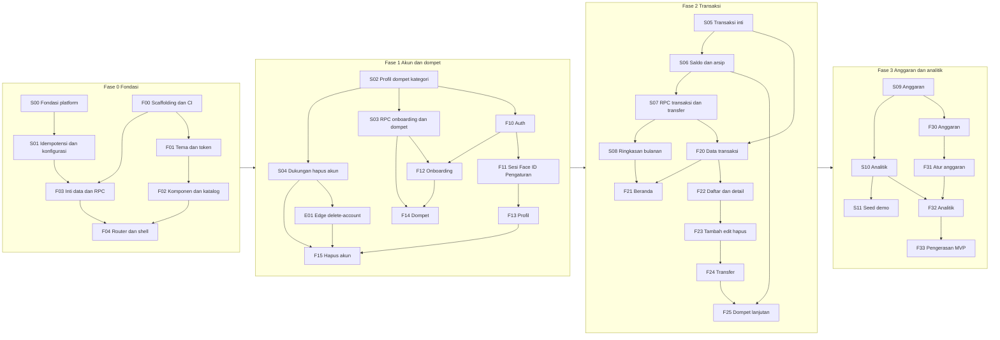

# 12. Build Plan Fase 0 sampai 3

> Ringkasan: urutan modul SQL (migrasi), satu modul Edge Function, dan modul Flutter untuk fase 0 sampai 3 (sampai MVP), masing-masing dengan isi, dependensi, dan definisi selesai (DoD) yang dapat diuji dengan ID tes di [10-test-plan.md](10-test-plan.md). Modul SQL berkode S, Edge berkode E, Flutter berkode F. Dokumen ini tidak berisi kode atau SQL; nama objek mengikuti [06-model-data.md](06-model-data.md).

Status: Draft, mengikuti keputusan OI-01 sampai OI-57 (Diputuskan). Butir Tertunda OI-58 sampai OI-61 tidak menyentuh modul fase 0 sampai 3 kecuali OI-59 (fokus input dan skeleton, sebelum F23). Set demo OI-26 dipakai sebagai seed, warna isi tombol #047857 (OI-27), dan OI-28 memakai jawaban "ya" (Anggaran dan kartu Beranda mengikuti aturan Analitik).

## 1. Cara memakai
- Satu modul SQL = satu atau beberapa berkas migrasi maju-saja ditambah tes pgTAP untuk modul itu. Modul dianggap selesai bila DoD terpenuhi dan CI hijau (analyze, tes, audit hak, pemindaian rahasia).
- Satu modul Flutter = satu fitur atau paket dengan tes unit/widget/golden dan, bila disebut, tes integrasi terhadap Supabase lokal. Modul Flutter dimulai setelah modul SQL yang disebut di kolom "Bergantung pada" selesai.
- Angka dalam DoD merujuk ID tes di 10; "AUT-01" dst. merujuk user story di [02-user-stories.md](02-user-stories.md).
- Kendala bertahap: CHECK `type` x `source` dan FK ke tabel fase berikutnya ditambahkan pada fase yang membuat tabel induknya (pola expand). Fase 0 sampai 3 hanya membuka kombinasi `manual` (income, expense, transfer antar dompet). Kombinasi `scan` (fase 4), `debt` dan `debt_payment` (fase 5), `investment` (fase 6), dan `chat` (fase 7) ditolak sampai migrasinya diterapkan (T-MIG-06).
- `seed.sql` diperluas oleh tiap modul SQL (hanya lokal/staging); S11 menyelesaikan set demo. Generator data sintetis untuk T-PERF dibuat di S05 (berkas tes, bukan migrasi) dan dipakai ulang oleh S06, S10, dan S11.
- DoD tambahan untuk setiap modul yang menambah tabel data pengguna (kelas A atau B): perluas `purge_user_data_v1` dan tambahkan atau perbarui T-DEL (T-DEL-01 dan T-DEL-03) untuk tabel itu dalam modul yang sama. Tanpa itu modul tidak selesai.
- Layar yang belum didesain (Perbarui Aplikasi, state offline, Batas Harian, Akun Sedang Dihapus, dialog Hapus Akun) dibuat sebagai placeholder fungsional dengan komponen yang ada; desain finalnya P2 (OI-39).

## 2. Peta dependensi

## 3. Urutan eksekusi
Langkah yang diberi "∥" dapat berjalan paralel bila ada lebih dari satu pengembang.
| # | Langkah | Modul | Catatan |
|---|---|---|---|
| 1 | Fondasi platform | S00 | skema, hak bawaan, enum, audit |
| 2 | ∥ Scaffolding Flutter dan idempotensi | F00 ∥ S01 | |
| 3 | Tema, komponen | F01 → F02 | |
| 4 | Inti data, router | F03 → F04 | F03 butuh S01 |
| 5 | **Gerbang fase 0** | - | DoD fase 0 di 09 |
| 6 | Profil, dompet, kategori | S02 | pemicu pendaftaran |
| 7 | ∥ RPC dompet, dukungan hapus akun | S03 ∥ S04 | |
| 8 | Edge delete-account | E01 | uji di proyek dev (OI-42) |
| 9 | Auth, sesi, onboarding | F10 → F11 ∥ F12 | |
| 10 | Profil, dompet, hapus akun | F13 → F14, F15 | F15 butuh E01 |
| 11 | **Gerbang fase 1** | - | |
| 12 | Transaksi inti, saldo, RPC, ringkasan | S05 → S06 → S07 → S08 | |
| 13 | Data transaksi, Beranda, daftar | F20 → F21 ∥ F22 | F21 butuh S08 |
| 14 | Tambah/edit/hapus, transfer, dompet lanjutan | F23 → F24 → F25 | F25 butuh S06 |
| 15 | **Gerbang fase 2** | - | |
| 16 | Anggaran, analitik, seed | S09 → S10 → S11 | |
| 17 | Layar Anggaran, Atur Anggaran, Analitik | F30 → F31 → F32 | |
| 18 | Pengerasan MVP | F33 | |
| 19 | **Gerbang fase 3 = MVP siap uji** | - | |

## 4. Modul SQL (migrasi)

### Fase 0
| ID | Isi | Bergantung pada | Definisi selesai |
|---|---|---|---|
| S00 | Fondasi platform: ekstensi `pg_trgm` dan `pg_cron`; skema `private`; kebijakan hak bawaan (`EXECUTE` bawaan dicabut dari `PUBLIC`/`anon`, hak bawaan untuk fungsi baru); semua tipe enum (`type`, `source`, `kind`, `direction`, `payment_channel`, dan lain-lain); pembantu pemicu `updated_at` dan pembantu zona waktu; kerangka pgTAP dan utilitas audit katalog | - | Migrasi dari nol berhasil (T-MIG-01). Audit katalog berjalan di CI dan lulus pada skema kosong: setiap tabel `public` punya RLS (T-RLS-10), setiap fungsi definer punya `search_path` tetap (T-SEC-04), tidak ada fungsi baru executable oleh `anon`/`PUBLIC` (T-SEC-05). `pg_cron` aktif di lokal. Objek `private` tidak terekspos Data API |
| S01 | Idempotensi dan konfigurasi: `request_log` (kelas A) dengan pembantu idempotensi di `private` (mulai, selesai, deteksi `request_id_reuse`); `app_config` (termasuk `update_url`, tautan unduh APK) dan `get_app_config_v1`; pekerjaan `pg_cron` pembersih `request_log` 30 hari | S00 | Pada fixture pgTAP (tabel dan RPC contoh hanya di berkas tes): T-IDM-01 sampai T-IDM-05 dan T-IDM-07 lulus; T-SEC-01 (DML ditolak), T-SEC-03 (anon ditolak), T-SEC-06 (tanpa `auth.uid()`) lulus pada fixture. `get_app_config_v1` hanya dapat dieksekusi `authenticated`. T-MIG-07 untuk `request_log` lulus |

### Fase 1
| ID | Isi | Bergantung pada | Definisi selesai |
|---|---|---|---|
| S02 | `profiles` (zona waktu dengan daftar diizinkan, flag onboarding/biometrik/foto nota/hapus akun, `ai_consent_at` dan `ai_consent_version` yang hanya diisi `record_ai_consent_v1` [RPC-nya dibuat di S12, BR-47], hak kolom), `wallets` (kelas A), `categories` (kelas B); `UNIQUE (user_id, id)`; satu dompet default per pengguna; RLS; `ON DELETE CASCADE` dari `auth.users`; pemicu pendaftaran: profil (zona dari metadata bila diizinkan, selain itu Asia/Jakarta), dompet "Saldo Utama", kategori sistem (8 pengeluaran, 8 pemasukan) | S00 | Pendaftaran menghasilkan tepat 1 profil, 1 dompet default, 16 kategori sistem; T-RLS-01 sampai T-RLS-03, T-RLS-05, T-RLS-06, T-RLS-09; T-TZ-01 dan T-TZ-02; T-CNS-05 (klien tidak dapat mengubah kolom persetujuan); T-SEC-01 untuk `wallets`; kategori sistem tidak dapat dihapus; indeks `categories` dan `wallets` ada |
| S03 | RPC dompet dan onboarding: `complete_onboarding_v1`, `create_wallet_v1`, `update_wallet_v1` | S02, S01 | T-IDM-04 (parameter wajib) dan T-IDM-06 untuk RPC ini; T-WAL-04 (onboarding dilewati = saldo awal 0) dan T-WAL-05 (ubah saldo awal); batas nominal `opening_balance` (T-MON-06); tepat satu default; audit T-SEC-03/04/05 lulus |
| S04 | Dukungan hapus akun: `request_account_deletion_v1`, `purge_user_data_v1` (hanya `service_role`); audit graf FK bebas siklus dan semua tabel pengguna mengaitkan `user_id` dengan CASCADE | S02 | T-SEC-08 (`purge` ditolak untuk `authenticated`); T-CHK-05 (graf FK tanpa siklus); `purge_user_data_v1` idempoten dan menghapus semua baris pengguna di tabel yang ada (T-DEL-01 dan T-DEL-03 pada tabel fase 1); pengguna lain utuh |
| E01 | Edge Function `delete-account`: verifikasi JWT dan kesegaran login (5 menit), batas 3 percobaan per jam, urutan Storage → (token Apple, hanya rilis iOS, dilewati di Android) → `purge_user_data_v1` → hapus pengguna auth, kode error per langkah | S04 | T-DEL-01 sampai T-DEL-08 di proyek dev; T-DEL-02 (pengguna dengan objek Storage) dijalankan di proyek dev pada fase ini (OI-42); T-DEL-07 (Apple) ditunda ke rilis iOS; T-SEC-10 (tanpa token ditolak); satu-satunya fungsi dengan klien admin |

### Fase 2
| ID | Isi | Bergantung pada | Definisi selesai |
|---|---|---|---|
| S05 | `transactions` (semua kolom; FK komposit ke `wallets` dan `categories`; kolom penunjuk `scan_id`, `debt_id`, `debt_payment_id`, `investment_transaction_id` ada tetapi FK-nya menyusul); CHECK matriks tahap 2 dan pemeriksaan kategori sesuai `type`; batas nominal; DML dicabut; RLS SELECT; generator data sintetis deterministik (10.000 dan 50.000 transaksi, berkas tes di `supabase/tests`, bukan migrasi); `purge_user_data_v1` diperluas ke `transactions`; indeks: keyset `(user_id, occurred_at DESC, id DESC)`, parsial analitik dengan `INCLUDE`, `(user_id, wallet_id, occurred_at)`, parsial `counter_wallet_id`, GIN trigram `title` dan `note` | S02 | T-CHK-01 (tahap 2), T-CHK-02, T-CHK-04, T-MIG-06 (tahap 2); T-FK-01 sampai T-FK-03 untuk kolom yang ada; T-SEC-01 untuk `transactions`; T-RLS-01 sampai T-RLS-06; T-MON-06; rencana kueri T-PERF-01, T-PERF-02, T-PERF-03 pada 50.000 transaksi sintetis dari generator S05; T-DEL-01 dan T-DEL-03 mencakup `transactions` |
| S06 | (memakai generator S05) `v_wallet_balance` (rumus 06 bagian 6), `get_wallet_balances_v1`, `archive_wallet_v1` | S05 | T-WAL-01, T-WAL-02, T-WAL-06, T-WAL-08 sampai T-WAL-11 (kombinasi manual; kombinasi lain saat fasenya), T-WAL-12 (konkurensi), T-WAL-13 (saldo negatif diizinkan); T-PERF-06 pada 10.000 transaksi dari generator S05 (keputusan cache, OI-47); T-PERF-07 (indeks FK) |
| S07 | `create_transaction_v1`, `update_transaction_v1`, `delete_transaction_v1`, `create_transfer_v1`, `v_transaction_feed` | S05, S06 | T-IDM-01, T-IDM-04, T-IDM-06; T-TRX-01 dan T-TRX-02; T-SEC-02 (tidak ada jalan menyisipkan source tertutup); T-RLS-07; T-MON-01 sampai T-MON-05; T-FLT-01 (feed menampilkan semua); transfer asal sama tujuan ditolak (T-WAL-03) |
| S08 | `v_monthly_summary` (menurut zona pengguna), `get_monthly_summary_v1` (income, expense yang dihitung, perbandingan bulan lalu) | S05 | Angka Beranda cocok dengan BR-04 pada data sintetis yang menyertakan `debt`, `debt_payment`, dan `transfer` (disisipkan oleh fixture tes karena RPC fase 2 tidak membuatnya) sehingga tidak mengubah hasil; T-TZ-03 sampai T-TZ-07 dan T-BGT-08 untuk batas bulan; T-FLT-01 |

### Fase 3
| ID | Isi | Bergantung pada | Definisi selesai |
|---|---|---|---|
| S09 | `monthly_budgets`, `budgets` (kelas A, FK komposit ke `categories`), `upsert_monthly_budget_v1`, `upsert_budget_v1`, `v_budget_status`, `get_budget_status_v1` | S05 | T-BGT-01 sampai T-BGT-05, T-BGT-09, T-BGT-11 sampai T-BGT-13; T-FK (budgets.category_id); T-SEC-01 untuk dua tabel; T-IDM-04; warna di batas 70% dan 90% (T-BGT-04); `purge_user_data_v1` diperluas ke `monthly_budgets` dan `budgets` dengan T-DEL-01/03 |
| S10 | `v_category_spending`, `get_category_breakdown_v1`, `get_cashflow_v1` (6 bulan) | S05, S08 | Hanya transaksi yang dihitung masuk (T-BGT-06, T-BGT-07, T-BGT-10); persen jumlah 100 dengan metode sisa terbesar; T-PERF-01 (rencana kueri memakai indeks parsial); T-TZ-04 |
| S11 | `seed.sql` set demo (dompet, transaksi, anggaran; angka sesuai set demo OI-26 yang disetujui dan BR-18), memakai generator dari S05 untuk T-PERF (di berkas tes, bukan migrasi) | S09, S10 | T-MIG-01 dan T-MIG-04 (seed tidak ke produksi); angka kanonik tampil benar di semua view; semua T-PERF-01 sampai T-PERF-07 lulus |

## 5. Modul Flutter

### Fase 0
| ID | Isi | Bergantung pada | Definisi selesai |
|---|---|---|---|
| F00 | Scaffolding: proyek, struktur folder (07 bagian 2), lint dan format, tiga lingkungan (dev, staging, prod) lewat `--dart-define` hanya URL dan anon key, CI Flutter, versi paket dikunci di CLAUDE.md | - | `dart format --set-exit-if-changed`, `flutter analyze`, `flutter test` hijau; build debug tiap lingkungan; pemindaian rahasia pada paket lulus (T-SEC-13); `seed.sql` tidak ikut pipeline produksi |
| F01 | Tema dan token: `ThemeExtension` warna, spasi, radius, tipografi; Plus Jakarta Sans dibundel; token baru (`accent-action`, `text-muted` baru, `status-good/warn/bad`, `fs-micro` 11); komponen Latar RekapFin | F00 | Tidak ada literal warna di luar tema (pemeriksaan otomatis); tes kontras token terhadap tabel 08; `accent-action` #047857 (OI-27) lulus 4,5:1 |
| F02 | Komponen inti dan katalog: GlassCard, Hero, FilterChip, PrimaryButton (default, loading, nonaktif), TransactionItem (expense, income, transfer, label sumber), BottomNavBar dan NavItem, TanyaAiFab, pola umum (field, segmented, header sheet, keypad, toggle, badge, dialog kaca) | F01 | Halaman katalog; golden cocok dengan 08 (ukuran, radius, efek) dalam toleransi yang ditetapkan; zona bebas Tanya AI diuji; tidak ada teks di bawah 12 px selain pengecualian (tes) |
| F03 | Inti data: `Rupiah` dan format (BR-02), klien Supabase dan sesi, pembungkus RPC berversi (membuat `client_request_id` per niat, memakai ulang saat retry), `Failure`/`NetworkFailure`, tenggat 15 detik, pemetaan kode error server (`request_id_reuse`, `fallback_quota_exhausted`, dan lainnya), pemeriksaan versi minimum | F00, S01 | T-MON-01; T-IDM-08 (klien); T-OFF-01, T-OFF-02, T-OFF-06, T-OFF-07 pada lapisan ini; tidak ada `double` untuk uang (lint); pemeriksaan versi memakai `get_app_config_v1` hanya setelah sesi (T-MIG-03 sisi klien) |
| F04 | Router dan shell: go_router, pengalihan (tanpa sesi → /login, belum onboarding → /onboarding, versi di bawah minimum → /update-required), ShellRoute lima tab, halaman turunan tanpa tab aktif, Tanya AI placeholder, layar /update-required placeholder (tombol "Unduh versi terbaru" membuka `update_url`) | F02, F03 | Tes navigasi untuk setiap pengalihan; tab aktif benar; Tanya AI tidak menimpa konten; kerangka tanpa fitur berjalan di tiga lingkungan |

### Fase 1
| ID | Isi | Bergantung pada | Definisi selesai |
|---|---|---|---|
| F10 | Auth: Masuk (default, error, loading), Daftar (kekuatan sandi, syarat), Google (tombol Apple disembunyikan di rilis Android), Lupa Kata Sandi (default, error, terkirim) | F04, S02 | AUT-01, AUT-02, AUT-03, AUT-05; golden semua varian; integrasi terhadap Supabase lokal: pendaftaran membuat profil, dompet default, dan kategori |
| F11 | Sesi, Face ID, Pengaturan: pemulihan sesi, Face ID/biometrik opsional (di Android: biometrik perangkat; bawaan mati), Keluar, layar Pengaturan (Face ID, Simpan foto nota, Zona waktu tiga pilihan) | F10 | AUT-04, AUT-06, PRF-04; T-TZ-01 dan T-TZ-02 dari UI; toggle tersimpan ke `profiles` |
| F12 | Onboarding saldo awal: layar dan keypad, panggil `complete_onboarding_v1`, boleh dilewati | F10, S03 | AUT-07; T-WAL-04; idempoten saat diulang |
| F13 | Profil dan Edit Profil, menu (Dompet, Pengaturan), tombol Keluar 208 px rata tengah | F11 | PRF-01 dan PRF-02; golden Profil sesuai keputusan OI-04 dan OI-33 |
| F14 | Dompet: layar Dompet, form tambah/ubah dompet, saldo awal; saldo ditampilkan sebagai saldo awal sampai F25 | F12, S03 | WAL-02 (tambah dan ubah), WAL-03; tes widget dan integrasi `create_wallet_v1`/`update_wallet_v1`; kolom nominal menolak di atas Rp 100 miliar |
| F15 | Hapus akun: dialog konfirmasi (pola dialog kaca, desain final menyusul), login ulang (akun Google/email; login ulang Apple saat rilis iOS), panggilan `delete-account`, pembersihan klien (notifikasi lokal, sesi, penyimpanan aman, pengaturan Face ID lokal), state akun sedang dihapus | F13, E01 | PRF-03; T-DEL-06; T-DEL-01 sampai T-DEL-05 end-to-end di proyek dev; T-DEL-07 (Apple) ditunda ke rilis iOS |

### Fase 2
| ID | Isi | Bergantung pada | Definisi selesai |
|---|---|---|---|
| F20 | Lapisan data transaksi: model freezed, repository (feed keyset, pencarian, CRUD lewat RPC), penyedia kategori dan dompet | F03, S05, S07 | Tes unit repository dengan fake; integrasi: T-TRX-01, T-TRX-02, T-IDM-08; paginasi keyset stabil |
| F21 | Beranda: kartu Hero Total Saldo, kartu Pemasukan/Pengeluaran (BR-04), Aksi Cepat (label 11 px), lima transaksi terbaru, placeholder kartu Hutang & Piutang dan Investasi, ikon mata, lonceng tanpa aksi | F20, S08 | TRX-06; angka cocok view (T-WAL-01, T-FLT-01); golden Beranda; label relatif Hari Ini/Kemarin menurut zona |
| F22 | Daftar Transaksi dan Detail: grup harian, filter chip, pencarian dengan debounce, Detail Transaksi (expense, income, transfer), baris transfer | F20 | TRX-04, TRX-05, TRX-07 (bagian detail); T-TZ-04; golden |
| F23 | Tambah/Edit/Hapus Transaksi: sheet tiga varian, keypad, 8 kategori seragam, field Dompet, peringatan saldo negatif, validasi, state loading/error/offline, dialog hapus | F22, S07 | TRX-01 sampai TRX-03, TRX-07, TRX-08; T-WAL-13 (peringatan tampil, simpan tetap bisa); T-OFF-01 dan T-OFF-02; T-INV-06 (tanpa kategori Investasi pada pengeluaran); golden semua varian |
| F24 | Transfer antar dompet: layar Transfer (default, terisi, error); pilihan tujuan "Investasi" dinonaktifkan dengan keterangan sampai fase 6 [ASUMSI] | F23 | WAL-04; T-WAL-02 dan T-WAL-03; WAL-05 ditunda ke fase 6 |
| F25 | Dompet lanjutan: Total Saldo dari `v_wallet_balance`, arsip dompet bersaldo 0, pemilih dompet di sheet | F24, S06 | WAL-01 sampai WAL-03; T-WAL-06, T-WAL-08, T-WAL-09, T-WAL-10 dari UI |

### Fase 3
| ID | Isi | Bergantung pada | Definisi selesai |
|---|---|---|---|
| F30 | Anggaran: layar, ring dan bar dengan warna hijau/amber/merah (70/90), pemilih bulan, "N hari tersisa", state belum diatur | F25, S09 | BGT-01 sampai BGT-03; T-BGT-01 sampai T-BGT-05 dan T-BGT-09 dari UI; golden tiga warna |
| F31 | Atur Anggaran: form total dan kategori, ringkasan alokasi, validasi jumlah kategori tidak melebihi total (klien dan server), error | F30 | BGT-04; T-BGT-12 dan T-BGT-13; golden normal dan error |
| F32 | Analitik: donat, legenda, arus kas 6 bulan (fl_chart), toggle periode, insight | F31, S10 | ANL-01 sampai ANL-03; T-BGT-06, T-BGT-07, T-BGT-10 (yang tidak dihitung tidak muncul); persen jumlah 100; golden |
| F33 | Pengerasan MVP: audit kontras di perangkat (OI-18, OI-27), aksesibilitas (label semantik, area sentuh 44, font sistem besar), performa daftar dan grafik, jalur uji lengkap dengan seed, pembaruan dokumen | F32, S11 | Tidak ada isu P0/P1 fase 0 sampai 3 terbuka; T-OFF-03 sampai T-OFF-05; T-MIG-02 (aplikasi lama kompatibel dengan RPC `_v1`); MVP siap uji pengguna |

## 6. Gerbang antar fase
| Gerbang | Syarat |
|---|---|
| Fase 0 | S00, S01, F00 sampai F04 selesai; DoD fase 0 di [09-roadmap.md](09-roadmap.md); PITR diperiksa pemilik dan cadangan manual berjalan (OI-49) |
| Fase 1 | S02 sampai S04, E01, F10 sampai F15 selesai; hapus akun lulus di proyek dev termasuk T-DEL-02 (OI-42); T-DEL-07 (Apple) ditunda ke rilis iOS |
| Fase 2 | S05 sampai S08, F20 sampai F25 selesai; T-PERF-06 diputuskan (cache saldo tidak/ya) |
| Fase 3 | S09 sampai S11, F30 sampai F33 selesai; seluruh MVP lulus jalur uji dengan seed |

## 7. Di luar fase 0 sampai 3
Modul fase 4 sampai 8 (scan nota, hutang-piutang, investasi, chatbot, rilis) diuraikan di [09-roadmap.md](09-roadmap.md) dan dipecah menjadi modul S/E/F dengan pola yang sama saat fase 3 mendekati selesai. Pekerjaan pg_cron untuk scan dan `pending_actions` serta `storage-janitor` masuk fase 4. Item terjadwal (OPEN_ISSUES bagian G): modul fase 4 sampai 8 dipecah di dokumen ini sebelum Sprint 17 (S12 dimulai); 36 story fase 4 sampai 8 dan TRX-09 dipetakan ke modul di sini, menggantikan pemetaan [PROVISIONAL] di 13.
