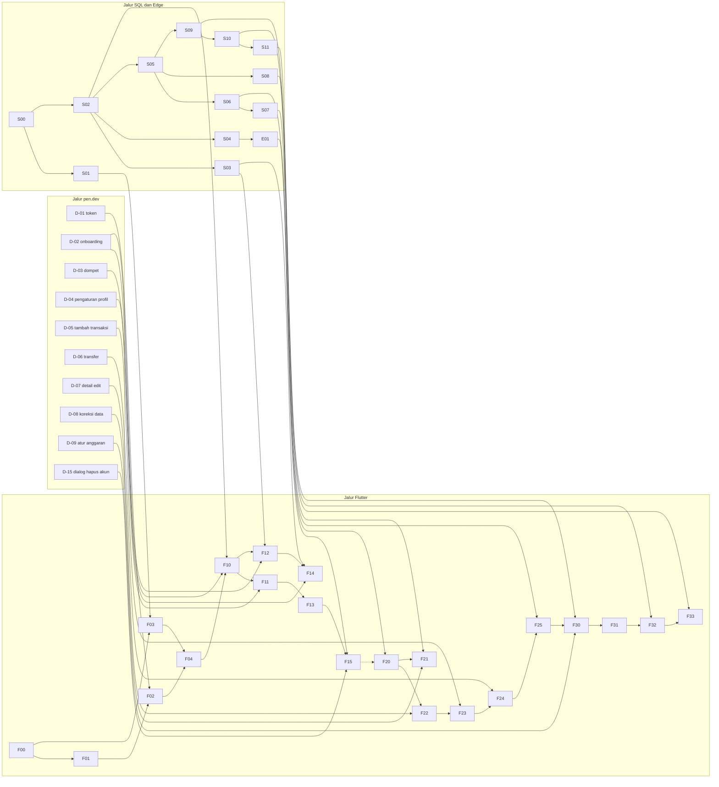

# 13. Sprint Plan

> Ringkasan: rencana 33 sprint mingguan (Sprint 0 sampai Sprint 32) untuk satu pengembang dibantu agen coding, dimulai 10 Nov 2026 [ASUMSI]. Total 245 poin kompleksitas (S=1, M=3, L=5) pada kapasitas awal 8 poin per sprint [ASUMSI, dikalibrasi setelah Sprint 1 dan 2]. MVP (fase 0 sampai 3) = 128 poin dan selesai pada Sprint 16; fase lanjutan (scan nota, hutang-piutang, investasi, chatbot, rilis) sampai Sprint 33. Semua tanggal adalah rentang perkiraan, bukan janji. Desain di pen.dev dijadwalkan sebagai jalur paralel satu sprint sebelum Flutter memakainya. Keputusan yang sudah masuk: rilis pertama mencakup semua fase (OI-50), hanya Android dulu dengan iOS setelahnya (OI-51), AI memakai Google AI (Gemini API) (OI-52), dan distribusi berupa APK lewat Google Drive tanpa Play Store (OI-53).

Status: Draft. Sumber: [09-roadmap.md](09-roadmap.md), [12-build-plan.md](12-build-plan.md), [02-user-stories.md](02-user-stories.md), [10-test-plan.md](10-test-plan.md), [OPEN_ISSUES.md](OPEN_ISSUES.md) (OI-01 sampai OI-57 Diputuskan; OI-58 sampai OI-61 Tertunda dengan tenggat di bagian H). Modul fase 0 sampai 3 memakai nama persis dari 12; modul fase 4 sampai 8 belum ada di 12 dan bertanda [PROVISIONAL] (kode S12 dan seterusnya melanjutkan penomoran 12). Semua angka kapasitas, poin, dan tanggal adalah [ASUMSI].

## 1. Ringkasan

**Tujuan rilis:** aplikasi RekapFin untuk Android (Flutter + Supabase; iOS menyusul setelah rilis Android, OI-51) yang memuat seluruh cakupan PRD: transaksi, dompet, anggaran, analitik, scan nota, hutang-piutang dengan saling hapus, investasi dengan scan screenshot, dan asisten AI, dengan data aman (RLS, RPC definer, hapus akun) dan dapat dipasang serta diperbarui dengan aman. Distribusi: APK bertanda tangan yang dibagikan lewat Google Drive dan dipasang manual, tanpa Play Store (OI-53); tidak ada review toko.

| Cakupan | Fase | Sprint | Poin [ASUMSI] |
|---|---|---|---|
| 0 Fondasi | 0 | 0 sampai 3 | 30 |
| 1 Akun dan dompet | 1 | 2 sampai 9 | 31 |
| 2 Transaksi | 2 | 4 sampai 13 | 41 |
| 3 Anggaran dan analitik | 3 | 10 sampai 17 | 23 |
| 4 Scan nota | 4 | 13 sampai 20 | 29 |
| 5 Hutang-piutang | 5 | 17 sampai 25 | 39 |
| 6 Investasi | 6 | 14 sampai 28 | 24 |
| 7 Asisten AI | 7 | 26 sampai 30 | 17 |
| 8 Rilis | 8 | 29 sampai 32 | 11 |
| Total | | 0 sampai 32 | 245 |

Kolom Sprint menunjukkan rentang sprint tempat item fase itu dikerjakan; rentang antarfase dapat tumpang tindih karena SQL, Edge, dan desain berjalan satu fase di depan Flutter.

- **MVP (fase 0 sampai 3):** 128 poin, Sprint 0 sampai 16.
- **Fase lanjutan (fase 4 sampai 7):** 109 poin. **Fase 8 (rilis):** 11 poin.
- Catatan: poin pada tabel ini dihitung per item backlog (modul, desain, tugas non-fitur) dan tidak sebanding dengan S/M/L per fase di 09-roadmap (lihat bagian 11).

**Milestone (rentang, bukan tanggal pasti)** [ASUMSI]:

| Milestone | Cepat (10 poin/sprint) | Rencana (8 poin/sprint) | Lambat (6 poin/sprint) | Definisi |
|---|---|---|---|---|
| MVP internal | 8 Feb 2027 | 8 Mar 2027 | 12 Apr 2027 | fase 0 sampai 3 lulus semua DoD dan diuji di emulator; uji perangkat nyata menyusul (X-06) |
| Beta tertutup dimulai | 29 Mar 2027 | 10 Mei 2027 | 5 Jul 2027 | APK beta dibagikan lewat Drive ke penguji (X-12), setelah fase 5 |
| Rilis APK final | 3 Mei 2027 | 28 Jun 2027 | 23 Agu 2027 | X-13 selesai: APK bertanda tangan final dan panduan pasang/perbarui dibagikan; fase 0 sampai 8 lengkap; tidak ada masa review toko |

Libur yang berpotensi mengurangi kapasitas [ASUMSI, tanggal perkiraan]: Natal dan Tahun Baru (Sprint 6 sampai 7), Idul Fitri sekitar 9 sampai 11 Maret 2027 (Sprint 17).

**Perubahan pada pembaruan ini (dilaporkan, tanggal rencana tidak digeser):** ditambah D-15 sampai D-19 (dialog Hapus Akun, Persetujuan AI, edit/hapus hutang, form investasi lanjutan, halaman hukum; masing-masing 1 poin [ASUMSI]) dan generator data sintetis dipindah dari S11 ke S05 (S05 menjadi 6 poin). Total naik dari 239 ke 245 poin (+6) dan MVP dari 124 ke 128. Penempatan: D-15 di Sprint 5, D-09 pindah dari Sprint 9 ke 10, D-16 di 13, D-18 di 14, D-17 di 17, D-19 di 29; semua dalam sprint yang punya sisa kapasitas, jadi jadwal rencana (8 poin per sprint) tetap: MVP 8 Mar 2027, beta 10 Mei 2027, rilis 28 Jun 2027. Yang bergeser hanya skenario: MVP lambat 5 ke 12 Apr 2027, beta lambat 28 Jun ke 5 Jul 2027, rilis cepat 26 Apr ke 3 Mei 2027, rilis lambat 16 ke 23 Agu 2027. Sisa kapasitas (buffer) turun dari 25 ke 19 poin. Prasyarat lingkungan Sprint 0 dihitung di dalam F00 (3 poin) [ASUMSI]; perluasan `purge_user_data_v1` per modul dihitung di dalam modulnya.

## 2. Aturan kerja

### 2.1 Definisi siap (Definition of Ready) per story/modul
1. Story punya kriteria penerimaan di [02-user-stories.md](02-user-stories.md) dan modulnya punya DoD di [12-build-plan.md](12-build-plan.md).
2. Semua dependensi sudah selesai: modul SQL yang dipakai sudah ter-merge dan lulus tes; layar pen.dev yang dipakai sudah ada, atau ada keputusan tertulis memakai placeholder dari katalog komponen.
3. Daftar ID tes target tertulis (kolom Tes di bagian 3).
4. Kontrak RPC (nama berversi, parameter, kode error) sudah dibekukan di 06 sebelum modul Flutter yang memanggilnya dimulai.
5. Ukuran maksimum L (5 poin); modul yang lebih besar dipecah. Satu modul = satu sesi agen = satu commit atau PR.
6. Tidak ada keputusan OI yang menggantung (semua Diputuskan).

### 2.2 Definisi selesai (Definition of Done) per story/modul
1. Kriteria penerimaan story lulus dan semua tes pada kolom Tes hijau, dengan output tes ditampilkan (bukan hanya klaim).
2. `dart format --set-exit-if-changed`, `flutter analyze`, dan tes yang relevan hijau untuk Flutter; `supabase db reset`, `supabase test db` hijau untuk SQL; tes Deno hijau untuk Edge.
3. Modul SQL: audit hak (T-SEC-03/04/05) dan RLS (T-RLS-10) lulus; RPC tulis menolak panggilan tanpa `client_request_id`.
4. Modul yang menambah tabel data pengguna (kelas A atau B): perluas `purge_user_data_v1` dan tambahkan atau perbarui tes T-DEL (T-DEL-01/03) untuk tabel itu dalam modul yang sama; tanpa itu modul tidak selesai.
4a. Modul Flutter: tidak ada literal warna di luar tema, tidak ada `double` untuk uang, golden/widget test untuk varian yang disebut, demo berjalan di emulator.
5. Dokumen yang berubah diperbarui (06 untuk RPC, 03 untuk layar, 12 untuk selisih modul) dalam commit yang sama atau sprint yang sama.
6. Commit dibuat setelah tes hijau; pesan commit memuat ID modul.

### 2.3 Tes hijau sebelum commit
- Agen menjalankan tes paling sempit yang relevan lebih dulu, lalu `flutter analyze`/lint, lalu seluruh tes modul; hasil ditempel di sesi.
- Commit per modul diizinkan (OI-56) hanya bila semua hijau; push hanya atas perintah pemilik produk.
- Commit hanya bila semua hijau. Dilarang menonaktifkan, melonggarkan, atau menghapus tes agar lulus; perubahan tes harus dijelaskan dan disetujui.
- Dilarang melewati pemeriksaan (mis. `--no-verify`) dan dilarang meng-commit rahasia atau berkas `.env*`.
- Tes yang gagal dilaporkan apa adanya; modul yang tidak hijau tidak dihitung poinnya.

### 2.4 Jalur paralel (SQL, Flutter, pen.dev, Edge, lainnya)
- **SQL dan Edge mendahului Flutter**: modul Flutter baru dimulai setelah modul SQL/Edge yang dipanggilnya selesai, ter-merge, dan lulus tes (dependensi lintas jalur ketat; antar-modul sejalur boleh berurutan dalam satu sprint).
- **pen.dev berjalan satu sprint di depan Flutter**: layar yang belum didesain adalah dependensi, bukan alasan menunda. Bila desain terlambat, Flutter memakai komponen katalog dan inventaris 03, menandai deviasi di 03, dan desain final menyusul.
- Perubahan kontrak RPC setelah dibekukan harus lewat `_v2` (expand-contract) dan dicatat di 06.
- Satu pengembang: jalur paralel berarti urutan pekerjaan yang tidak saling menunggu, bukan pekerjaan serentak; kapasitas tetap 8 poin per sprint untuk seluruh jalur.

### 2.5 Bila agen melaporkan selesai tanpa output tes
1. Anggap modul **belum selesai**. Jangan commit dan jangan hitung poin.
2. Minta agen menjalankan ulang tes yang tercantum pada kolom Tes dan menampilkan output lengkap (jumlah tes, lulus/gagal).
3. Periksa diff: tidak ada tes yang dihapus, dilewati, atau dilemahkan; periksa juga bahwa berkas tes memang menyentuh perilaku yang diklaim.
4. Bila tes tidak dapat dijalankan, catat penyebabnya, tandai item "belum terverifikasi" di tabel pelacakan, dan selesaikan dulu penyebabnya.
5. Catat kejadian di retrospektif; dua kejadian berturut-turut memicu aturan: tidak ada merge tanpa output tes terlampir.

## 3. Backlog terurut

Urutan mengikuti jadwal sprint. Jalur: SQL, Flutter, pen.dev (D), Edge Function (E), Lainnya (X). Poin [ASUMSI]. Tes merujuk [10-test-plan.md](10-test-plan.md). Modul fase 4 sampai 8 [PROVISIONAL].

| # | ID | Jalur | Item | Story | Poin | Bergantung pada | Tes | Sprint |
|---|---|---|---|---|---|---|---|---|
| 1 | S00 | SQL | Fondasi platform | - | 3 | - | T-MIG-01, T-RLS-10, T-SEC-04, T-SEC-05 | 0 |
| 2 | F00 | Flutter | Scaffolding Flutter, git, CI, prasyarat lingkungan | - | 3 | - | analyze, format, test hijau; T-SEC-13 | 0 |
| 3 | X-01 | Lainnya | Kalibrasi kapasitas dan checklist DoD | - | 1 | - | kapasitas terukur | 0 |
| 4 | X-02 | Lainnya | Tiga lingkungan Supabase dan rahasia | - | 1 | - | tiga lingkungan terpisah; T-MIG-04 | 0 |
| 5 | S01 | SQL | Idempotensi dan konfigurasi | - | 3 | S00 | T-IDM-01..05, T-IDM-07, T-SEC-01/03/06 (fixture), T-MIG-07 | 1 |
| 6 | F01 | Flutter | Tema dan token | - | 3 | F00 | tes kontras token; tanpa literal warna | 1 |
| 7 | D-01 | pen.dev | Token baru dan halaman dokumentasi | layar: 11 P2-1, P2-1b, P2-2, P2-2b | 1 | - | checklist 11 | 1 |
| 8 | X-04 | Lainnya | Keystore penandatanganan, nama paket, konfigurasi Google OAuth (SHA-1) | - | 1 | - | keystore dibuat dan dicadangkan di dua tempat; SHA-1 terdaftar; login Google berjalan di build debug dan rilis (T-DST-04) | 1 |
| 9 | F02 | Flutter | Komponen inti dan katalog | - | 5 | F01, D-01 | golden katalog; zona Tanya AI; tanpa teks di bawah 12 px (selain pengecualian) | 2 |
| 10 | D-02 | pen.dev | Onboarding dan Lupa Kata Sandi | layar: 11 P0-2, P0-3 | 1 | - | checklist 11 | 2 |
| 11 | D-03 | pen.dev | Dompet dan Form Dompet | layar: 11 P0-4 | 1 | - | checklist 11 | 2 |
| 12 | X-03 | Lainnya | Cadangan manual dan cek PITR | - | 1 | X-02 | cadangan manual berjalan; satu pemulihan ke staging (T-MIG-05) | 2 |
| 13 | F03 | Flutter | Inti data dan RPC | - | 5 | F00, S01 | T-MON-01, T-IDM-08, T-OFF-01/02/06/07 | 3 |
| 14 | F04 | Flutter | Router dan shell | - | 3 | F02, F03 | tes pengalihan; T-MIG-03 (klien) | 3 |
| 15 | S02 | SQL | Profil, dompet, kategori | AUT-01, PRF-01 | 3 | S00 | T-RLS-01..03/05/06/09, T-TZ-01/02, T-SEC-01, T-CNS-05 | 4 |
| 16 | S03 | SQL | RPC onboarding dan dompet | AUT-07, WAL-02, WAL-03 | 1 | S02, S01 | T-IDM-04/06, T-WAL-04/05, T-MON-06 | 4 |
| 17 | S04 | SQL | Dukungan hapus akun | PRF-03 | 1 | S02 | T-SEC-08, T-CHK-05, T-DEL-01/03 (tabel fase 1) | 4 |
| 18 | D-04 | pen.dev | Pengaturan dan Profil | layar: 11 P0-8, P1-8, P1-13 | 1 | - | checklist 11 | 4 |
| 19 | D-05 | pen.dev | Tambah Transaksi dan peringatan saldo | layar: 11 P0-1, P1-11 | 1 | - | checklist 11 | 4 |
| 20 | D-06 | pen.dev | Transfer | layar: 11 P0-5 | 1 | - | checklist 11 | 4 |
| 21 | F10 | Flutter | Auth | AUT-01, AUT-02, AUT-03, AUT-05 | 5 | F04, S02, D-02, X-04 | golden varian auth; integrasi daftar membuat profil, dompet, kategori | 5 |
| 22 | F12 | Flutter | Onboarding saldo awal | AUT-07 | 1 | F10, S03 | T-WAL-04 | 5 |
| 23 | D-15 | pen.dev | Dialog Hapus Akun | layar: 11 P0-10 | 1 | - | checklist 11 | 5 |
| 24 | D-08 | pen.dev | Koreksi data Beranda, Transaksi, Analitik, Chat | layar: 11 P1-2, P1-3, P1-4 | 1 | - | checklist 11 | 5 |
| 25 | E01 | Edge Function | Edge delete-account | PRF-03 | 3 | S04 | T-DEL-01..08, T-SEC-10 (proyek dev) | 6 |
| 26 | F11 | Flutter | Sesi, Face ID, Pengaturan | AUT-04, AUT-06, PRF-04 | 3 | F10, D-04 | T-TZ-01/02 dari UI; toggle tersimpan | 6 |
| 27 | D-13 | pen.dev | Perbarui Aplikasi, state offline, Akun Sedang Dihapus | layar: 11 P2-3, P2-3b, P2-4 | 2 | - | checklist 11 | 6 |
| 28 | F13 | Flutter | Profil dan Edit Profil | PRF-01, PRF-02 | 3 | F11 | golden Profil | 7 |
| 29 | F14 | Flutter | Dompet | WAL-02, WAL-03 | 3 | F12, S03, D-03 | integrasi create/update wallet; batas Rp 100 miliar | 7 |
| 30 | F15 | Flutter | Hapus akun | PRF-03 | 3 | F13, E01, D-15 | T-DEL-01..06 end-to-end; T-DEL-07 manual | 8 |
| 31 | D-07 | pen.dev | Detail, Edit, Hapus Transaksi | layar: 11 P0-6 | 3 | - | checklist 11 | 8 |
| 32 | S05 | SQL | Transaksi inti dan generator data sintetis | TRX-01, TRX-02, TRX-09 | 6 | S02 | T-CHK-01/02/04, T-MIG-06, T-FK-01..03, T-SEC-01, T-RLS-01..06, T-MON-06, T-PERF-01..03; generator data sintetis (10.000 dan 50.000 transaksi) menghasilkan data yang sama untuk dua kali jalan; T-DEL-01/03 diperluas ke transaksi | 9 |
| 33 | S08 | SQL | Ringkasan bulanan | TRX-06 | 1 | S05 | T-TZ-03..07, T-BGT-08, T-FLT-01 | 9 |
| 34 | X-05 | Lainnya | Uji perangkat Android nyata gerbang fase 1 | - | 1 | F15 | biometrik dan hapus akun di perangkat Android nyata (T-DEL-07 Apple ditunda ke rilis iOS) | 9 |
| 35 | S06 | SQL | Saldo dan arsip dompet | WAL-01, WAL-02 | 3 | S05 | T-WAL-01/02/06/08..13, T-PERF-06/07 | 10 |
| 36 | S07 | SQL | RPC transaksi dan transfer | TRX-01 sampai TRX-03, TRX-07, WAL-04 | 3 | S05, S06 | T-IDM-01/04/06, T-TRX-01/02, T-SEC-02, T-RLS-07, T-MON-01..05, T-FLT-01, T-WAL-03 | 10 |
| 37 | D-09 | pen.dev | Atur Anggaran dan angka Anggaran | layar: 11 P0-7, P1-1 | 1 | - | checklist 11 | 10 |
| 38 | F20 | Flutter | Lapisan data transaksi | TRX-01, TRX-02 | 3 | F03, S05, S07 | T-TRX-01/02, T-IDM-08 (integrasi) | 11 |
| 39 | F21 | Flutter | Beranda | TRX-06 | 3 | F20, S08, D-08 | T-WAL-01, T-FLT-01; golden Beranda | 11 |
| 40 | F22 | Flutter | Daftar Transaksi dan Detail | TRX-04, TRX-05, TRX-07 | 3 | F20, D-07 | T-TZ-04; golden | 12 |
| 41 | F23 | Flutter | Tambah, Edit, Hapus Transaksi | TRX-01 sampai TRX-03, TRX-07, TRX-08 | 5 | F22, S07, D-05 | T-WAL-13, T-OFF-01/02, T-INV-06; golden varian | 12 |
| 42 | F24 | Flutter | Transfer antar dompet | TRX-09, WAL-04 | 3 | F23, D-06 | T-WAL-02/03 | 13 |
| 43 | F25 | Flutter | Dompet lanjutan | WAL-01 sampai WAL-03 | 3 | F24, S06 | T-WAL-06/08/09/10 | 13 |
| 44 | D-16 | pen.dev | Dialog Persetujuan Pemrosesan AI | layar: 11 P1-17 | 1 | - | checklist 11 | 13 |
| 45 | S09 | SQL | Anggaran | BGT-01 sampai BGT-04 | 3 | S05 | T-BGT-01..05/09/11..13, T-FK, T-SEC-01 | 14 |
| 46 | S10 | SQL | Analitik | ANL-01 sampai ANL-03 | 3 | S09, S08 | T-BGT-06/07/10, T-PERF-01, T-TZ-04 | 14 |
| 47 | S11 | SQL | Seed demo | - | 1 | S09, S10 | T-MIG-01/04, T-PERF-01..07 (memakai generator dari S05) | 14 |
| 48 | D-18 | pen.dev | Form investasi lanjutan: pembelian, perbarui nilai, menu aset, pemilih platform, hapus aset | layar: 11 P1-15 | 1 | - | checklist 11 | 14 |
| 49 | F30 | Flutter | Anggaran | BGT-01 sampai BGT-03 | 3 | F25, S09, D-09 | T-BGT-01..05/09 dari UI; golden tiga warna | 15 |
| 50 | F31 | Flutter | Atur Anggaran | BGT-04 | 3 | F30 | T-BGT-12/13; golden | 15 |
| 51 | D-12 | pen.dev | Koreksi Scan Nota dan Batas Harian | layar: 11 P1-9, P2-4 | 2 | - | checklist 11 | 15 |
| 52 | F32 | Flutter | Analitik | ANL-01 sampai ANL-03 | 5 | F31, S10 | persen donat 100; T-BGT-06/07/10; golden | 16 |
| 53 | F33 | Flutter | Pengerasan MVP | - | 3 | F32, S11 | T-OFF-03..05, T-MIG-02; audit kontras perangkat | 16 |
| 54 | S12 | SQL | Scans, kuota AI, RPC scan [PROVISIONAL] | SCN-05, SCN-08, SCN-09 | 5 | S11 | T-OCR-17/19/20/21/22, T-JAN-05/07, T-IDM-04, T-MIG-06 (+scan), T-CNS-01..04/06 | 17 |
| 55 | D-10 | pen.dev | Pemilih Kontak dan Dialog Nama Ganda | layar: 11 P0-9 | 1 | - | checklist 11 | 17 |
| 56 | D-17 | pen.dev | Edit Hutang/Piutang, Dialog Hapus Catatan dan Batalkan Pembayaran | layar: 11 P1-14 | 1 | - | checklist 11 | 17 |
| 57 | X-06 | Lainnya | Uji perangkat Android nyata MVP internal | - | 1 | F33 | jalur MVP lengkap di perangkat Android nyata | 17 |
| 58 | E02 | Edge Function | Edge ocr-parse (nota) [PROVISIONAL] | SCN-02, SCN-03, SCN-04 | 5 | S12 | T-OCR-01..07, T-OCR-13/14, T-LLM-01..06, T-SEC-09/11 | 18 |
| 59 | E03 | Edge Function | Edge storage-janitor [PROVISIONAL] | SCN-05 | 3 | S12 | T-JAN-01..04, T-JAN-08 | 18 |
| 60 | F40 | Flutter | Scan Nota: kamera dan ML Kit [PROVISIONAL] | SCN-01, SCN-06 | 5 | F33, S12, D-12 | uji kamera di perangkat; T-OFF-03 | 19 |
| 61 | D-11 | pen.dev | Koreksi layar Hutang & Piutang | layar: 11 P1-5, P1-6, P1-7, P1-12 | 3 | - | checklist 11 | 19 |
| 62 | F41 | Flutter | Memproses dan Hasil Scan [PROVISIONAL] | SCN-02 sampai SCN-05, SCN-07, SCN-09 | 5 | F40, E02, D-16 | T-OCR-01..05, T-OCR-08, T-CNS-07 | 20 |
| 63 | F42 | Flutter | Foto nota, batas harian, Ketik Manual [PROVISIONAL] | SCN-05, SCN-06, SCN-08 | 3 | F41, E03 | T-OCR-09/15/16/17/21 | 20 |
| 64 | S13 | SQL | Kontak, hutang, pembayaran [PROVISIONAL] | DBT-01 sampai DBT-06, DBT-08 | 5 | S11 | T-PAY-01..13, T-CHK-01/03, T-CON-04..07, T-MIG-06 (+debt) | 21 |
| 65 | S14 | SQL | Saling hapus [PROVISIONAL] | NET-01 sampai NET-04, NET-07 | 3 | S13 | T-NET-01..17 | 21 |
| 66 | F50 | Flutter | Daftar Hutang & Piutang [PROVISIONAL] | DBT-01 | 3 | F33, S13, D-11 | golden daftar dan Kosong - Pengguna Baru | 22 |
| 67 | F51 | Flutter | Tambah Hutang/Piutang [PROVISIONAL] | DBT-02 | 5 | F50, D-10 | T-CON-01..03, T-IDM-08 | 22 |
| 68 | F52 | Flutter | Detail dan Catat Pembayaran [PROVISIONAL] | DBT-03 sampai DBT-06, DBT-08 | 5 | F51, D-17 | T-PAY-04/05/10/11 dari UI | 23 |
| 69 | F53 | Flutter | Saldo Bersih dan Saling Hapus [PROVISIONAL] | NET-01 sampai NET-04, NET-06 | 3 | F52, S14 | T-NET-17 (peringatan), golden tiga hasil | 23 |
| 70 | F54 | Flutter | Notifikasi lokal jatuh tempo [PROVISIONAL] | DBT-07 | 3 | F52 | uji notifikasi lokal (izin, restart) | 24 |
| 71 | X-07 | Lainnya | Teks Syarat dan Kebijakan Privasi | - | 3 | - | teks final ditinjau | 24 |
| 72 | X-08 | Lainnya | Ikon, splash, nama aplikasi | - | 2 | - | ikon dan splash terpasang di build | 24 |
| 73 | S15 | SQL | Investasi [PROVISIONAL] | INV-01, INV-03 sampai INV-05 | 5 | S11 | T-INV-01..05/08..10, T-MIG-06 (+investment) | 25 |
| 74 | D-14 | pen.dev | Koreksi layar Investasi | layar: 11 P1-7 (investasi) | 1 | - | checklist 11 | 25 |
| 75 | X-12 | Lainnya | Beta tertutup (APK ke penguji lewat Google Drive) | - | 2 | F53, X-07, X-08 | APK beta terpasang pada penguji lewat Drive; T-DST-01/02/05/07; umpan balik terkumpul | 25 |
| 76 | F60 | Flutter | Daftar Investasi [PROVISIONAL] | INV-01, INV-02, INV-06 | 3 | F33, S15, D-14 | golden daftar dan kosong; T-INV-01/02/05 | 26 |
| 77 | F61 | Flutter | Tambah Investasi dan transfer ke aset [PROVISIONAL] | INV-03, WAL-05 | 3 | F60, F24, D-18 | T-INV-03/07 | 26 |
| 78 | X-10 | Lainnya | Gerbang pemilihan model chat | - | 1 | - | model dipilih | 26 |
| 79 | E04 | Edge Function | Edge ocr-parse (investasi) [PROVISIONAL] | SIN-01, SIN-02 | 3 | E02, S15 | T-OCR-18, T-LLM-01..06 | 27 |
| 80 | F62 | Flutter | Detail Aset [PROVISIONAL] | INV-04, INV-05 | 3 | F60, D-18 | T-INV-04, T-INV-10 | 27 |
| 81 | S16 | SQL | Chat dan pending actions [PROVISIONAL] | AIC-02, AIC-04 | 3 | S11 | T-AIC-05/09, T-MIG-06 (+chat) | 28 |
| 82 | F63 | Flutter | Scan Investasi [PROVISIONAL] | SIN-01 sampai SIN-04 | 5 | F41, E04, F61 | sampel 5 per platform [ASUMSI] | 28 |
| 83 | E05 | Edge Function | Edge chat [PROVISIONAL] | AIC-01, AIC-02, AIC-04 | 5 | S16, X-10 | T-AIC-01..08, T-LLM-07..09, T-SEC-09..12 | 29 |
| 84 | D-19 | pen.dev | Halaman Syarat dan Kebijakan Privasi | layar: 11 P1-16 | 1 | - | checklist 11 | 29 |
| 85 | X-09 | Lainnya | Crash reporting | - | 1 | F33 | crash terlaporkan di build uji | 29 |
| 86 | F70 | Flutter | Chat UI [PROVISIONAL] | AIC-01, AIC-03, AIC-05 | 5 | F04, S16 | golden chat | 30 |
| 87 | F71 | Flutter | Kartu konfirmasi dan integrasi [PROVISIONAL] | AIC-02, AIC-04 | 3 | F70, E05 | T-AIC-01..04 | 30 |
| 88 | F80 | Flutter | Pengerasan akhir: aksesibilitas dan performa [PROVISIONAL] | - | 3 | F71, F63 | audit aksesibilitas | 31 |
| 89 | F81 | Flutter | Halaman Syarat dan Kebijakan [PROVISIONAL] | - | 1 | X-07, F04, D-19 | tautan Syarat dan Kebijakan dapat dibuka | 31 |
| 90 | X-11 | Lainnya | Audit hak menyeluruh, rotasi rahasia, uji pemulihan | - | 3 | F71, F63 | T-SEC audit penuh, T-MIG-05 | 31 |
| 91 | X-13 | Lainnya | Build rilis final bertanda tangan, panduan pasang dan perbarui, tautan unduh | - | 2 | F80, F81, X-11, X-12 | T-DST-01..09; APK rilis final dibagikan; panduan pasang dan perbarui teruji | 32 |

## 4. Rencana sprint

Tiap sprint: tujuan, item per jalur dengan poin, total dan sisa kapasitas (dari 8), kriteria selesai yang dapat diverifikasi, serta risiko dan dependensi eksternal. Sisa kapasitas dipakai sebagai buffer, perbaikan, atau dipercepat dari sprint berikut (lihat bagian 7).

### Sprint 0: 10 Nov 2026 sampai 16 Nov 2026 [ASUMSI]

**Tujuan:** Repo, git, Supabase, Flutter, tiga lingkungan, dan CI dasar berdiri, lalu kapasitas awal diukur.

| Jalur | Item | Poin |
|---|---|---|
| SQL | S00 Fondasi platform | 3 |
| Flutter | F00 Scaffolding Flutter, git, CI, prasyarat lingkungan | 3 |
| Lainnya | X-01 Kalibrasi kapasitas dan checklist DoD | 1 |
| Lainnya | X-02 Tiga lingkungan Supabase dan rahasia | 1 |

**Total:** 8 dari 8 poin. **Sisa kapasitas:** 0.

**Selesai bila (tes hijau):** F00: analyze, format, test hijau; T-SEC-13; S00: T-MIG-01, T-RLS-10, T-SEC-04, T-SEC-05; X-01: kapasitas terukur; X-02: tiga lingkungan terpisah; T-MIG-04.

**Demo di emulator/perangkat:** `flutter run` membuka aplikasi kosong di emulator pada tiga lingkungan; `supabase start` naik; PR pertama hijau di CI; docs sudah ter-commit.

**Risiko dan dependensi eksternal:** Batas proyek gratis Supabase untuk tiga lingkungan; menit CI. Keputusan lingkungan staging dan produksi perlu akun aktif.

**Rincian Sprint 0 (wajib):**
- Commit docs: seluruh `docs/` dan `CLAUDE.md` di-commit sebagai commit pertama setelah `git init` (F00).
- Inisialisasi git: `git init`, `.gitignore` (mengecualikan `.env*`, kunci, build), cabang `main` (F00).
- `supabase init`: struktur `supabase/` (migrations, functions, tests, seed.sql) dan `supabase start` lokal; migrasi pertama S00 (S00).
- Project Flutter: `flutter create`, struktur folder 07 bagian 2, lint dan format, kunci versi paket di CLAUDE.md (F00).
- Tiga lingkungan: lokal (Supabase CLI), staging, produksi (proyek Supabase terpisah dengan URL, anon key, service role, dan kunci LLM masing-masing); `--dart-define` hanya URL dan anon key (X-02).
- CI sederhana: `dart format --set-exit-if-changed`, `flutter analyze`, `flutter test` pada setiap PR (F00); CI SQL (`supabase test db`) menyusul begitu ada tes pgTAP di S00/S01.
- Kalibrasi kapasitas: catat poin yang benar-benar selesai di Sprint 0, hitung ulang kapasitas setelah Sprint 1 dan 2 (X-01).

**Prasyarat lingkungan (dipasang dan diverifikasi sebelum F00; keluaran perintah versi ditempel di sesi, versi paket dikunci di CLAUDE.md):**

| Prasyarat | Dipakai untuk | Verifikasi |
|---|---|---|
| Git | repositori, commit per modul | `git --version` |
| Docker (Engine atau Desktop) yang berjalan | `supabase start`, `supabase db reset`, `supabase test db` (pgTAP) | `docker --version`, `docker ps` |
| Flutter SDK (kanal stabil) | aplikasi, tes, analisis | `flutter doctor -v` tanpa galat untuk Android |
| Android SDK (cmdline-tools, platform-tools, platform dan build-tools sesuai Flutter) dan emulator (minimal satu AVD) | build dan demo tiap sprint; perangkat nyata untuk X-05 dan X-06 | `flutter doctor -v`, `flutter devices` |
| JDK versi yang diminta toolchain Gradle/AGP proyek Flutter | build Android; `keytool` untuk keystore (X-04) | `java -version`, `keytool -help` |
| Supabase CLI | `supabase init/start/db reset/test db/functions serve`, deploy | `supabase --version` |
| Deno | Edge Function dan tesnya | `deno --version` |
| Akun: Supabase (tiga proyek, X-02), Google Cloud untuk klien OAuth (X-04), Google AI/Gemini API berpenagihan (sebelum Sprint 17) | lingkungan dan fitur AI | dicek pemilik produk; kredensial tidak ditulis di repo atau sesi |

Nomor versi tidak ditulis di sini karena belum diverifikasi terhadap dokumentasi resmi; periksa di Sprint 0 dan catat. Bila prasyarat gagal dipasang (mis. Docker tidak tersedia), Sprint 0 dihentikan dan dilaporkan; biaya pemasangan dihitung di dalam F00 (3 poin) [ASUMSI].

### Sprint 1: 17 Nov 2026 sampai 23 Nov 2026 [ASUMSI]

**Tujuan:** Pola tulis aman terbukti pada fixture dan tema serta token siap dipakai.

| Jalur | Item | Poin |
|---|---|---|
| SQL | S01 Idempotensi dan konfigurasi | 3 |
| Flutter | F01 Tema dan token | 3 |
| pen.dev | D-01 Token baru dan halaman dokumentasi | 1 |
| Lainnya | X-04 Keystore penandatanganan, nama paket, konfigurasi Google OAuth (SHA-1) | 1 |

**Total:** 8 dari 8 poin. **Sisa kapasitas:** 0.

**Selesai bila (tes hijau):** S01: T-IDM-01..05, T-IDM-07, T-SEC-01/03/06 (fixture), T-MIG-07; F01: tes kontras token; tanpa literal warna; X-04: keystore dibuat dan dicadangkan di dua tempat; SHA-1 terdaftar; login Google berjalan di build debug dan rilis (T-DST-04).

**Demo di emulator/perangkat:** Halaman uji token menampilkan warna dan tipografi; tes fixture idempotensi hijau.

**Risiko dan dependensi eksternal:** Keystore harus dibuat dan dicadangkan sekarang; kehilangannya berarti pembaruan tidak bisa menimpa pemasangan lama. Klien OAuth Google butuh SHA-1. Akun Google AI (Gemini API) berpenagihan aktif disiapkan sebelum Sprint 17.

### Sprint 2: 24 Nov 2026 sampai 30 Nov 2026 [ASUMSI]

**Tujuan:** Komponen inti tersedia di katalog dan cadangan manual berjalan.

| Jalur | Item | Poin |
|---|---|---|
| Flutter | F02 Komponen inti dan katalog | 5 |
| pen.dev | D-02 Onboarding dan Lupa Kata Sandi | 1 |
| pen.dev | D-03 Dompet dan Form Dompet | 1 |
| Lainnya | X-03 Cadangan manual dan cek PITR | 1 |

**Total:** 8 dari 8 poin. **Sisa kapasitas:** 0.

**Selesai bila (tes hijau):** X-03: cadangan manual berjalan; satu pemulihan ke staging (T-MIG-05); F02: golden katalog; zona Tanya AI; tanpa teks di bawah 12 px (selain pengecualian).

**Demo di emulator/perangkat:** Katalog komponen di emulator (GlassCard, tombol, chip, nav) cocok dengan desain.

**Risiko dan dependensi eksternal:** Cek PITR hanya bisa oleh pemilik di dashboard.

**Kalibrasi:** setelah Sprint 2, hitung rata-rata poin selesai Sprint 0 sampai 2 dan perbarui kapasitas di tabel pelacakan; jadwal bagian 4 dihitung ulang dengan kapasitas baru.

### Sprint 3: 1 Des 2026 sampai 7 Des 2026 [ASUMSI] (Gerbang fase 0)

**Tujuan:** Inti data dan kerangka aplikasi (router, shell) berjalan; gerbang fase 0.

| Jalur | Item | Poin |
|---|---|---|
| Flutter | F03 Inti data dan RPC | 5 |
| Flutter | F04 Router dan shell | 3 |

**Total:** 8 dari 8 poin. **Sisa kapasitas:** 0.

**Selesai bila (tes hijau):** F03: T-MON-01, T-IDM-08, T-OFF-01/02/06/07; F04: tes pengalihan; T-MIG-03 (klien).

**Demo di emulator/perangkat:** Shell lima tab terbuka di emulator; format rupiah dan pembungkus RPC dengan retry terbukti lewat tes.

**Risiko dan dependensi eksternal:** F03 (5 poin) adalah modul inti; bila molor, geser F04 ke sprint berikut.

### Sprint 4: 8 Des 2026 sampai 14 Des 2026 [ASUMSI]

**Tujuan:** Skema akun, dompet, dan dukungan hapus akun siap; desain Pengaturan, Tambah Transaksi, dan Transfer selesai.

| Jalur | Item | Poin |
|---|---|---|
| SQL | S02 Profil, dompet, kategori | 3 |
| SQL | S03 RPC onboarding dan dompet | 1 |
| SQL | S04 Dukungan hapus akun | 1 |
| pen.dev | D-04 Pengaturan dan Profil | 1 |
| pen.dev | D-05 Tambah Transaksi dan peringatan saldo | 1 |
| pen.dev | D-06 Transfer | 1 |

**Total:** 8 dari 8 poin. **Sisa kapasitas:** 0.

**Selesai bila (tes hijau):** S02: T-RLS-01..03/05/06/09, T-TZ-01/02, T-SEC-01, T-CNS-05; S03: T-IDM-04/06, T-WAL-04/05, T-MON-06; S04: T-SEC-08, T-CHK-05, T-DEL-01/03 (tabel fase 1).

**Demo di emulator/perangkat:** Pendaftaran di Supabase lokal membuat profil, dompet Saldo Utama, dan 16 kategori; desain baru terpasang di .pen.

**Risiko dan dependensi eksternal:** Desain pen.dev harus selesai sebelum F10 dan F14.

### Sprint 5: 15 Des 2026 sampai 21 Des 2026 [ASUMSI]

**Tujuan:** Pengguna dapat mendaftar, masuk, dan mengisi saldo awal.

| Jalur | Item | Poin |
|---|---|---|
| Flutter | F10 Auth | 5 |
| Flutter | F12 Onboarding saldo awal | 1 |
| pen.dev | D-15 Dialog Hapus Akun | 1 |
| pen.dev | D-08 Koreksi data Beranda, Transaksi, Analitik, Chat | 1 |

**Total:** 8 dari 8 poin. **Sisa kapasitas:** 0.

**Selesai bila (tes hijau):** F10: golden varian auth; integrasi daftar membuat profil, dompet, kategori; F12: T-WAL-04.

**Demo di emulator/perangkat:** Daftar, masuk, lupa kata sandi, dan onboarding saldo awal di emulator terhadap Supabase lokal.

**Risiko dan dependensi eksternal:** Konfigurasi Google sign-in (OAuth); uji di perangkat Android nyata.

### Sprint 6: 22 Des 2026 sampai 28 Des 2026 [ASUMSI]

**Tujuan:** Sesi, biometrik, dan Pengaturan berfungsi; Edge hapus akun siap.

| Jalur | Item | Poin |
|---|---|---|
| Edge Function | E01 Edge delete-account | 3 |
| Flutter | F11 Sesi, Face ID, Pengaturan | 3 |
| pen.dev | D-13 Perbarui Aplikasi, state offline, Akun Sedang Dihapus | 2 |

**Total:** 8 dari 8 poin. **Sisa kapasitas:** 0.

**Selesai bila (tes hijau):** F11: T-TZ-01/02 dari UI; toggle tersimpan; E01: T-DEL-01..08, T-SEC-10 (proyek dev).

**Demo di emulator/perangkat:** Biometrik dapat diaktifkan di Pengaturan; zona waktu dapat dipilih; fungsi delete-account lulus tes di proyek dev.

**Risiko dan dependensi eksternal:** Liburan Natal: kapasitas bisa turun; item terakhir (D-13) adalah buffer.

### Sprint 7: 29 Des 2026 sampai 4 Jan 2027 [ASUMSI]

**Tujuan:** Profil dan layar Dompet berfungsi.

| Jalur | Item | Poin |
|---|---|---|
| Flutter | F13 Profil dan Edit Profil | 3 |
| Flutter | F14 Dompet | 3 |

**Total:** 6 dari 8 poin. **Sisa kapasitas:** 2.

**Selesai bila (tes hijau):** F13: golden Profil; F14: integrasi create/update wallet; batas Rp 100 miliar.

**Demo di emulator/perangkat:** Profil, Edit Profil, dan Dompet (tambah/ubah) tampil dengan data nyata.

**Risiko dan dependensi eksternal:** Libur akhir tahun [ASUMSI]; F14 dapat bergeser.

### Sprint 8: 5 Jan 2027 sampai 11 Jan 2027 [ASUMSI] (Gerbang fase 1 (setelah X-05 di Sprint 9))

**Tujuan:** Hapus akun end-to-end; gerbang fase 1 (setelah uji perangkat nyata).

| Jalur | Item | Poin |
|---|---|---|
| Flutter | F15 Hapus akun | 3 |
| pen.dev | D-07 Detail, Edit, Hapus Transaksi | 3 |

**Total:** 6 dari 8 poin. **Sisa kapasitas:** 2.

**Selesai bila (tes hijau):** F15: T-DEL-01..06 end-to-end; T-DEL-07 manual.

**Demo di emulator/perangkat:** Hapus akun dari aplikasi menghapus data dan berkas di proyek dev; pengguna kembali ke Masuk.

**Risiko dan dependensi eksternal:** Perilaku Storage saat hapus pengguna (OI-42) diuji di sini; bila gagal, perbaiki urutan langkah.

### Sprint 9: 12 Jan 2027 sampai 18 Jan 2027 [ASUMSI]

**Tujuan:** Skema transaksi inti dan generator data sintetis berdiri; fase 1 lolos uji perangkat nyata.

| Jalur | Item | Poin |
|---|---|---|
| SQL | S05 Transaksi inti dan generator data sintetis | 6 |
| SQL | S08 Ringkasan bulanan | 1 |
| Lainnya | X-05 Uji perangkat Android nyata gerbang fase 1 | 1 |

**Total:** 8 dari 8 poin. **Sisa kapasitas:** 0.

**Selesai bila (tes hijau):** X-05: biometrik dan hapus akun di perangkat Android nyata (T-DEL-07 Apple ditunda ke rilis iOS); S05: T-CHK-01/02/04, T-MIG-06, T-FK-01..03, T-SEC-01, T-RLS-01..06, T-MON-06, T-PERF-01..03; generator data sintetis (10.000 dan 50.000 transaksi) menghasilkan data yang sama untuk dua kali jalan; T-DEL-01/03 diperluas ke transaksi; S08: T-TZ-03..07, T-BGT-08, T-FLT-01.

**Demo di emulator/perangkat:** Struktur transaksi terlihat lewat tes pgTAP; uji biometrik dan hapus akun di perangkat Android nyata.

**Risiko dan dependensi eksternal:** Skema transaksi 6 poin (termasuk generator data sintetis); CHECK dan indeks harus benar sebelum RPC.

### Sprint 10: 19 Jan 2027 sampai 25 Jan 2027 [ASUMSI]

**Tujuan:** Saldo dompet, arsip, serta RPC transaksi dan transfer selesai.

| Jalur | Item | Poin |
|---|---|---|
| SQL | S06 Saldo dan arsip dompet | 3 |
| SQL | S07 RPC transaksi dan transfer | 3 |
| pen.dev | D-09 Atur Anggaran dan angka Anggaran | 1 |

**Total:** 7 dari 8 poin. **Sisa kapasitas:** 1.

**Selesai bila (tes hijau):** S06: T-WAL-01/02/06/08..13, T-PERF-06/07; S07: T-IDM-01/04/06, T-TRX-01/02, T-SEC-02, T-RLS-07, T-MON-01..05, T-FLT-01, T-WAL-03.

**Demo di emulator/perangkat:** Tes pgTAP: saldo per kombinasi, arsip dompet, transfer, dan RPC transaksi idempoten.

**Risiko dan dependensi eksternal:** Kinerja saldo (T-PERF-06) diukur; bila p95 lebih dari 300 ms, tambah cache.

### Sprint 11: 26 Jan 2027 sampai 1 Feb 2027 [ASUMSI]

**Tujuan:** Lapisan data transaksi dan Beranda tampil dari data nyata.

| Jalur | Item | Poin |
|---|---|---|
| Flutter | F20 Lapisan data transaksi | 3 |
| Flutter | F21 Beranda | 3 |

**Total:** 6 dari 8 poin. **Sisa kapasitas:** 2.

**Selesai bila (tes hijau):** F20: T-TRX-01/02, T-IDM-08 (integrasi); F21: T-WAL-01, T-FLT-01; golden Beranda.

**Demo di emulator/perangkat:** Beranda menampilkan Total Saldo, Pemasukan, Pengeluaran, dan transaksi terbaru dari data seed.

**Risiko dan dependensi eksternal:** Desain Beranda dan Detail harus sudah di .pen.

### Sprint 12: 2 Feb 2027 sampai 8 Feb 2027 [ASUMSI]

**Tujuan:** Daftar Transaksi dan sheet Tambah/Edit/Hapus berfungsi.

| Jalur | Item | Poin |
|---|---|---|
| Flutter | F22 Daftar Transaksi dan Detail | 3 |
| Flutter | F23 Tambah, Edit, Hapus Transaksi | 5 |

**Total:** 8 dari 8 poin. **Sisa kapasitas:** 0.

**Selesai bila (tes hijau):** F22: T-TZ-04; golden; F23: T-WAL-13, T-OFF-01/02, T-INV-06; golden varian.

**Demo di emulator/perangkat:** Menambah, mengubah, dan menghapus transaksi dari emulator; daftar tergrup per hari dengan pencarian.

**Risiko dan dependensi eksternal:** F23 (5 poin) sentral; tes widget banyak varian.

### Sprint 13: 9 Feb 2027 sampai 15 Feb 2027 [ASUMSI] (Gerbang fase 2)

**Tujuan:** Transfer dan dompet lanjutan selesai; gerbang fase 2.

| Jalur | Item | Poin |
|---|---|---|
| Flutter | F24 Transfer antar dompet | 3 |
| Flutter | F25 Dompet lanjutan | 3 |
| pen.dev | D-16 Dialog Persetujuan Pemrosesan AI | 1 |

**Total:** 7 dari 8 poin. **Sisa kapasitas:** 1.

**Selesai bila (tes hijau):** F24: T-WAL-02/03; F25: T-WAL-06/08/09/10.

**Demo di emulator/perangkat:** Transfer antar dompet mengubah saldo sesuai rumus; arsip dompet bersaldo nol berhasil, bersaldo bukan nol ditolak.

**Risiko dan dependensi eksternal:** Gerbang fase 2: seluruh MVP data harus konsisten dengan seed.

### Sprint 14: 16 Feb 2027 sampai 22 Feb 2027 [ASUMSI]

**Tujuan:** Skema anggaran, analitik, dan seed demo selesai.

| Jalur | Item | Poin |
|---|---|---|
| SQL | S09 Anggaran | 3 |
| SQL | S10 Analitik | 3 |
| SQL | S11 Seed demo | 1 |
| pen.dev | D-18 Form investasi lanjutan: pembelian, perbarui nilai, menu aset, pemilih platform, hapus aset | 1 |

**Total:** 8 dari 8 poin. **Sisa kapasitas:** 0.

**Selesai bila (tes hijau):** S09: T-BGT-01..05/09/11..13, T-FK, T-SEC-01; S10: T-BGT-06/07/10, T-PERF-01, T-TZ-04; S11: T-MIG-01/04, T-PERF-01..07 (memakai generator dari S05).

**Demo di emulator/perangkat:** Tes pgTAP anggaran dan analitik; seed demo memuat angka kanonik.

**Risiko dan dependensi eksternal:** Libur Lebaran [ASUMSI: sekitar 9 sampai 11 Maret 2027] mendekati sprint 16 sampai 17.

### Sprint 15: 23 Feb 2027 sampai 1 Mar 2027 [ASUMSI]

**Tujuan:** Layar Anggaran dan Atur Anggaran berfungsi.

| Jalur | Item | Poin |
|---|---|---|
| Flutter | F30 Anggaran | 3 |
| Flutter | F31 Atur Anggaran | 3 |
| pen.dev | D-12 Koreksi Scan Nota dan Batas Harian | 2 |

**Total:** 8 dari 8 poin. **Sisa kapasitas:** 0.

**Selesai bila (tes hijau):** F30: T-BGT-01..05/09 dari UI; golden tiga warna; F31: T-BGT-12/13; golden.

**Demo di emulator/perangkat:** Anggaran tampil dengan warna hijau/amber/merah; Atur Anggaran menolak jumlah melebihi total.

**Risiko dan dependensi eksternal:** Desain Atur Anggaran (D-09) sudah selesai di Sprint 10.

### Sprint 16: 2 Mar 2027 sampai 8 Mar 2027 [ASUMSI] (Gerbang fase 3 = MVP internal)

**Tujuan:** Analitik dan pengerasan MVP selesai; MVP internal.

| Jalur | Item | Poin |
|---|---|---|
| Flutter | F32 Analitik | 5 |
| Flutter | F33 Pengerasan MVP | 3 |

**Total:** 8 dari 8 poin. **Sisa kapasitas:** 0.

**Selesai bila (tes hijau):** F32: persen donat 100; T-BGT-06/07/10; golden; F33: T-OFF-03..05, T-MIG-02; audit kontras perangkat.

**Demo di emulator/perangkat:** Alur MVP lengkap (daftar sampai analitik) berjalan di emulator dengan seed.

**Risiko dan dependensi eksternal:** Libur Lebaran [ASUMSI]; kapasitas dapat turun.

### Sprint 17: 9 Mar 2027 sampai 15 Mar 2027 [ASUMSI]

**Tujuan:** Skema scan dan kuota AI siap; MVP diuji di perangkat nyata.

| Jalur | Item | Poin |
|---|---|---|
| SQL | S12 Scans, kuota AI, RPC scan | 5 |
| pen.dev | D-10 Pemilih Kontak dan Dialog Nama Ganda | 1 |
| pen.dev | D-17 Edit Hutang/Piutang, Dialog Hapus Catatan dan Batalkan Pembayaran | 1 |
| Lainnya | X-06 Uji perangkat Android nyata MVP internal | 1 |

**Total:** 8 dari 8 poin. **Sisa kapasitas:** 0.

**Selesai bila (tes hijau):** X-06: jalur MVP lengkap di perangkat Android nyata; S12: T-OCR-17/19/20/21/22, T-JAN-05/07, T-IDM-04, T-MIG-06 (+scan), T-CNS-01..04/06.

**Demo di emulator/perangkat:** MVP berjalan di perangkat Android nyata; tes pgTAP kuota scan lulus.

**Risiko dan dependensi eksternal:** Libur Lebaran [ASUMSI]; akun Google AI (Gemini API) dengan penagihan aktif dan batas biaya harus siap sebelum S18; data nyata tidak dikirim lewat kuota gratis.

### Sprint 18: 16 Mar 2027 sampai 22 Mar 2027 [ASUMSI]

**Tujuan:** Edge ocr-parse dan storage-janitor siap.

| Jalur | Item | Poin |
|---|---|---|
| Edge Function | E02 Edge ocr-parse (nota) | 5 |
| Edge Function | E03 Edge storage-janitor | 3 |

**Total:** 8 dari 8 poin. **Sisa kapasitas:** 0.

**Selesai bila (tes hijau):** E02: T-OCR-01..07, T-OCR-13/14, T-LLM-01..06, T-SEC-09/11; E03: T-JAN-01..04, T-JAN-08.

**Demo di emulator/perangkat:** Fungsi ocr-parse mengembalikan JSON tervalidasi untuk teks contoh; janitor menghapus file yatim uji.

**Risiko dan dependensi eksternal:** Kunci Gemini API di rahasia Edge; pilih model dari daftar terkini; biaya AI awal diukur.

### Sprint 19: 23 Mar 2027 sampai 29 Mar 2027 [ASUMSI]

**Tujuan:** Kamera dan ML Kit membaca teks nota.

| Jalur | Item | Poin |
|---|---|---|
| Flutter | F40 Scan Nota: kamera dan ML Kit | 5 |
| pen.dev | D-11 Koreksi layar Hutang & Piutang | 3 |

**Total:** 8 dari 8 poin. **Sisa kapasitas:** 0.

**Selesai bila (tes hijau):** F40: uji kamera di perangkat; T-OFF-03.

**Demo di emulator/perangkat:** Kamera atau galeri menghasilkan teks OCR di perangkat nyata.

**Risiko dan dependensi eksternal:** Izin kamera; ML Kit di perangkat lama.

### Sprint 20: 30 Mar 2027 sampai 5 Apr 2027 [ASUMSI] (Gerbang fase 4)

**Tujuan:** Hasil Scan dan simpan transaksi; gerbang fase 4.

| Jalur | Item | Poin |
|---|---|---|
| Flutter | F41 Memproses dan Hasil Scan | 5 |
| Flutter | F42 Foto nota, batas harian, Ketik Manual | 3 |

**Total:** 8 dari 8 poin. **Sisa kapasitas:** 0.

**Selesai bila (tes hijau):** F41: T-OCR-01..05, T-OCR-08, T-CNS-07; F42: T-OCR-09/15/16/17/21.

**Demo di emulator/perangkat:** Foto nota menghasilkan transaksi pengeluaran dengan item; amber tampil untuk keyakinan rendah.

**Risiko dan dependensi eksternal:** Akurasi OCR pada sampel nota nyata (target 85%); kalibrasi ambang.

### Sprint 21: 6 Apr 2027 sampai 12 Apr 2027 [ASUMSI]

**Tujuan:** Skema hutang-piutang dan saling hapus selesai.

| Jalur | Item | Poin |
|---|---|---|
| SQL | S13 Kontak, hutang, pembayaran | 5 |
| SQL | S14 Saling hapus | 3 |

**Total:** 8 dari 8 poin. **Sisa kapasitas:** 0.

**Selesai bila (tes hijau):** S13: T-PAY-01..13, T-CHK-01/03, T-CON-04..07, T-MIG-06 (+debt); S14: T-NET-01..17.

**Demo di emulator/perangkat:** Tes pgTAP: pembayaran, pembatalan, dan saling hapus FIFO dengan invarian saldo bersih.

**Risiko dan dependensi eksternal:** Konkurensi saling hapus (T-NET-08) sulit diuji; sediakan uji dua sesi.

### Sprint 22: 13 Apr 2027 sampai 19 Apr 2027 [ASUMSI]

**Tujuan:** Daftar dan Tambah Hutang/Piutang berfungsi.

| Jalur | Item | Poin |
|---|---|---|
| Flutter | F50 Daftar Hutang & Piutang | 3 |
| Flutter | F51 Tambah Hutang/Piutang | 5 |

**Total:** 8 dari 8 poin. **Sisa kapasitas:** 0.

**Selesai bila (tes hijau):** F50: golden daftar dan Kosong - Pengguna Baru; F51: T-CON-01..03, T-IDM-08.

**Demo di emulator/perangkat:** Daftar Hutang & Piutang dan Tambah Hutang/Piutang (dengan dialog nama ganda) di emulator.

**Risiko dan dependensi eksternal:** Desain D-11 harus sudah selesai.

### Sprint 23: 20 Apr 2027 sampai 26 Apr 2027 [ASUMSI]

**Tujuan:** Detail, pembayaran, dan Saling Hapus berfungsi.

| Jalur | Item | Poin |
|---|---|---|
| Flutter | F52 Detail dan Catat Pembayaran | 5 |
| Flutter | F53 Saldo Bersih dan Saling Hapus | 3 |

**Total:** 8 dari 8 poin. **Sisa kapasitas:** 0.

**Selesai bila (tes hijau):** F52: T-PAY-04/05/10/11 dari UI; F53: T-NET-17 (peringatan), golden tiga hasil.

**Demo di emulator/perangkat:** Mencatat pembayaran dan menjalankan Saling Hapus Budi: hutang Lunas, piutang Rp 1.250.000.

**Risiko dan dependensi eksternal:** Banyak varian; kuota waktu pen.dev.

### Sprint 24: 27 Apr 2027 sampai 3 Mei 2027 [ASUMSI] (Gerbang fase 5)

**Tujuan:** Notifikasi lokal, teks hukum, serta ikon dan splash selesai; gerbang fase 5.

| Jalur | Item | Poin |
|---|---|---|
| Flutter | F54 Notifikasi lokal jatuh tempo | 3 |
| Lainnya | X-07 Teks Syarat dan Kebijakan Privasi | 3 |
| Lainnya | X-08 Ikon, splash, nama aplikasi | 2 |

**Total:** 8 dari 8 poin. **Sisa kapasitas:** 0.

**Selesai bila (tes hijau):** F54: uji notifikasi lokal (izin, restart); X-07: teks final ditinjau; X-08: ikon dan splash terpasang di build.

**Demo di emulator/perangkat:** Notifikasi H-3 dan hari-H muncul di perangkat nyata; halaman Syarat dan Kebijakan terisi teks; ikon dan splash terpasang di build.

**Risiko dan dependensi eksternal:** Teks hukum perlu tinjau pihak lain [ASUMSI]; teks harus menyebut Google sebagai pemroses AI.

### Sprint 25: 4 Mei 2027 sampai 10 Mei 2027 [ASUMSI]

**Tujuan:** Beta tertutup dimulai (APK lewat Google Drive) dan skema investasi selesai.

| Jalur | Item | Poin |
|---|---|---|
| SQL | S15 Investasi | 5 |
| pen.dev | D-14 Koreksi layar Investasi | 1 |
| Lainnya | X-12 Beta tertutup (APK ke penguji lewat Google Drive) | 2 |

**Total:** 8 dari 8 poin. **Sisa kapasitas:** 0.

**Selesai bila (tes hijau):** S15: T-INV-01..05/08..10, T-MIG-06 (+investment); X-12: APK beta terpasang pada penguji lewat Drive; T-DST-01/02/05/07; umpan balik terkumpul.

**Demo di emulator/perangkat:** APK beta terpasang pada penguji lewat Drive; tes pgTAP investasi hijau.

**Risiko dan dependensi eksternal:** Penguji perlu panduan pasang dari sumber tidak dikenal; bagikan tautan Drive hanya ke akun tertentu; keystore dan SHA-1 harus benar (T-DST-04).

### Sprint 26: 11 Mei 2027 sampai 17 Mei 2027 [ASUMSI]

**Tujuan:** Daftar Investasi dan Tambah Investasi (transfer ke aset) berfungsi.

| Jalur | Item | Poin |
|---|---|---|
| Flutter | F60 Daftar Investasi | 3 |
| Flutter | F61 Tambah Investasi dan transfer ke aset | 3 |
| Lainnya | X-10 Gerbang pemilihan model chat | 1 |

**Total:** 7 dari 8 poin. **Sisa kapasitas:** 1.

**Selesai bila (tes hijau):** F60: golden daftar dan kosong; T-INV-01/02/05; F61: T-INV-03/07; X-10: model dipilih.

**Demo di emulator/perangkat:** Daftar Investasi menampilkan angka kanonik (Rp 12.930.000); Tambah Investasi manual dan transfer dari dompet di emulator.

**Risiko dan dependensi eksternal:** Dua modul Flutter paralel dengan satu pengembang; model chat (X-10) harus dipilih sebelum Sprint 29.

### Sprint 27: 18 Mei 2027 sampai 24 Mei 2027 [ASUMSI]

**Tujuan:** Detail Aset dan Edge scan investasi selesai.

| Jalur | Item | Poin |
|---|---|---|
| Edge Function | E04 Edge ocr-parse (investasi) | 3 |
| Flutter | F62 Detail Aset | 3 |

**Total:** 6 dari 8 poin. **Sisa kapasitas:** 2.

**Selesai bila (tes hijau):** F62: T-INV-04, T-INV-10; E04: T-OCR-18, T-LLM-01..06.

**Demo di emulator/perangkat:** Detail Aset (untung dan rugi) di emulator; ocr-parse mengenali sampel screenshot Bibit dan Tokopedia Emas.

**Risiko dan dependensi eksternal:** Format screenshot platform berubah; sampel perlu diperbarui.

### Sprint 28: 25 Mei 2027 sampai 31 Mei 2027 [ASUMSI] (Gerbang fase 6)

**Tujuan:** Scan Investasi berfungsi dan skema chat siap; gerbang fase 6.

| Jalur | Item | Poin |
|---|---|---|
| SQL | S16 Chat dan pending actions | 3 |
| Flutter | F63 Scan Investasi | 5 |

**Total:** 8 dari 8 poin. **Sisa kapasitas:** 0.

**Selesai bila (tes hijau):** F63: sampel 5 per platform [ASUMSI]; S16: T-AIC-05/09, T-MIG-06 (+chat).

**Demo di emulator/perangkat:** Screenshot investasi menghasilkan aset dan transfer dari dompet, bukan pengeluaran; tes pgTAP chat hijau.

**Risiko dan dependensi eksternal:** Sampel minimal 5 per platform [ASUMSI] harus dikumpulkan.

### Sprint 29: 1 Jun 2027 sampai 7 Jun 2027 [ASUMSI]

**Tujuan:** Edge chat siap dengan kuota dan validasi; pelaporan crash terpasang.

| Jalur | Item | Poin |
|---|---|---|
| Edge Function | E05 Edge chat | 5 |
| pen.dev | D-19 Halaman Syarat dan Kebijakan Privasi | 1 |
| Lainnya | X-09 Crash reporting | 1 |

**Total:** 7 dari 8 poin. **Sisa kapasitas:** 1.

**Selesai bila (tes hijau):** E05: T-AIC-01..08, T-LLM-07..09, T-SEC-09..12; X-09: crash terlaporkan di build uji.

**Demo di emulator/perangkat:** Fungsi chat menjawab dari data seed dan menolak melewati kuota 50; satu crash uji terlaporkan.

**Risiko dan dependensi eksternal:** Model chat (X-10) sudah dipilih; akun Google AI berpenagihan aktif.

### Sprint 30: 8 Jun 2027 sampai 14 Jun 2027 [ASUMSI] (Gerbang fase 7)

**Tujuan:** Chat dan kartu konfirmasi berfungsi; gerbang fase 7.

| Jalur | Item | Poin |
|---|---|---|
| Flutter | F70 Chat UI | 5 |
| Flutter | F71 Kartu konfirmasi dan integrasi | 3 |

**Total:** 8 dari 8 poin. **Sisa kapasitas:** 0.

**Selesai bila (tes hijau):** F70: golden chat; F71: T-AIC-01..04.

**Demo di emulator/perangkat:** Percakapan membuat kartu konfirmasi; Simpan membuat transaksi, Ubah tidak menulis.

**Risiko dan dependensi eksternal:** Prompt injection (T-LLM-07..09) harus lulus sebelum gerbang.

### Sprint 31: 15 Jun 2027 sampai 21 Jun 2027 [ASUMSI]

**Tujuan:** Pengerasan akhir, audit hak, rotasi rahasia, uji pemulihan, dan halaman hukum.

| Jalur | Item | Poin |
|---|---|---|
| Flutter | F80 Pengerasan akhir: aksesibilitas dan performa | 3 |
| Flutter | F81 Halaman Syarat dan Kebijakan | 1 |
| Lainnya | X-11 Audit hak menyeluruh, rotasi rahasia, uji pemulihan | 3 |

**Total:** 7 dari 8 poin. **Sisa kapasitas:** 1.

**Selesai bila (tes hijau):** X-11: T-SEC audit penuh, T-MIG-05; F80: audit aksesibilitas; F81: tautan Syarat dan Kebijakan dapat dibuka.

**Demo di emulator/perangkat:** Semua tes otomatis hijau; pemulihan cadangan ke staging berhasil; audit hak bersih.

**Risiko dan dependensi eksternal:** Pemulihan cadangan membutuhkan akses staging.

### Sprint 32: 22 Jun 2027 sampai 28 Jun 2027 [ASUMSI] (Rilis APK (fase 8))

**Tujuan:** APK rilis final bertanda tangan dibagikan lewat Google Drive.

| Jalur | Item | Poin |
|---|---|---|
| Lainnya | X-13 Build rilis final bertanda tangan, panduan pasang dan perbarui, tautan unduh | 2 |

**Total:** 2 dari 8 poin. **Sisa kapasitas:** 6.

**Selesai bila (tes hijau):** X-13: T-DST-01..09; APK rilis final dibagikan; panduan pasang dan perbarui teruji.

**Demo di emulator/perangkat:** APK rilis terpasang di perangkat bersih; pembaruan menimpa versi lama; panduan pasang diikuti penguji baru.

**Risiko dan dependensi eksternal:** Keystore benar dan SHA-1 terdaftar; tautan Drive dibatasi; panduan teruji pada penguji baru.

## 5. Dependensi lintas jalur

### 5.1 pen.dev yang harus selesai sebelum Flutter

| Desain (pen.dev) | Prompt di 11 | Selesai di sprint | Dipakai oleh | Mulai Flutter di sprint | Jarak |
|---|---|---|---|---|---|
| D-01 Token baru dan halaman dokumentasi | 11 P2-1, P2-1b, P2-2, P2-2b | 1 | F02 | 2 | 1 sprint |
| D-02 Onboarding dan Lupa Kata Sandi | 11 P0-2, P0-3 | 2 | F10 | 5 | 3 sprint |
| D-03 Dompet dan Form Dompet | 11 P0-4 | 2 | F14 | 7 | 5 sprint |
| D-04 Pengaturan dan Profil | 11 P0-8, P1-8, P1-13 | 4 | F11 | 6 | 2 sprint |
| D-15 Dialog Hapus Akun | 11 P0-10 | 5 | F15 | 8 | 3 sprint |
| D-05 Tambah Transaksi dan peringatan saldo | 11 P0-1, P1-11 | 4 | F23 | 12 | 8 sprint |
| D-06 Transfer | 11 P0-5 | 4 | F24 | 13 | 9 sprint |
| D-07 Detail, Edit, Hapus Transaksi | 11 P0-6 | 8 | F22 | 12 | 4 sprint |
| D-08 Koreksi data Beranda, Transaksi, Analitik, Chat | 11 P1-2, P1-3, P1-4 | 5 | F21 | 11 | 6 sprint |
| D-13 Perbarui Aplikasi, state offline, Akun Sedang Dihapus | 11 P2-3, P2-3b, P2-4 | 6 | (tidak ada dependensi eksplisit; dibutuhkan fase terkait) | - | - |
| D-09 Atur Anggaran dan angka Anggaran | 11 P0-7, P1-1 | 10 | F30 | 15 | 5 sprint |
| D-12 Koreksi Scan Nota dan Batas Harian | 11 P1-9, P2-4 | 15 | F40 | 19 | 4 sprint |
| D-16 Dialog Persetujuan Pemrosesan AI | 11 P1-17 | 13 | F41 | 20 | 7 sprint |
| D-10 Pemilih Kontak dan Dialog Nama Ganda | 11 P0-9 | 17 | F51 | 22 | 5 sprint |
| D-11 Koreksi layar Hutang & Piutang | 11 P1-5, P1-6, P1-7, P1-12 | 19 | F50 | 22 | 3 sprint |
| D-17 Edit Hutang/Piutang, Dialog Hapus Catatan dan Batalkan Pembayaran | 11 P1-14 | 17 | F52 | 23 | 6 sprint |
| D-14 Koreksi layar Investasi | 11 P1-7 (investasi) | 25 | F60 | 26 | 1 sprint |
| D-18 Form investasi lanjutan: pembelian, perbarui nilai, menu aset, pemilih platform, hapus aset | 11 P1-15 | 14 | F61, F62 | 26 | 12 sprint |
| D-19 Halaman Syarat dan Kebijakan Privasi | 11 P1-16 | 29 | F81 | 31 | 2 sprint |

Dompet (D-03) dan Transfer (D-06) selesai sebelum fase 2 dimulai (Sprint 9); Atur Anggaran (D-09) selesai di Sprint 10 sebelum fase 3 (F30 di Sprint 15).

### 5.2 Peta dependensi MVP (SQL, Edge, pen.dev, Flutter)

### 5.3 Dependensi fase lanjutan (ringkas) [PROVISIONAL]

| Fase | Backend lebih dulu | Desain lebih dulu | Flutter |
|---|---|---|---|
| 4 Scan nota | S12 → E02, E03 | D-12, D-16 (dialog persetujuan AI, sebelum F41) | F40 → F41 → F42 |
| 5 Hutang-piutang | S13 → S14 | D-10, D-11, D-17 | F50 → F51 → F52 → F53, F54 |
| 6 Investasi | S15, E04 (butuh E02) | D-14, D-18 | F60 → F61, F62 → F63 (butuh F41 dan E04) |
| 7 Asisten AI | S16 → E05 (butuh X-10) | (memakai komponen yang ada) | F70 → F71 |
| 8 Rilis | X-11 (audit) | D-19 | F80, F81 (butuh X-07), X-13 |

## 6. Item paralel, pemblokir, dan jalur kritis

### 6.1 Bisa dikerjakan paralel (tidak saling menunggu)
- pen.dev (D-xx) dan SQL (S-xx) pada fase yang sama, mis. D-02 sampai D-06 saat F02/F03 berjalan.
- Modul SQL fase berikutnya (mis. S05 saat F15) dan modul Edge terpisah (E01 saat F10) ketika dependensinya sudah ter-merge.
- Tugas non-fitur (X-xx) yang tidak bergantung kode: X-02, X-03, X-04, X-07, X-08.
- Dalam satu fase: F21 dan F22 sama-sama bergantung F20; F11 dan F12 sama-sama bergantung F10.

### 6.2 Memblokir
| Pemblokir | Menahan | Catatan |
|---|---|---|
| S00, S01 | F03 → F04 → seluruh fitur | pola tulis aman harus terbukti dulu |
| X-04 (keystore, SHA-1, konfigurasi Google OAuth) | F10 (Sign in with Google di build rilis), X-05, X-12, X-13 | login Google gagal di build rilis bila SHA-1 salah |
| S02 → S05 → S07 | F20 → seluruh fase 2 | skema transaksi dan RPC menjadi dasar |
| D-07 (Detail/Edit Transaksi), D-05 | F22, F23 | desain harus ada atau placeholder |
| S11 | gerbang fase 3 | seed demo menyelesaikan angka kanonik |
| S12 → E02 | F40 → F41 → F42 | akun Google AI (Gemini API) berpenagihan aktif dan biaya AI |
| F41 (hasil scan) | F63 (scan investasi) | pipeline OCR dipakai ulang |
| X-10 (model chat) | E05 → F71 | gerbang fase 7 |
| X-07 (teks hukum) | F81, X-12, X-13 | tinjauan pihak lain [ASUMSI]; teks harus menyebut Google sebagai pemroses AI |
| X-12 (beta lewat Drive) | X-13 | masukan penguji harus ditangani sebelum APK final |

### 6.3 Jalur kritis
Jalur kritis (rantai dependensi terpanjang dan menentukan tanggal rilis; karena satu pengembang, panjangnya juga dibatasi kapasitas):

`S00 → S01 → F03 → F04 → F10 → F11 → F13 → F15 ⇢ [S05 → S06 → S07] → F20 → F22 → F23 → F24 → F25 → F30 → F31 → F32 → F33 ⇢ [S12 → E02] → F40 → F41 → F42 ⇢ [S13 → S14] → F50 → F51 → F52 → F53 ⇢ [S15 → E04] → F60 → F61 → F63 ⇢ [S16 → E05] → F70 → F71 → F80 → X-13`

Panah `→` adalah dependensi teknis; panah `⇢` adalah urutan gerbang fase (modul fase berikutnya dimulai setelah gerbang, sesuai 09 dan 12, walau secara teknis dapat mulai lebih awal).

Modul dalam kurung siku adalah backend yang harus selesai sebelum modul Flutter berikutnya. Jalur Flutter total 129 poin, SQL 52, Edge 19, pen.dev 25, lainnya 20. Jalur Flutter paling panjang sehingga setiap keterlambatan modul Flutter menggeser tanggal rilis satu banding satu; keterlambatan SQL/Edge hanya menggeser bila menahan modul Flutter berikutnya.

## 7. Pemeriksaan di setiap akhir sprint

| Langkah | Isi | Bukti |
|---|---|---|
| Demo | Jalankan skenario "Demo" sprint di emulator (dan perangkat nyata pada gerbang) | rekaman layar atau catatan singkat |
| Tes | Semua tes pada "Selesai bila" hijau; `flutter analyze`, `supabase test db` hijau | output tes terlampir |
| Retrospektif singkat (15 menit) | Apa yang berjalan, apa yang menghambat, apa yang diubah; catat satu perbaikan proses | baris catatan di tabel pelacakan |
| Pembaruan kapasitas | Poin selesai sprint ini; rata-rata 3 sprint terakhir; ubah kapasitas bila selisih lebih dari 20% [ASUMSI] | kolom Kapasitas terukur |
| Pembaruan jadwal | Item yang tidak selesai kembali ke backlog dan diurutkan ulang; hitung ulang rentang milestone | bagian 1 dan 4 diperbarui |
| Pembaruan dokumen | Selisih modul, RPC, atau layar dicatat di 06, 03, 12 | commit dokumen |
| Gerbang fase (bila ada) | DoD fase di 09 dan gerbang di 12 bagian 6 terpenuhi | daftar periksa gerbang |

## 8. Register risiko (10 teratas)

| # | Risiko | Pemicu | Tindakan | Sprint terkait |
|---|---|---|---|---|
| 1 | Kuota, biaya, dan ketentuan data Google AI (OI-09, OI-52) | Biaya harian melewati batas; kuota 20/50/10 sering habis; produksi tanpa penagihan aktif sehingga data masuk kuota gratis (konten dapat dipakai Google untuk meningkatkan produk dan ditinjau manusia) | Aktifkan penagihan Gemini API untuk produksi sebelum Sprint 18; dev dan staging hanya data sintetis; pantau biaya per hari; turunkan `ai_limits` tanpa rilis; periksa ketentuan terkini; pilih model dari daftar terkini | 17 sampai 20, 27 sampai 30 |
| 2 | PITR tidak tersedia pada paket Supabase (OI-49) | Dashboard tidak menampilkan PITR atau berbayar di luar anggaran | Cadangan manual berkala (X-03) sudah jalan sejak Sprint 2; uji pemulihan ke staging per kuartal dan di X-11 | 2, 3, 31 |
| 3 | Penandatanganan dan Google Sign-In pada build rilis (OI-53) | Keystore hilang atau berbeda sehingga pembaruan tidak bisa menimpa pemasangan lama; SHA-1 salah sehingga login Google gagal hanya di build rilis; layar persetujuan OAuth masih berstatus pengujian sehingga hanya akun terdaftar yang bisa masuk [belum diverifikasi] | Buat dan cadangkan keystore di Sprint 1 (dua salinan terenkripsi, di luar repo); daftarkan SHA-1 debug dan rilis; uji login Google pada build rilis (T-DST-04) sejak beta; daftarkan akun penguji bila diperlukan | 1, 5, 25, 32 |
| 4 | Gesekan pemasangan dan pembaruan manual APK (OI-53) | Penguji gagal memasang (izin sumber tidak dikenal, peringatan Play Protect [belum diverifikasi]); penguji tetap di versi lama; tautan Drive bocor atau tidak dapat diakses | Panduan pasang dan perbarui yang teruji (T-DST-08); `min_app_version` dan `update_url` memblokir versi lama; tautan hanya untuk akun tertentu; satu berkas berversi; pola expand-contract agar APK lama tetap berfungsi | 25, 32 |
| 5 | Hapus akun gagal karena objek Storage atau urutan langkah (OI-42) | T-DEL-02 gagal di proyek dev | Urutan Storage dulu sudah dirancang; perbaiki di Sprint 8; ulangi saat X-11 | 6, 8, 31 |
| 6 | Kinerja saldo dompet dan kueri Analitik buruk (OI-47) | p95 saldo lebih dari 300 ms pada 10.000 transaksi (T-PERF-06); rencana kueri tidak memakai indeks parsial | Ukur di Sprint 10 dan 14; tambah cache saldo hanya bila gagal; periksa indeks | 10, 14 |
| 7 | Akurasi OCR dan validasi lebih rendah dari target | Akurasi total pada sampel nyata di bawah 85%; banyak fallback | Kumpulkan sampel nyata (30 nota, 5 screenshot per platform [ASUMSI]) sejak Sprint 17; kalibrasi ambang; selalu sediakan Ketik Manual | 18 sampai 20, 27, 28 |
| 8 | Kapasitas satu pengembang lebih rendah dari 8 poin atau libur | Dua sprint berturut-turut selesai di bawah 6 poin; Natal dan Lebaran | Kalibrasi di Sprint 2; pangkas lingkup (tunda F63 atau F70 ke setelah rilis awal) bukan kualitas; perpanjang rentang | semua |
| 9 | Agen melaporkan selesai tanpa bukti atau melemahkan tes | Laporan tanpa output; tes berkurang di diff | Aturan 2.3 dan 2.5; tinjau diff tes; audit hak otomatis (T-SEC) dan CI | semua |
| 10 | Desain pen.dev terlambat atau tidak konsisten dengan dokumen | Layar belum ada saat sprint Flutter; selisih angka demo | Desain dijadwalkan satu sprint di depan; placeholder dari katalog; periksa 11 setiap sprint desain | 4, 5, 8, 9, 15 |

## 9. Pekerjaan non-fitur yang sering terlupa

| Pekerjaan | Mengapa penting | Item | Sprint | Poin |
|---|---|---|---|---|
| Keystore penandatanganan (dicadangkan di dua tempat), nama paket (application ID), konfigurasi Google OAuth dan SHA-1; akun Play Console dan Apple Developer tidak diperlukan sampai kelak memakai toko | Tanpa keystore yang sama pembaruan tidak bisa menimpa; SHA-1 menentukan login Google | X-04 | 1 | 1 |
| Tiga lingkungan Supabase dan rahasia per lingkungan | Mencegah data dan kunci tercampur; syarat DoD fase 0 | X-02 | 0 | 1 |
| Cadangan manual berkala dan cek PITR di dashboard (OI-49) | Cadangan kedua bila PITR tidak ada | X-03 | 2 | 1 |
| Pengujian di perangkat Android nyata (biometrik, kamera, notifikasi, hapus akun) | Emulator tidak cukup untuk biometrik, kamera, dan notifikasi | X-05, X-06 | 9, 17 | 2 |
| Kebijakan Privasi dan Syarat & Ketentuan (OI-30) | Persetujuan pengguna sebelum fitur AI aktif (menyebut Google sebagai pemroses); layar persetujuan OAuth Google; bukan lagi syarat toko | X-07, F81 | 24, 31 | 4 |
| Ikon, splash, dan nama aplikasi (tanpa aset listing toko) | Identitas aplikasi pada perangkat penguji | X-08 | 24 | 2 |
| Akun Google AI (Gemini API) dengan penagihan aktif untuk produksi, batas pengeluaran, dan pemeriksaan ketentuan data (tugas pemilik) | Data nyata tidak boleh lewat kuota gratis; diperlukan sebelum Edge ocr-parse diuji (S18) | di luar poin | 17 | 0 |
| Beta tertutup: APK dibagikan lewat Google Drive ke akun penguji dengan panduan pasang dan formulir umpan balik | Umpan balik pengguna nyata sebelum APK final | X-12 | 25 | 2 |
| Pelaporan crash | Mendeteksi kegagalan di perangkat pengguna | X-09 | 29 | 1 |
| Audit hak menyeluruh, rotasi rahasia pertama, uji pemulihan cadangan | Menutup risiko keamanan dan pemulihan sebelum rilis | X-11 | 31 | 3 |
| Build rilis final bertanda tangan, catatan rilis, panduan pasang dan perbarui, tautan unduh di `app_config.update_url` | Penguji dapat memasang dan memperbarui tanpa bantuan | X-13 | 32 | 2 |
| Kalibrasi kapasitas dan checklist DoD | Dasar semua estimasi | X-01 | 0 | 1 |

## 10. Backlog pasca-rilis (tidak dijadwalkan)

Item yang sudah diputuskan ditunda; tidak dihitung dalam poin atau sprint di atas.

- Layar Notifikasi (lonceng Beranda dan menu Notifikasi) dan pengaturan notifikasi global.
- Layar Riwayat Saling Hapus (data tetap dicatat sejak fase 5).
- Layar riwayat percakapan chat (teks disimpan 90 hari).
- Kategori Saya, Ekspor Data (CSV/PDF), Bantuan & Dukungan.
- Mikrofon di chat, pengingat via WhatsApp, impor kontak perangkat, penjualan aset dan harga otomatis, tema gelap, transaksi berulang, dan ide lain di bagian Usulan [OPEN_ISSUES.md](OPEN_ISSUES.md).
- **Distribusi lewat Google Play (opsional kelak, OI-53):** akun Play Console, format AAB, formulir Data safety, kebijakan penghapusan akun Google Play, dan bila akun personal baru closed test dengan minimal 12 penguji ter-opt-in selama 14 hari berturut-turut sebelum akses produksi (terverifikasi di halaman bantuan Google Play).
- **Rilis iOS (OI-51):** Sign in with Apple, TestFlight dan App Store, pencabutan token Apple (T-DEL-07), uji Face ID, label Face ID menggantikan label Biometrik, tombol Apple diaktifkan kembali, akun Apple Developer. Dimulai setelah rilis Android stabil; dipecah menjadi modul tersendiri.
- Desain final layar "Perbarui Aplikasi", state offline, dan dialog yang masih placeholder dikerjakan di D-13 dan D-12; polesan lanjutan setelah rilis.

## 11. Selisih terhadap dokumen lain (dilaporkan, tidak diubah diam-diam)

| # | Selisih | Penanganan di dokumen ini |
|---|---|---|
| 1 | 12-build-plan tidak memberi poin per modul; 09-roadmap memberi S/M/L per fase (fase 0 L, 1 L, 2 L, 3 M). Menjumlahkan modul 12 menghasilkan 25 sampai 40 poin per fase, tidak sebanding dengan L=5 per fase. | Poin per modul ditetapkan di sini [ASUMSI]; S/M/L di 09 diperlakukan sebagai urutan besar relatif, bukan satuan yang sama. |
| 2 | 12 hanya merinci modul fase 0 sampai 3; fase 4 sampai 8 belum punya modul. | Modul fase 4 sampai 8 diberi kode provisional (S12 sampai S16, E02 sampai E05, F40 sampai F42, F50 sampai F54, F60 sampai F63, F70, F71, F80, F81) dan bertanda [PROVISIONAL]. 12 perlu diperluas dengan kode yang sama sebelum fase 4. |
| 3 | 12 tidak memuat modul pen.dev (D) dan tugas non-fitur (X). | D-01 sampai D-14 dipetakan ke prompt di 11 (kolom Prompt di 5.1); X-01 sampai X-13 ditambahkan di sini. |
| 4 | 09 fase 8 sebelumnya memuat Kategori Saya, Ekspor Data, dan Bantuan. | Sudah diperbaiki di 09 (OI-30): ketiganya pasca-rilis, sehingga tidak ada di sprint. |
| 5 | 12 menyatakan F10 bergantung pada F04 dan S02; ketergantungan nyata juga pada D-02 (Lupa Kata Sandi) dan X-04 (akun developer). | Dependensi tambahan dicantumkan di backlog (bagian 3); tidak mengubah 12. |
| 6 | 12 menempatkan S09 sampai S11 di fase 3; di sini dijadwalkan setelah gerbang fase 2 (Sprint 14) karena Flutter fase 2 adalah jalur kritis. | Tidak ada konflik dependensi; hanya urutan di dalam batas fase. |
| 7 | Gerbang fase 1 di 12 membutuhkan uji perangkat nyata; di sini dilakukan di X-05 (Sprint 9) setelah F15 (Sprint 8), hanya di Android (biometrik dan hapus akun); T-DEL-07 (Apple) ditunda ke rilis iOS. | Gerbang fase 1 dianggap tercapai setelah X-05. |
| 8 | Beta tertutup tidak didefinisikan di PRD/09. | Ditetapkan setelah fase 5 (Sprint 25) [ASUMSI]; berbentuk APK yang dibagikan lewat Google Drive (OI-53). |
| 9 | 09 fase 8 dan PRD menyebut "rilis toko"; 07 sempat menyebut TestFlight dan Play. | Diputuskan tanpa toko (OI-53): 01, 09, 07 bagian 16.1 diperbarui; X-08, X-12, X-13 diperkecil menjadi 2 poin masing-masing dan X-04 menjadi keystore dan OAuth [ASUMSI]. |
| 10 | 09 fase 8 dan 12 menyebut uji di Android dan iOS, serta Sign in with Apple di F10/E01/F15. | Diputuskan Android dulu (OI-51): bagian iOS dan Apple dilewati di sprint; dokumen 02, 03, 07, 09, 10, 11, 12 sudah disesuaikan; modul F10, F15, dan E01 tidak berubah nama atau poin. |
| 11 | OI-09 awal menetapkan Claude sebagai penyedia AI. | Diganti Google AI (Gemini API) oleh OI-52; 05 BR-11, 07, 09, CLAUDE.md sudah disesuaikan; kuota 20/50/10 tidak berubah. |

## 12. Keputusan yang menentukan jadwal

| # | Keputusan | Status | Dampak pada jadwal |
|---|---|---|---|
| 1 | Cakupan rilis pertama | **Diputuskan (OI-50):** semua fase 0 sampai 8, termasuk investasi dan asisten AI. | Jadwal 33 sprint berlaku apa adanya; tidak ada rilis parsial setelah fase 5. |
| 2 | Platform dan distribusi rilis pertama | **Diputuskan (OI-51, OI-53):** Android dulu; APK bertanda tangan dibagikan lewat Google Drive, tanpa Play Store; iOS dan toko kelak. | Tidak ada Sign in with Apple, TestFlight, atau token Apple; uji perangkat hanya Android; tidak ada review toko atau syarat closed test 12 penguji x 14 hari; muncul pekerjaan keystore, SHA-1, panduan pasang, dan `update_url`. |
| 3 | Akun yang harus diurus | **Diputuskan (OI-52):** AI memakai Google AI (Gemini API), bukan Claude. Akun developer toko tidak diperlukan. | Buat keystore dan klien OAuth Google sebelum Sprint 5 (F10) dan akun Gemini API berpenagihan aktif sebelum Sprint 18 (E02). |
| 4 | Siapa yang mengerjakan pen.dev dan apakah waktunya masuk kapasitas | **Tertunda (OI-61).** Rencana saat ini menghitung desain (25 poin) di dalam kapasitas 8 poin per minggu. | Bila desain dikerjakan di luar jam kode atau oleh orang lain, jalur kode berkurang 25 poin (sekitar 2 sampai 3 sprint lebih singkat); bila tidak, rentang di bagian 1 berlaku. |
| 5 | Kapasitas nyata per minggu dan ketersediaan (libur Natal, Lebaran, pekerjaan lain) serta anggaran biaya AI | **Tertunda (OI-61).** Dipakai 8 poin per minggu [ASUMSI], dikalibrasi di Sprint 1 dan 2. | Kapasitas 6 poin menggeser pengajuan ke sekitar akhir Agustus 2027 atau lebih; 10 poin memajukan ke sekitar awal Mei 2027 (bagian 1). |

**Penjelasan keputusan 4 (slot desain):** langkah membuat atau mengubah layar di pen.dev (mis. layar Dompet, Transfer, Atur Anggaran) juga memakan waktu pengembang atau pemilik produk yang mendesain. Plan ini menghitungnya sebagai poin yang bersaing dengan waktu menulis kode dalam 8 poin per minggu. Jika desain dikerjakan di waktu terpisah (atau orang lain yang mendesain), poinnya tidak mengurangi kapasitas kode dan jadwal lebih singkat. Jawab "di dalam kapasitas" atau "terpisah" dan bagian 1 dan 4 dihitung ulang.

## 13. Tabel pelacakan (isi tiap minggu)

| Sprint | Tanggal [ASUMSI] | Poin rencana | Poin selesai | Kapasitas terukur | Item tidak selesai | Catatan retrospektif |
|---|---|---|---|---|---|---|
| 0 | 10 Nov 2026 sampai 16 Nov 2026 | 8 | | | | |
| 1 | 17 Nov 2026 sampai 23 Nov 2026 | 8 | | | | |
| 2 | 24 Nov 2026 sampai 30 Nov 2026 | 8 | | | | |
| 3 | 1 Des 2026 sampai 7 Des 2026 | 8 | | | | |
| 4 | 8 Des 2026 sampai 14 Des 2026 | 8 | | | | |
| 5 | 15 Des 2026 sampai 21 Des 2026 | 8 | | | | |
| 6 | 22 Des 2026 sampai 28 Des 2026 | 8 | | | | |
| 7 | 29 Des 2026 sampai 4 Jan 2027 | 6 | | | | |
| 8 | 5 Jan 2027 sampai 11 Jan 2027 | 6 | | | | |
| 9 | 12 Jan 2027 sampai 18 Jan 2027 | 8 | | | | |
| 10 | 19 Jan 2027 sampai 25 Jan 2027 | 7 | | | | |
| 11 | 26 Jan 2027 sampai 1 Feb 2027 | 6 | | | | |
| 12 | 2 Feb 2027 sampai 8 Feb 2027 | 8 | | | | |
| 13 | 9 Feb 2027 sampai 15 Feb 2027 | 7 | | | | |
| 14 | 16 Feb 2027 sampai 22 Feb 2027 | 8 | | | | |
| 15 | 23 Feb 2027 sampai 1 Mar 2027 | 8 | | | | |
| 16 | 2 Mar 2027 sampai 8 Mar 2027 | 8 | | | | |
| 17 | 9 Mar 2027 sampai 15 Mar 2027 | 8 | | | | |
| 18 | 16 Mar 2027 sampai 22 Mar 2027 | 8 | | | | |
| 19 | 23 Mar 2027 sampai 29 Mar 2027 | 8 | | | | |
| 20 | 30 Mar 2027 sampai 5 Apr 2027 | 8 | | | | |
| 21 | 6 Apr 2027 sampai 12 Apr 2027 | 8 | | | | |
| 22 | 13 Apr 2027 sampai 19 Apr 2027 | 8 | | | | |
| 23 | 20 Apr 2027 sampai 26 Apr 2027 | 8 | | | | |
| 24 | 27 Apr 2027 sampai 3 Mei 2027 | 8 | | | | |
| 25 | 4 Mei 2027 sampai 10 Mei 2027 | 8 | | | | |
| 26 | 11 Mei 2027 sampai 17 Mei 2027 | 7 | | | | |
| 27 | 18 Mei 2027 sampai 24 Mei 2027 | 6 | | | | |
| 28 | 25 Mei 2027 sampai 31 Mei 2027 | 8 | | | | |
| 29 | 1 Jun 2027 sampai 7 Jun 2027 | 7 | | | | |
| 30 | 8 Jun 2027 sampai 14 Jun 2027 | 8 | | | | |
| 31 | 15 Jun 2027 sampai 21 Jun 2027 | 7 | | | | |
| 32 | 22 Jun 2027 sampai 28 Jun 2027 | 2 | | | | |
| Total | | 245 | | | | |
